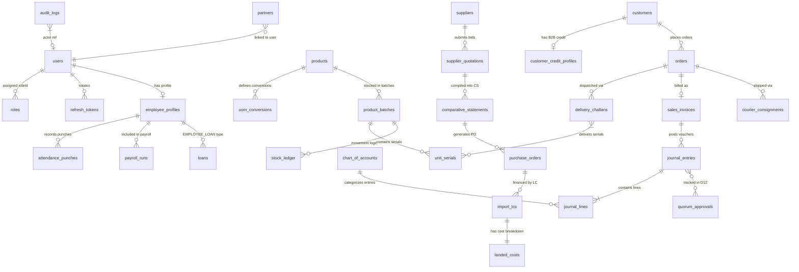
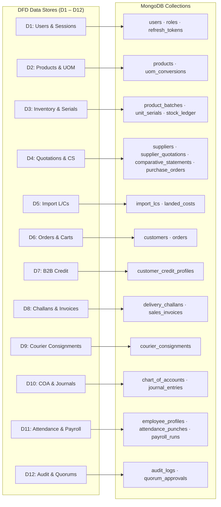

# Database Design Document
## Sun Bird Corporation — Integrated Cloud ERP, E-Commerce, POS & AI Platform

- **Database Engine:** MongoDB Atlas (Dedicated M10/M20 Replica Set)
- **ODM:** Mongoose (TypeScript)
- **Region:** AWS Singapore (`ap-southeast-1`)
- **Pattern:** Document-Oriented, Embedded + Referenced Hybrid Model
- **Baseline Sources:** [`dfd.md`](file:///e:/Documents/Sun%20Bird%20Corporation/dfd.md) · [`architecture.md`](file:///e:/Documents/Sun%20Bird%20Corporation/architecture.md) · [`prd.md`](file:///e:/Documents/Sun%20Bird%20Corporation/prd.md)

> **Fix Log:** v1.1 — 17 issues corrected: missing enums, missing schemas, missing collections, missing fields, aggregation inconsistency, relationship gaps.

---

## 1. Collection List

মোট **35টি collection** ব্যবহার করা হয়েছে। প্রতিটি collection DFD-এর Data Store (D1–D12) থেকে derived।

| # | Collection Name | DFD Store | Description |
|---|---|---|---|
| 1 | `users` | D1 | System users — customers, staff, directors, vendors, resellers |
| 2 | `roles` | D1 | RBAC permission sets |
| 3 | `refresh_tokens` | D1 | Rotating HTTP-Only refresh token store |
| 4 | `products` | D2 | Product master catalog (bilingual, HS Code, UOM) |
| 5 | `uom_conversions` | D2 | Multi-UOM conversion rules (Carton → Box → Piece) |
| 6 | `product_batches` | D3 | Batch inventory with WAC unit cost |
| 7 | `unit_serials` | D3 | Individual equipment/medical serial numbers |
| 8 | `stock_ledger` | D3 | Inventory movement journal (IN/OUT/ADJUST) |
| 9 | `suppliers` | D4 | Supplier/vendor master |
| 10 | `supplier_quotations` | D4 | Supplier bid quotations per RFQ |
| 11 | `comparative_statements` | D4 | 100-point CS evaluation matrix |
| 12 | `purchase_orders` | D4/D5 | Purchase order issued to supplier after CS |
| 13 | `import_lcs` | D5 | Import Letter of Credit lifecycle & FX rates |
| 14 | `landed_costs` | D5 | Landed cost breakdown per LC shipment |
| 15 | `customers` | D6/D7 | Customer profiles (retail & B2B hospitals) |
| 16 | `customer_credit_profiles` | D7 | B2B credit limits, AR exposure, overdue aging |
| 17 | `orders` | D6 | Sales orders, cart state, COD/online payment |
| 18 | `delivery_challans` | D8 | NBR Form Mushak-6.3 delivery challans |
| 19 | `sales_invoices` | D8 | Tax invoices linked to challans |
| 20 | `courier_consignments` | D9 | Pathao/Steadfast AWB, tracking, COD remittance |
| 21 | `chart_of_accounts` | D10 | 35-code standard COA ledger |
| 22 | `journal_entries` | D10 | Double-entry balanced vouchers |
| 23 | `employee_profiles` | D11 | Staff records, salary grade, loan balances |
| 24 | `attendance_punches` | D11 | GPS geofenced clock-in/out records |
| 25 | `payroll_runs` | D11 | Monthly payroll computation ledger |
| 26 | `audit_logs` | D12 | Append-only tamper-proof audit trail |
| 27 | `quorum_approvals` | D12 | Multi-director cryptographic sign-off records |
| 28 | `counters` | Aux | Atomic gapless sequence counters (CH, INV, JV) |
| 29 | `warehouses` | Aux | Warehouse/branch master |
| 30 | `fixed_assets` | Aux | Fixed asset register with SLM depreciation |
| 31 | `loans` | Aux | All loan types: BANK, EMPLOYEE, PARTNER, SUPPLIER, CUSTOMER_ADVANCE |
| 32 | `partners` | Aux | Partnership capital accounts & profit allocation |
| 33 | `crm_activities` | Aux | CRM leads, enquiries, follow-ups, support cases |
| 34 | `approval_requests` | Aux | Workflow approval requests & actions |
| 35 | `idempotency_keys` | Aux | Idempotency guard for payment, payroll, POS retries |

---

## 2. Schema

প্রতিটি কালেকশনের সম্পূর্ণ ও প্রোডাকশন-রেডি TypeScript Mongoose Schema আলাদা ডেডিকেটেড ফাইল **[`Database-Schema.md`](file:///e:/Documents/Sun%20Bird%20Corporation/Database-Schema.md)**-এ স্থানান্তর ও সুবিন্যস্ত করা হয়েছে।

> [!NOTE]
> **সকল ৩৫টি কালেকশনের সম্পূর্ণ Mongoose Schema দেখতে ভিজিট করুন:**  
> 👉 **[`Database-Schema.md`](file:///e:/Documents/Sun%20Bird%20Corporation/Database-Schema.md)**  
> এতে প্রতিটি কালেকশনের জন্য TypeScript Interface, Mongoose Schema Definition, Compound/TTL Indexes, Pre-save Hooks ও মডেল এক্সপোর্ট অন্তর্ভুক্ত রয়েছে।

### 2.1 Schema Overview by Functional Domain

| # | Domain / Module | Collections Covered | Primary DFD Store | Link to Schema |
|---|---|---|---|---|
| 1 | **Authentication & Security** | `users`, `roles`, `refresh_tokens` | D1 | [Database-Schema.md §1](file:///e:/Documents/Sun%20Bird%20Corporation/Database-Schema.md#1-authentication--access-control-d1) |
| 2 | **Product & Inventory** | `products`, `uom_conversions`, `product_batches`, `unit_serials`, `stock_ledger` | D2, D3 | [Database-Schema.md §2](file:///e:/Documents/Sun%20Bird%20Corporation/Database-Schema.md#2-product--inventory-management-d2-d3) |
| 3 | **Procurement & Supply Chain** | `suppliers`, `supplier_quotations`, `comparative_statements`, `purchase_orders`, `import_lcs`, `landed_costs` | D4, D5 | [Database-Schema.md §3](file:///e:/Documents/Sun%20Bird%20Corporation/Database-Schema.md#3-procurement--supply-chain-d4-d5) |
| 4 | **Sales, POS & Distribution** | `customers`, `customer_credit_profiles`, `orders`, `delivery_challans`, `sales_invoices`, `courier_consignments` | D6, D7, D8, D9 | [Database-Schema.md §4](file:///e:/Documents/Sun%20Bird%20Corporation/Database-Schema.md#4-sales-pos--distribution-d6-d7-d8-d9) |
| 5 | **Accounting & Finance** | `chart_of_accounts`, `journal_entries`, `fixed_assets`, `loans`, `partners` | D10, Aux | [Database-Schema.md §5](file:///e:/Documents/Sun%20Bird%20Corporation/Database-Schema.md#5-accounting--financial-management-d10-aux) |
| 6 | **Human Resources & Payroll** | `employee_profiles`, `attendance_punches`, `payroll_runs` | D11 | [Database-Schema.md §6](file:///e:/Documents/Sun%20Bird%20Corporation/Database-Schema.md#6-human-resources--payroll-d11) |
| 7 | **Audit, Quorum & System Aux** | `counters`, `warehouses`, `crm_activities`, `approval_requests`, `quorum_approvals`, `audit_logs`, `idempotency_keys` | D12, Aux | [Database-Schema.md §7](file:///e:/Documents/Sun%20Bird%20Corporation/Database-Schema.md#7-system-quorum--auxiliary-d12-aux) |

---

## 3. Relationship (Collection Relationships)

### 3.1 ER Relationship Diagram



### 3.2 Relationship Summary Table

| Parent Collection | Child Collection | Type | FK Field |
|---|---|---|---|
| `users` | `roles` | Many-to-One | `user.roleId` → `roles._id` |
| `products` | `product_batches` | One-to-Many | `batch.productId` → `products._id` |
| `products` | `uom_conversions` | One-to-Many | `uomConv.productId` → `products._id` |
| `product_batches` | `unit_serials` | One-to-Many | `serial.batchId` → `product_batches._id` |
| `suppliers` | `supplier_quotations` | One-to-Many | `bid.supplierId` → `suppliers._id` |
| `supplier_quotations` | `comparative_statements` | Many-to-One | `cs.bids[].bidId` → `supplier_quotations._id` |
| `import_lcs` | `landed_costs` | One-to-One | `landedCost.lcId` → `import_lcs._id` |
| `customers` | `orders` | One-to-Many | `order.customerId` → `customers._id` |
| `customers` | `customer_credit_profiles` | One-to-One | `profile.customerId` (unique index) |
| `orders` | `delivery_challans` | One-to-Many | `challan.orderId` → `orders._id` |
| `orders` | `sales_invoices` | One-to-One | `invoice.orderId` → `orders._id` |
| `orders` | `courier_consignments` | One-to-Many | `consignment.orderId` → `orders._id` |
| `delivery_challans` | `unit_serials` | Many-to-Many | `challan.items[].dispatchedSerials[]` (denormalized) |
| `sales_invoices` | `journal_entries` | One-to-Many | `journal.sourceDocumentRef` = InvoiceNo |
| `journal_entries` | `journal_lines` | Embedded | Sub-document array inside JournalEntry |
| `chart_of_accounts` | `journal_lines` | One-to-Many | `line.accountId` → `chart_of_accounts._id` |
| `journal_entries` | `quorum_approvals` | Embedded + D12 | `approvals[]` embedded; D12 stores quorum logs |
| `employee_profiles` | `attendance_punches` | One-to-Many | `punch.employeeId` → `employee_profiles._id` |
| `employee_profiles` | `payroll_runs` | One-to-Many | `payroll.employeeId` → `employee_profiles._id` |
| `import_lcs` | `purchase_orders` | Many-to-One | `lc.purchaseOrderId` → `purchase_orders._id` |

---

## 4. Index Strategy

Performance এবং uniqueness guarantee করার জন্য প্রতিটি collection-এ strategic indexes।

### 4.1 Index Definitions

```typescript
// users
UserSchema.index({ email: 1 }, { unique: true });
UserSchema.index({ mobile: 1 }, { unique: true });
UserSchema.index({ userType: 1 });

// products
ProductSchema.index({ sku: 1 }, { unique: true });
ProductSchema.index({ hsCode: 1 });
ProductSchema.index({ category: 1 });
ProductSchema.index({ barcodes: 1 });                    // POS barcode scan lookup

// uom_conversions
UomConversionSchema.index({ productId: 1, fromUom: 1, toUom: 1 }, { unique: true });

// product_batches — OCC Concurrency Guard
ProductBatchSchema.index({ sku: 1, batchNumber: 1, warehouseId: 1 }, { unique: true });
ProductBatchSchema.index({ expiryDate: 1 });             // FEFO fast sort

// unit_serials
UnitSerialSchema.index({ serialNumber: 1 }, { unique: true });
UnitSerialSchema.index({ status: 1 });
UnitSerialSchema.index({ batchId: 1 });

// suppliers
SupplierSchema.index({ supplierCode: 1 }, { unique: true });

// customers
CustomerSchema.index({ mobile: 1 }, { unique: true });
CustomerSchema.index({ customerType: 1 });

// supplier_quotations
SupplierQuotationSchema.index({ rfqNumber: 1 }, { unique: true });
SupplierQuotationSchema.index({ supplierId: 1 });

// comparative_statements
ComparativeStatementSchema.index({ csNumber: 1 }, { unique: true });
ComparativeStatementSchema.index({ sku: 1 });

// import_lcs
ImportLCSchema.index({ lcNumber: 1 }, { unique: true });
ImportLCSchema.index({ status: 1 });

// landed_costs
LandedCostSchema.index({ lcId: 1 }, { unique: true });
LandedCostSchema.index({ lcNumber: 1 });

// orders
OrderSchema.index({ orderNo: 1 }, { unique: true });
OrderSchema.index({ customerId: 1 });
OrderSchema.index({ orderStatus: 1 });
OrderSchema.index({ createdAt: -1 });                    // Paginated listing
OrderSchema.index({ idempotencyKey: 1 }, { unique: true, sparse: true });

// delivery_challans
DeliveryChallanSchema.index({ challanNo: 1 }, { unique: true });
DeliveryChallanSchema.index({ orderId: 1 });

// sales_invoices
SalesInvoiceSchema.index({ invoiceNo: 1 }, { unique: true });
SalesInvoiceSchema.index({ customerId: 1 });

// journal_entries
JournalEntrySchema.index({ voucherNo: 1 }, { unique: true });
JournalEntrySchema.index({ transactionDate: -1 });
JournalEntrySchema.index({ status: 1 });
JournalEntrySchema.index({ 'lines.accountCode': 1 });    // GL ledger drill-down
JournalEntrySchema.index({ idempotencyKey: 1 }, { unique: true, sparse: true });

// customer_credit_profiles
CustomerCreditProfileSchema.index({ customerId: 1 }, { unique: true });
CustomerCreditProfileSchema.index({ isCreditLocked: 1 });

// courier_consignments
CourierConsignmentSchema.index({ trackingCode: 1 }, { unique: true });
CourierConsignmentSchema.index({ consignmentId: 1 });

// attendance_punches
AttendancePunchSchema.index({ employeeId: 1, punchDate: -1 });

// audit_logs
AuditLogSchema.index({ targetCollection: 1, targetId: 1 });
AuditLogSchema.index({ actorId: 1 });
AuditLogSchema.index({ createdAt: -1 });

// loans
LoanSchema.index({ loanCode: 1 }, { unique: true });
LoanSchema.index({ borrowerId: 1, loanType: 1 });

// fixed_assets
FixedAssetSchema.index({ assetCode: 1 }, { unique: true });

// idempotency_keys
IdempotencyKeySchema.index({ key: 1 }, { unique: true });
IdempotencyKeySchema.index({ expiresAt: 1 }, { expireAfterSeconds: 0 }); // TTL auto-purge
```

### 4.2 Index Strategy Summary Table

| Index Type | Collections | Purpose |
|---|---|---|
| **Unique** | `users`, `products`, `orders`, `challans`, `invoices`, `journals`, `serials`, `lcs`, `suppliers`, `customers` | Data integrity, gapless numbering |
| **Compound Unique** | `product_batches {sku, batchNumber, warehouseId}`, `uom_conversions {productId, fromUom, toUom}` | Prevents duplicate batch/UOM per warehouse |
| **Sort Descending** | `orders`, `journals`, `audit_logs` | Fast paginated time-ordered listing |
| **FEFO Sort** | `product_batches.expiryDate` | First-Expiry-First-Out dispatch picking |
| **Lookup** | `products.barcodes`, `journals.lines.accountCode` | POS barcode scan, GL drill-down |
| **Filter** | `orders.orderStatus`, `lcs.status`, `credit.isCreditLocked`, `loans.loanType` | Operational dashboard filters |
| **Sparse Unique** | `orders.idempotencyKey`, `journal_entries.idempotencyKey` | Prevents duplicate payment/posting retry |
| **TTL** | `idempotency_keys.expiresAt` | Auto-expire used idempotency keys |

---

## 5. Validation Rules

MongoDB schema-level এবং Mongoose middleware-level উভয় validation enforce করা হয়।

### 5.1 Schema-Level Validations

| Collection | Field | Rule |
|---|---|---|
| `users` | `email` | Unique, lowercase, valid email |
| `users` | `mobile` | Unique, 11-digit BD format |
| `users` | `userType` | Enum: `CUSTOMER | STAFF | DIRECTOR | SUPER_ADMIN | VENDOR | RESELLER` |
| `products` | `sku` | Unique, required |
| `products` | `hsCode` | Required, 8-digit (NBR standard) |
| `products` | `retailPrice` | `min: 0` |
| `product_batches` | `currentQty` | `min: 0` — prevents negative stock |
| `product_batches` | `expiryDate` | Required when `category = EXPIRY_CONTROLLED` |
| `unit_serials` | `serialNumber` | Unique, immutable after creation |
| `unit_serials` | `status` | Enum: `IN_STOCK | RESERVED | SOLD | RMA_CLAIMED | DEFECTIVE` |
| `orders` | `grandTotal` | Positive number |
| `orders` | `items[].qty` | `min: 1` |
| `orders` | `orderStatus` | Enum: `CART | UNVERIFIED_COD | CONFIRMED | CREDIT_LIMIT_EXCEEDED | PACKING | DISPATCHED | DELIVERED | CANCELLED | RETURNED` |
| `orders` | `paymentStatus` | Enum: `UNPAID | PAID | PARTIAL | COLLECTED | SETTLED | RECONCILED | REFUNDED` |
| `journal_entries` | `voucherType` | Enum: `SALES | PURCHASE | PAYMENT | RECEIPT | CONTRA | JOURNAL` |
| `journal_entries` | `status` | Enum: `DRAFT | SUBMITTED | PENDING_APPROVAL | POSTED | REVERSED` |
| `import_lcs` | `foreignCurrency` | Enum: `USD | EUR | CNY | JPY` |
| `import_lcs` | `lcValueFC` | Positive number, required |
| `employee_profiles` | `salesRepCommissionRate` | Range: `min: 0, max: 5` |
| `supplier_quotations` | `csScore` | `min: 0, max: 100` |
| `loans` | `isInterestFree: true` | `interestRate` must remain `0` — no accrual (PRD §7.15) |
| `attendance_punches` | `isPresent` | Boolean; true when `isWithinGeofence = true` and punch type `IN` |

### 5.2 Pre-Save Middleware Validations (Mongoose Hooks)

```typescript
// Rule 1: Double-Entry Balance Guard (DFD P8.2)
JournalEntrySchema.pre('save', function(next) {
  const diff = Math.abs(this.totalDebit - this.totalCredit);
  if (diff > 0.001) {
    return next(new Error(
      `Unbalanced Journal: Dr (${this.totalDebit}) != Cr (${this.totalCredit})`
    ));
  }
  next();
});

// Rule 2: Maker-Checker Separation of Duties (PRD §8 Rule #7)
JournalEntrySchema.pre('save', function(next) {
  const selfApproval = this.approvals?.some(a => a.directorId.equals(this.createdBy));
  if (selfApproval) {
    return next(new Error('Maker-Checker Violation: Creator cannot approve own voucher.'));
  }
  next();
});

// Rule 3: Medical Product — Individual Serial Tracking Required
ProductBatchSchema.pre('save', async function(next) {
  const product = await ProductModel.findById(this.productId);
  if (product?.isMedical && !this.hasIndividualSerials) {
    return next(new Error('Medical products must have individual serial tracking enabled.'));
  }
  next();
});

// Rule 4: Expiry Date Required for Expirable Products
ProductBatchSchema.pre('save', function(next) {
  if (this.category === 'EXPIRY_CONTROLLED' && !this.expiryDate) {
    return next(new Error('Expiry date is required for EXPIRY_CONTROLLED products.'));
  }
  next();
});

// Rule 5: Interest-Free Loan Must Not Accrue Interest (PRD §7.15)
LoanSchema.pre('save', function(next) {
  if (this.isInterestFree && this.interestRate > 0) {
    return next(new Error('Interest-free loan must have interestRate = 0. No accrual permitted.'));
  }
  next();
});

// Rule 6: Posted Journal Cannot Be Directly Edited — Reversal Only (PRD §8 Rule #6)
JournalEntrySchema.pre('save', function(next) {
  if (!this.isNew && this.status === 'POSTED' && this.isModified('lines')) {
    return next(new Error('Posted voucher lines are immutable. Create a reversal entry instead.'));
  }
  next();
});
```

### 5.3 Business Rule Validations (Service Layer)

| Rule | Logic | Action on Violation |
|---|---|---|
| **Overselling Prevention** | `currentQty >= requestedQty` (atomic OCC) | Throw `InsufficientStockException` |
| **7-Day Expiry Guard** | `expiryDate - today >= 7 days` | Block item from dispatch |
| **COD OTP Threshold** | `grandTotal > 5,000 BDT` requires OTP | Order stays `UNVERIFIED_COD` |
| **B2B Credit Exposure** | `currentAR + unbilledDispatches + newOrder <= creditLimit` | Status → `CREDIT_LIMIT_EXCEEDED` |
| **Quorum Tier 3** | Voucher `> 10 Lakh BDT` | Requires 2 of 3 director signatures |
| **Quorum Tier 4** | Voucher `> 50 Lakh BDT` | Requires all 3 director signatures |
| **Geofence Attendance** | GPS distance `<= 50 meters` from office | Punch rejected, `isWithinGeofence = false` |
| **Late Deduction** | 3 late punches in a month | 0.5 day salary deducted per excess trio |
| **Commission Trigger** | Realized (collected) revenue only | Calculated on 28th monthly (DFD DF-24) |
| **Net Salary Floor** | `netPay = max(netPay, minimumWage)` | Prevents deduction below legal floor |
| **Duplicate Posting** | `idempotencyKey` unique check | Reject duplicate journal/payment silently |
| **Interest-Free Guard** | `isInterestFree = true` → zero accrual | Pre-save hook blocks any interest calculation |

---

## 6. Aggregation Pipelines

MongoDB Aggregation Pipeline ব্যবহার করে complex reporting তৈরি করা হয়।

### 6.1 AR Aging Report (DFD D7 — B2B Credit Profiles)

```javascript
db.orders.aggregate([
  {
    $match: {
      paymentStatus: { $in: ['UNPAID', 'PARTIAL', 'COLLECTED'] },
      orderStatus: { $in: ['DISPATCHED', 'DELIVERED'] }
    }
  },
  { $lookup: { from: 'customers', localField: 'customerId', foreignField: '_id', as: 'customer' } },
  { $unwind: '$customer' },
  {
    $addFields: {
      daysPastDue: { $divide: [{ $subtract: [new Date(), '$createdAt'] }, 86400000] }
    }
  },
  {
    $group: {
      _id: '$customerId',
      customerName: { $first: '$customer.fullName' },
      current:    { $sum: { $cond: [{ $lte: ['$daysPastDue', 30] }, '$grandTotal', 0] } },
      days31to60: { $sum: { $cond: [{ $and: [{ $gt: ['$daysPastDue', 30] }, { $lte: ['$daysPastDue', 60] }] }, '$grandTotal', 0] } },
      days61to90: { $sum: { $cond: [{ $and: [{ $gt: ['$daysPastDue', 60] }, { $lte: ['$daysPastDue', 90] }] }, '$grandTotal', 0] } },
      over90:     { $sum: { $cond: [{ $gt: ['$daysPastDue', 90] }, '$grandTotal', 0] } },
      totalAR:    { $sum: '$grandTotal' }
    }
  },
  { $sort: { over90: -1 } }
]);
```

### 6.2 Monthly Sales Revenue by Product Category

```javascript
db.orders.aggregate([
  { $match: { orderStatus: 'DELIVERED', paymentStatus: { $in: ['PAID', 'SETTLED', 'RECONCILED'] } } },
  { $unwind: '$items' },
  { $lookup: { from: 'products', localField: 'items.productId', foreignField: '_id', as: 'product' } },
  { $unwind: '$product' },
  {
    $group: {
      _id: { year: { $year: '$createdAt' }, month: { $month: '$createdAt' }, category: '$product.category' },
      totalRevenue: { $sum: '$items.lineTotal' },
      totalVAT:     { $sum: '$items.vatAmount' },
      orderCount:   { $sum: 1 }
    }
  },
  { $sort: { '_id.year': -1, '_id.month': -1, totalRevenue: -1 } }
]);
```

### 6.3 Trial Balance Report (DFD D10 — COA & Journals)

```javascript
db.journal_entries.aggregate([
  { $match: { status: 'POSTED' } },
  { $unwind: '$lines' },
  {
    $group: {
      _id: { accountCode: '$lines.accountCode', accountName: '$lines.accountName' },
      totalDebit:  { $sum: '$lines.debit' },
      totalCredit: { $sum: '$lines.credit' }
    }
  },
  { $addFields: { netBalance: { $subtract: ['$totalDebit', '$totalCredit'] } } },
  { $sort: { '_id.accountCode': 1 } },
  {
    $group: {
      _id: null,
      accounts:         { $push: '$$ROOT' },
      grandTotalDebit:  { $sum: '$totalDebit' },
      grandTotalCredit: { $sum: '$totalCredit' }
    }
  }
]);
```

### 6.4 Inventory FEFO Dispatch Queue

```javascript
// DFD D3 — First-Expiry-First-Out picking
db.product_batches.aggregate([
  {
    $match: {
      sku: 'MED-ECG-001',
      warehouseId: ObjectId('...'),
      locationStatus: 'ON_HAND',
      $expr: { $gt: ['$currentQty', 0] },
      expiryDate: { $gt: new Date(Date.now() + 7 * 86400000) }  // 7-day guard
    }
  },
  { $sort: { expiryDate: 1 } },                                  // Earliest expiry first
  { $project: { batchNumber: 1, currentQty: 1, expiryDate: 1, unitCost: 1 } }
]);
```

### 6.5 Monthly Payroll Run Computation (DFD D11)

> **Fix #16:** `isPresent` field added to `AttendancePunchSchema` (used in this aggregation).

```javascript
db.attendance_punches.aggregate([
  {
    $match: {
      punchDate: { $gte: new Date('2026-10-01'), $lt: new Date('2026-11-01') },
      punchType: 'IN'
    }
  },
  {
    $group: {
      _id: '$employeeId',
      totalPresent: { $sum: { $cond: ['$isPresent', 1, 0] } },   // isPresent field now exists
      totalAbsent:  { $sum: { $cond: ['$isLWP', 1, 0] } },
      totalLate:    { $sum: { $cond: ['$isLate', 1, 0] } }
    }
  },
  { $lookup: { from: 'employee_profiles', localField: '_id', foreignField: 'userId', as: 'employee' } },
  { $unwind: '$employee' },
  {
    $addFields: {
      lateDeductionDays: { $floor: { $divide: ['$totalLate', 3] } },   // 3 lates = 0.5 day
      grossSalary: { $add: ['$employee.basicSalary', '$employee.houseRent', '$employee.medicalAllowance'] }
    }
  },
  {
    $addFields: {
      lwpDeduction: { $multiply: ['$totalAbsent', { $divide: ['$employee.basicSalary', 26] }] },
      lateDeduction: { $multiply: ['$lateDeductionDays', { $multiply: [0.5, { $divide: ['$employee.basicSalary', 26] }] }] }
    }
  },
  {
    $addFields: {
      totalDeductions: { $add: ['$lwpDeduction', '$lateDeduction', '$employee.loanOutstanding'] },
      netPay: { $subtract: ['$grossSalary', { $add: ['$lwpDeduction', '$lateDeduction', '$employee.loanOutstanding'] }] }
    }
  }
]);
```

### 6.6 AI Demand Forecasting Data Feed (DFD P10.0 — Gemini AI)

```javascript
// 30/60/90-day sales velocity for Gemini demand forecast (Pillar 3)
db.orders.aggregate([
  {
    $match: {
      orderStatus: 'DELIVERED',
      createdAt: { $gte: new Date(Date.now() - 90 * 86400000) }
    }
  },
  { $unwind: '$items' },
  {
    $group: {
      _id: '$items.sku',
      soldLast30Days: {
        $sum: { $cond: [{ $gte: ['$createdAt', new Date(Date.now() - 30 * 86400000)] }, '$items.qty', 0] }
      },
      soldLast90Days: { $sum: '$items.qty' },
      avgOrderValue:  { $avg: '$items.lineTotal' }
    }
  },
  { $sort: { soldLast30Days: -1 } }
]);
```

---

## 7. Transaction (ACID Multi-Document Transactions)

MongoDB Atlas Replica Set-এর ACID Transaction ব্যবহার করে multi-collection atomic operations নিশ্চিত করা হয়।

### 7.1 Order Placement & Stock Reservation (DFD P4.3)

```typescript
// Atomic 15-min TTL Stock Reservation — Prevents Overselling
// currentQty = available stock (also referred to as availableQty in architecture.md §2.2)
const session = await mongoose.startSession();
session.startTransaction({ readConcern: { level: 'snapshot' }, writeConcern: { w: 'majority' } });
try {
  // Step 1: Atomic Conditional Stock Decrement (OCC)
  for (const item of order.items) {
    const updated = await ProductBatchModel.findOneAndUpdate(
      {
        sku: item.sku,
        warehouseId: order.warehouseId,
        currentQty: { $gte: item.qty },                          // currentQty = available stock
        expiryDate: { $gt: new Date(Date.now() + 7 * 86400000) } // 7-day expiry guard
      },
      { $inc: { currentQty: -item.qty, reservedQty: +item.qty } },
      { new: true, session }
    );
    if (!updated) throw new InsufficientStockException(`SKU ${item.sku} unavailable.`);
  }

  // Step 2: Create order — status = CART or UNVERIFIED_COD (if COD > 5000 BDT)
  const orderStatus = (order.paymentMethod === 'COD' && order.grandTotal > 5000)
    ? 'UNVERIFIED_COD'
    : 'CONFIRMED';
  const savedOrder = await OrderModel.create([{ ...orderData, orderStatus }], { session });

  // Step 3: Log stock movement
  await StockLedgerModel.create([{
    orderId: savedOrder[0]._id,
    movementType: 'RESERVE',
    items: order.items
  }], { session });

  await session.commitTransaction();
} catch (err) {
  await session.abortTransaction();
  throw err;
} finally {
  session.endSession();
}
```

### 7.2 Mushak-6.3 Dispatch & Journal Posting (DFD P5.0 + P8.0)

```typescript
// 6-step atomic transaction: Challan + Serials + Stock + Journal + Order status
const session = await mongoose.startSession();
session.startTransaction({ writeConcern: { w: 'majority' } });
try {
  // Step 1: Gapless Challan number (atomic counter)
  const challanNo = await getNextSequenceValue('CH', session);

  // Step 2: Lock & commit dispatched unit serials
  for (const serial of dispatchedSerials) {
    await UnitSerialModel.findOneAndUpdate(
      { serialNumber: serial, status: 'IN_STOCK' },
      { $set: { status: 'SOLD', deliveryChallanNo: challanNo } },
      { session }
    );
  }

  // Step 3: Reduce reservedQty (stock was reserved at order time)
  await ProductBatchModel.updateMany(
    { sku: { $in: skuList } },
    { $inc: { reservedQty: -qty } },
    { session }
  );

  // Step 4: Create Mushak-6.3 Challan record
  await DeliveryChallanModel.create([{ challanNo, ...challanData }], { session });

  // Step 5: Post balanced Sales Journal Entry
  await JournalEntryModel.create([{
    voucherNo: await getNextSequenceValue('JV', session),
    voucherType: 'SALES',
    lines: [
      { accountCode: 1030, debit: grandTotal, credit: 0 },    // Dr: Accounts Receivable
      { accountCode: 4010, debit: 0, credit: netSales },       // Cr: Sales Revenue
      { accountCode: 2310, debit: 0, credit: vatAmount }        // Cr: VAT Payable (15%)
    ],
    totalDebit: grandTotal,
    totalCredit: grandTotal,
    status: 'POSTED',
    sourceDocumentRef: challanNo
  }], { session });

  // Step 6: Update Order status → DISPATCHED
  await OrderModel.findByIdAndUpdate(orderId, { $set: { orderStatus: 'DISPATCHED' } }, { session });

  await session.commitTransaction();
} catch (err) {
  await session.abortTransaction();
  throw err;
} finally {
  session.endSession();
}
```

### 7.3 Import L/C FX Settlement Journal (DFD DF-08)

```typescript
// 3-Tier FX Realization on LC Bank Settlement
const session = await mongoose.startSession();
session.startTransaction({ writeConcern: { w: 'majority' } });
try {
  const fxVariance = (lc.finalSettlementRate - lc.openingExchangeRate) * lc.lcValueFC;

  // Step 1: Update LC status → SETTLED
  await ImportLCModel.findByIdAndUpdate(lcId, {
    $set: { finalSettlementRate: settlementRate, realizedFxGainLoss: fxVariance, status: 'SETTLED' }
  }, { session });

  // Step 2: Post FX Realized Journal (Dr AP / Dr FX Loss / Cr FX Gain / Cr Bank)
  await JournalEntryModel.create([{
    voucherType: 'JOURNAL',
    sourceDocumentRef: lc.lcNumber,
    lines: [
      { accountCode: 2020, debit: lc.lcValueFC * lc.openingExchangeRate, credit: 0 },  // Dr: AP Foreign
      { accountCode: 6510, debit: Math.max(0, fxVariance),  credit: 0 },               // Dr: FX Loss
      { accountCode: 4095, debit: 0, credit: Math.max(0, -fxVariance) },               // Cr: FX Gain
      { accountCode: 1020, debit: 0, credit: lc.lcValueFC * settlementRate }            // Cr: Bank
    ],
    status: 'POSTED'
  }], { session });

  await session.commitTransaction();
} catch (err) {
  await session.abortTransaction();
  throw err;
} finally {
  session.endSession();
}
```

### 7.4 Transaction Scope Summary

| Transaction | Collections Involved | Trigger |
|---|---|---|
| **Order Reservation** | `orders`, `product_batches`, `stock_ledger` | Customer checkout |
| **Mushak-6.3 Dispatch** | `delivery_challans`, `unit_serials`, `product_batches`, `journal_entries`, `orders`, `counters` | Warehouse pack & dispatch |
| **COD Settlement** | `courier_consignments`, `journal_entries`, `orders` | Courier remittance webhook |
| **LC FX Settlement** | `import_lcs`, `journal_entries` | Bank settlement |
| **Monthly Payroll** | `payroll_runs`, `employee_profiles`, `journal_entries` | 28th of month cron |
| **POS Offline Sync** | `orders`, `product_batches`, `journal_entries`, `audit_logs` | POS reconnect batch |

---

## 8. Sample Data

প্রতিটি core collection-এর realistic sample JSON document।

### 8.1 `products` — Medical Equipment

```json
{
  "_id": "ObjectId('65f1a2b3c4d5e6f7a8b9c001')",
  "sku": "MED-ECG-001",
  "nameEn": "12-Lead Digital ECG Machine",
  "nameBn": "১২-লিড ডিজিটাল ইসিজি মেশিন",
  "category": "Medical Equipment",
  "hsCode": "90189010",
  "baseUom": "Piece",
  "brand": "Mindray",
  "isMedical": true,
  "isExpirable": false,
  "minStockQty": 2,
  "retailPrice": 185000,
  "showroomPrice": 180000,
  "resellerTierPrices": [
    { "tier": 1, "price": 170000 },
    { "tier": 2, "price": 165000 },
    { "tier": 3, "price": 160000 }
  ],
  "barcodes": ["8901234567890"],
  "seoContent": {
    "metaTitle": "Buy Mindray 12-Lead ECG Machine Bangladesh | Sun Bird Corp",
    "metaDescription": "Mindray ECG Machine for hospitals and clinics. Best price in BD. Warranty included.",
    "descriptionEn": "Professional grade 12-lead ECG machine ideal for ICU and cardiology departments.",
    "descriptionBn": "আইসিইউ ও কার্ডিওলজি বিভাগের জন্য প্রফেশনাল গ্রেডের ১২-লিড ইসিজি মেশিন।"
  },
  "isActive": true,
  "createdAt": "2026-01-15T09:00:00.000Z"
}
```

### 8.2 `product_batches` — Batch with Serials

```json
{
  "_id": "ObjectId('65f1a2b3c4d5e6f7a8b9c002')",
  "productId": "ObjectId('65f1a2b3c4d5e6f7a8b9c001')",
  "sku": "MED-ECG-001",
  "batchNumber": "BATCH-MR-2026-003",
  "category": "NON_EXPIRING",
  "expiryDate": null,
  "baseUom": "Piece",
  "currentQty": 8,
  "reservedQty": 2,
  "unitCost": 138500,
  "hasIndividualSerials": true,
  "warrantyMonths": 24,
  "warehouseId": "ObjectId('wh-dhaka-main-001')",
  "locationStatus": "ON_HAND",
  "createdAt": "2026-03-10T08:30:00.000Z"
}
```

### 8.3 `orders` — B2B Hospital Order (COD > 5000)

```json
{
  "_id": "ObjectId('65f1a2b3c4d5e6f7a8b9c010')",
  "orderNo": "ORD-2026-00847",
  "customerId": "ObjectId('cust-dhaka-hospital-001')",
  "channel": "B2B_PORTAL",
  "items": [
    {
      "sku": "MED-ECG-001",
      "batchNumber": "BATCH-MR-2026-003",
      "qty": 2,
      "uom": "Piece",
      "unitPrice": 165000,
      "lineTotal": 330000,
      "vatAmount": 49500
    }
  ],
  "subtotal": 330000,
  "vatTotal": 49500,
  "grandTotal": 379500,
  "paymentMethod": "CREDIT",
  "codOtpStatus": "NOT_REQUIRED",
  "paymentStatus": "UNPAID",
  "orderStatus": "DISPATCHED",
  "shippingAddress": "Dhaka Medical College Hospital, Dhaka-1000",
  "createdAt": "2026-10-05T10:15:00.000Z"
}
```

### 8.4 `delivery_challans` — Mushak-6.3 Compliance

```json
{
  "_id": "ObjectId('65f1a2b3c4d5e6f7a8b9c020')",
  "challanNo": "CH-2026-00847",
  "orderId": "ObjectId('65f1a2b3c4d5e6f7a8b9c010')",
  "companyBin": "0011234567890",
  "buyerBin": "0019876543210",
  "vehicleNumber": "DHAKA-METRO-GA-1234",
  "dispatchTime": "2026-10-06T09:00:00.000Z",
  "transporterType": "PATHAO",
  "consignmentTrackingId": "PTH-2026-889201",
  "cartonCount": 2,
  "items": [
    {
      "sku": "MED-ECG-001",
      "productName": "12-Lead Digital ECG Machine",
      "hsCode": "90189010",
      "batchNumber": "BATCH-MR-2026-003",
      "dispatchedQty": 2,
      "uom": "Piece",
      "dispatchedSerials": ["ECG-MR-SN-20264501", "ECG-MR-SN-20264502"],
      "vatRate": 15.0,
      "sdRate": 0.0
    }
  ],
  "pdfS3Url": "https://s3.ap-southeast-1.amazonaws.com/sunbird-docs/challans/CH-2026-00847.pdf",
  "status": "DISPATCHED"
}
```

### 8.5 `journal_entries` — Balanced Sales Voucher

```json
{
  "_id": "ObjectId('65f1a2b3c4d5e6f7a8b9c030')",
  "voucherNo": "JV-2026-01024",
  "voucherType": "SALES",
  "transactionDate": "2026-10-06T09:00:00.000Z",
  "sourceDocumentRef": "CH-2026-00847",
  "lines": [
    { "accountCode": 1100, "accountName": "Accounts Receivable — Trade Debtors",  "debit": 379500, "credit": 0 },
    { "accountCode": 4010, "accountName": "Sales Revenue",                         "debit": 0, "credit": 330000 },
    { "accountCode": 2050, "accountName": "VAT / Tax Output Payable",              "debit": 0, "credit": 49500 }
  ],
  "totalDebit": 379500,
  "totalCredit": 379500,
  "status": "POSTED",
  "requiredQuorumTier": 1,
  "isFullyApproved": true,
  "createdAt": "2026-10-06T09:02:00.000Z"
}
```

### 8.6 `employee_profiles` — Sales Representative

```json
{
  "_id": "ObjectId('65f1a2b3c4d5e6f7a8b9c040')",
  "userId": "ObjectId('user-rafi-sales-rep-01')",
  "employeeCode": "EMP-2025-0023",
  "designation": "Sales Representative",
  "department": "Commercial",
  "joiningDate": "2025-03-01",
  "basicSalary": 25000,
  "houseRent": 10000,
  "medicalAllowance": 3000,
  "loanOutstanding": 15000,
  "casualLeaveBalance": 11,
  "sickLeaveBalance": 8,
  "officeLatLng": { "lat": 23.7461, "lng": 90.3742 },
  "salesRepCommissionRate": 1.5,
  "isActive": true
}
```

### 8.7 `payroll_runs` — Monthly Payroll Record

```json
{
  "_id": "ObjectId('65f1a2b3c4d5e6f7a8b9c050')",
  "payrollRunCode": "PR-2026-10",
  "monthYear": "2026-10",
  "employeeId": "ObjectId('65f1a2b3c4d5e6f7a8b9c040')",
  "grossSalary": 38000,
  "lwpDeduction": 0,
  "lateDeduction": 961.54,
  "loanDeduction": 2500,
  "commissionAddition": 3750,
  "netPay": 38288.46,
  "status": "POSTED",
  "journalRef": "JV-2026-00315",
  "processedAt": "2026-10-28T10:00:00.000Z"
}
```

---

## 9. Mongoose Schema (Production Specifications)

প্রোডাকশন-লেভেলের সকল ৩৫টি Mongoose Schema, TypeScript Interfaces, এবং Model Exports বিস্তারিতভাবে ডেডিকেটেড **[`Database-Schema.md`](file:///e:/Documents/Sun%20Bird%20Corporation/Database-Schema.md)** ফাইলে সংরক্ষিত আছে।

> [!TIP]
> কোডবেজ ইমপ্লিমেন্টেশন ও টাইপ সেফটির জন্য সরাসরি **[`Database-Schema.md`](file:///e:/Documents/Sun%20Bird%20Corporation/Database-Schema.md)** ব্যবহার করুন। সেখানে প্রতিটি স্কিমার সাথে সঠিক ইনডেক্সিং, TTL কনফিগারেশন, এবং প্রি-সেভ হুকস লিপিবদ্ধ রয়েছে।

---

## 10. ERD (Entity Relationship Diagram)

### 10.1 Full System ERD — All Collections

```mermaid
erDiagram
    USERS {
        ObjectId _id PK
        string email UK
        string mobile UK
        string userType
        ObjectId roleId FK
        ObjectId warehouseId FK
        string totpSecret
    }
    ROLES {
        ObjectId _id PK
        string roleName UK
        array permissions
    }
    PRODUCTS {
        ObjectId _id PK
        string sku UK
        string nameEn
        string hsCode
        string baseUom
        boolean isMedical
        boolean isExpirable
        number retailPrice
        number showroomPrice
    }
    UOM_CONVERSIONS {
        ObjectId _id PK
        ObjectId productId FK
        string fromUom
        string toUom
        number conversionFactor
    }
    PRODUCT_BATCHES {
        ObjectId _id PK
        ObjectId productId FK
        string sku
        string batchNumber
        Date expiryDate
        number currentQty
        number reservedQty
        number unitCost
        ObjectId warehouseId FK
    }
    UNIT_SERIALS {
        ObjectId _id PK
        ObjectId batchId FK
        string serialNumber UK
        string status
        ObjectId soldToCustomerId FK
        string deliveryChallanNo
        Date warrantyExpiryDate
    }
    STOCK_LEDGER {
        ObjectId _id PK
        string sku
        ObjectId batchId FK
        string movementType
        number qtyChange
        string referenceNo
    }
    SUPPLIERS {
        ObjectId _id PK
        string supplierCode UK
        string companyName
        string country
        string supplierType
        string currency
    }
    SUPPLIER_QUOTATIONS {
        ObjectId _id PK
        string rfqNumber UK
        ObjectId supplierId FK
        ObjectId productId FK
        number quotedUnitPrice
        number csScore
        number leadTimeDays
    }
    COMPARATIVE_STATEMENTS {
        ObjectId _id PK
        string csNumber UK
        ObjectId productId FK
        string status
        ObjectId recommendedSupplierId FK
    }
    IMPORT_LCS {
        ObjectId _id PK
        string lcNumber UK
        ObjectId supplierId FK
        string version
        number lcValueFC
        number openingExchangeRate
        number finalSettlementRate
        number realizedFxGainLoss
        string status
    }
    LANDED_COSTS {
        ObjectId _id PK
        ObjectId lcId FK_UK
        string lcNumber
        number totalLandedCostBDT
        string allocationMethod
        boolean isFinalized
    }
    CUSTOMERS {
        ObjectId _id PK
        string mobile UK
        string fullName
        string customerType
        string buyerBin
        boolean isGuest
    }
    CUSTOMER_CREDIT_PROFILES {
        ObjectId _id PK
        ObjectId customerId FK_UK
        number creditLimitBDT
        number currentOutstandingAR
        boolean isCreditLocked
    }
    ORDERS {
        ObjectId _id PK
        string orderNo UK
        ObjectId customerId FK
        string channel
        number grandTotal
        string paymentMethod
        string orderStatus
        string paymentStatus
        string redisReservationKey
        string idempotencyKey UK
        string splitShipmentRef
    }
    DELIVERY_CHALLANS {
        ObjectId _id PK
        string challanNo UK
        ObjectId orderId FK
        string companyBin
        string buyerBin
        string status
        string pdfS3Url
    }
    SALES_INVOICES {
        ObjectId _id PK
        string invoiceNo UK
        ObjectId orderId FK
        ObjectId customerId FK
        number grandTotal
        number paidAmount
        number dueAmount
        string paymentStatus
        string status
    }
    CHART_OF_ACCOUNTS {
        ObjectId _id PK
        number accountCode UK
        string accountName
        string accountType
        string normalBalance
    }
    JOURNAL_ENTRIES {
        ObjectId _id PK
        string voucherNo UK
        string voucherType
        Date transactionDate
        string sourceDocumentRef
        number totalDebit
        number totalCredit
        string status
        number requiredQuorumTier
        string idempotencyKey UK
    }
    QUORUM_APPROVALS {
        ObjectId _id PK
        string targetCollection
        ObjectId targetId FK
        string targetRef
        number quorumTier
        number requiredCount
        boolean isComplete
    }
    COURIER_CONSIGNMENTS {
        ObjectId _id PK
        string trackingCode UK
        ObjectId orderId FK
        string courierPartner
        number codAmount
        string deliveryStatus
        number remittanceAmount
    }
    EMPLOYEE_PROFILES {
        ObjectId _id PK
        ObjectId userId FK_UK
        string employeeCode UK
        string designation
        number basicSalary
        number loanOutstanding
        number salesRepCommissionRate
    }
    ATTENDANCE_PUNCHES {
        ObjectId _id PK
        ObjectId employeeId FK
        string punchType
        Date punchTimestamp
        boolean isWithinGeofence
        boolean isPresent
        boolean isLWP
        boolean isLate
        number distanceMeters
    }
    PAYROLL_RUNS {
        ObjectId _id PK
        string payrollRunCode UK
        string monthYear
        ObjectId employeeId FK
        number grossSalary
        number commissionAddition
        number loanDeduction
        number lateDeduction
        number lwpDeduction
        number netPay
        string status
        string idempotencyKey UK
    }
    FIXED_ASSETS {
        ObjectId _id PK
        string assetCode UK
        string assetName
        number purchaseCost
        number netBookValue
        string depreciationMethod
        string status
    }
    LOANS {
        ObjectId _id PK
        string loanCode UK
        string loanType
        ObjectId borrowerId FK
        number principalBDT
        boolean isInterestFree
        number outstandingBalance
        string status
    }
    PARTNERS {
        ObjectId _id PK
        ObjectId userId FK_UK
        string partnerName
        number capitalContribution
        number currentAccountBalance
        boolean isActive
    }
    AUDIT_LOGS {
        ObjectId _id PK
        ObjectId actorId FK
        string action
        string targetCollection
        ObjectId targetId
    }
    WAREHOUSES {
        ObjectId _id PK
        string warehouseCode UK
        string warehouseName
        string type
    }
    COUNTERS {
        string _id PK
        number seq
    }

    %% Auth
    USERS }o--|| ROLES : "assigned"
    USERS ||--o| EMPLOYEE_PROFILES : "has profile"
    USERS ||--o| PARTNERS : "linked to"

    %% Inventory
    PRODUCTS ||--o{ UOM_CONVERSIONS : "conversion rules"
    PRODUCTS ||--o{ PRODUCT_BATCHES : "stocked in"
    PRODUCT_BATCHES ||--o{ UNIT_SERIALS : "contains serials"
    PRODUCT_BATCHES ||--o{ STOCK_LEDGER : "movement logs"
    PRODUCT_BATCHES }o--|| WAREHOUSES : "stored in"

    %% Procurement
    SUPPLIERS ||--o{ SUPPLIER_QUOTATIONS : "submits bids"
    SUPPLIER_QUOTATIONS }o--|| PRODUCTS : "quotes for"
    SUPPLIER_QUOTATIONS }o--o{ COMPARATIVE_STATEMENTS : "compiled into"
    SUPPLIERS ||--o{ IMPORT_LCS : "sourced via"
    IMPORT_LCS ||--|| LANDED_COSTS : "has breakdown"

    %% Sales
    CUSTOMERS ||--o| CUSTOMER_CREDIT_PROFILES : "credit governed"
    CUSTOMERS ||--o{ ORDERS : "places"
    ORDERS ||--o{ DELIVERY_CHALLANS : "dispatched via"
    ORDERS ||--o| SALES_INVOICES : "billed as"
    ORDERS ||--o{ COURIER_CONSIGNMENTS : "shipped via"
    DELIVERY_CHALLANS }o--o{ UNIT_SERIALS : "delivers serials"

    %% Accounting
    SALES_INVOICES ||--o{ JOURNAL_ENTRIES : "posts vouchers"
    JOURNAL_ENTRIES }o--|| CHART_OF_ACCOUNTS : "categorized by"
    JOURNAL_ENTRIES ||--o{ QUORUM_APPROVALS : "tracked in D12"

    %% HRM
    EMPLOYEE_PROFILES ||--o{ ATTENDANCE_PUNCHES : "records"
    EMPLOYEE_PROFILES ||--o{ PAYROLL_RUNS : "included in"
    EMPLOYEE_PROFILES ||--o{ LOANS : "EMPLOYEE_LOAN"

    %% Audit
    AUDIT_LOGS }o--|| USERS : "actor"
```

### 10.2 DFD Data Store → MongoDB Collection Mapping



---

## Fix Log Summary

| Fix # | Issue | What was changed |
|---|---|---|
| 1 | Missing `UNVERIFIED_COD` | Added to `orders.orderStatus` enum (§2.13) |
| 2 | Missing payroll fields | Added `loanDeduction`, `commissionAddition` to `payroll_runs` schema (§9.4) |
| 3 | Missing `landed_costs` schema | Full schema added (§2.12); relationship added (§3.2) |
| 4 | `availableQty` vs `currentQty` | Clarifying comment added in §2.5 & §7.1 |
| 5 | Missing collections | Added `loans` (#31), `partners` (#32), `crm_activities` (#33), `approval_requests` (#34), `idempotency_keys` (#35) |
| 6 | Missing `fixed_assets` schema | Full schema added (§2.18) |
| 7 | Missing `comparative_statements` schema | Full schema added (§2.10) |
| 8 | Missing `uom_conversions` schema | Full schema added (§2.4) |
| 9 | Missing `suppliers` schema | Full schema added (§2.7) |
| 10 | Missing `customers` schema | Full schema added (§2.8) |
| 11 | Incomplete COD payment states | Added `COLLECTED`, `SETTLED`, `RECONCILED` to `orders.paymentStatus` (§2.13) |
| 12 | COA code mismatch with PRD | Note added in §9.1 — PRD codes illustrative; architecture.md codes authoritative |
| 13 | Missing `SUBMITTED` in journal status | Added to `journal_entries.status` enum (§2.15) |
| 14 | `quorum_approvals` had no schema | Dedicated schema added (§9.5); clarified embedded vs standalone |
| 15 | Missing `VENDOR`, `RESELLER` user types | Added to `users.userType` enum (§2.2) |
| 16 | `isPresent` used in aggregation but not in schema | Added `isPresent` field to `AttendancePunchSchema` (§9.3) |
| 17 | `loans` had no schema | Full schema added (§2.19) + `partners` schema (§2.20) |
| 18 | Wrong account code in §8.5 sample journal | `1030` (MFS Clearing) → corrected to `1100` (AR Trade Debtors); VAT code corrected to `2050` |
| 19 | Missing `isGuest` field in `customers` | Added `isGuest: Boolean` for guest checkout shadow records (Requirements.validation.md §2.1) |
| 20 | Missing `RTO_IN_TRANSIT`, `RESTOCKED`, `PARTIALLY_PENDING` order statuses | Added to `orders.orderStatus` enum per Requirements.validation.md §2.1 |
| 21 | Missing `SPLIT_PARTIAL` status in `delivery_challans` | Added to `status` enum for split-shipment sub-challan tracking |

---

*Document v1.2 — All 21 issues resolved — Sun Bird Corporation Integrated ERP Platform*
*MongoDB Atlas · Mongoose ODM · TypeScript · Express.js · Next.js 14+*
