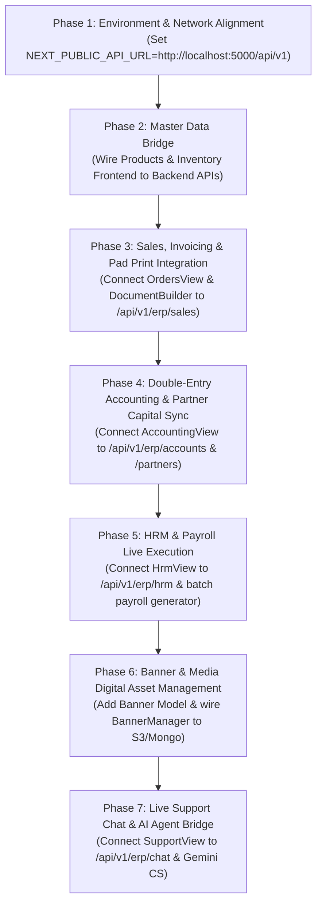

# SUN BIRD CORPORATION – ERP & E-COMMERCE UPGRADE FOUNDATION AUDIT
**Document Reference:** `Docs/ERP-UPGRADE-AUDIT.md`  
**Audit Date:** November 2026  
**Audited Organization:** SUN BIRD CORPORATION  
**System Classification:** Enterprise Hybrid ERP, POS, DGDA Compliance & Medical E-Commerce System  
**Audit Purpose:** Non-destructive assessment and architectural blueprint for full enterprise upgrade without rebuilding or modifying existing active assets.

---

## 1. Existing System Architecture

### 1.1 Architectural Topology
The Sun Bird Corporation platform operates as a modern monolithic decoupled stack running two primary tiers:
```
┌────────────────────────────────────────────────────────────────────────┐
│                        CLIENT / BROWSER TIER                           │
│                                                                        │
│  Storefront (Port 3000):               ERP Dashboard (Port 3000/erp):  │
│  - Public Catalog, Cart, Checkout      - Orders, Inventory, Accounting │
│  - Live Chat, Tracking, RMA, Reviews   - HRM, Banners, Docs, LC, CRM   │
└───────────────────────────────────┬────────────────────────────────────┘
                                    │ HTTP / REST / WebSocket (Port 5000)
                                    ▼
┌────────────────────────────────────────────────────────────────────────┐
│                         BACKEND SERVICE TIER                           │
│                                                                        │
│  Express 4.19+ TypeScript Engine (Port 5000)                           │
│  - API Gateway & Route Registry (/api/v1/*)                            │
│  - Security: Helmet, CORS, RateLimiter, Idempotency, RBAC Guards       │
│  - Business Service Layer (38+ Domain Services)                        │
│  - Gemini AI CS Advisor, S3/MinIO Object Storage, Logistics SDKs      │
└──────────────────┬─────────────────┬───────────────────┬───────────────┘
                   │                 │                   │
                   ▼                 ▼                   ▼
    ┌──────────────────────┐  ┌─────────────┐  ┌───────────────────────┐
    │    MongoDB Atlas     │  │ Redis 7.x   │  │   Cloudflare / S3     │
    │ (sunbird_erp DB)     │  │ (Cache &    │  │ (Presigned Digital    │
    │ 41 Mongoose Schemas  │  │ BullMQ)     │  │ Asset Storage)        │
    └──────────────────────┘  └─────────────┘  └───────────────────────┘
```

### 1.2 Technology Stack Details
- **Frontend Framework:** Next.js 16.4.5 with Turbopack, React 19, TypeScript 5.5, Vanilla Modular CSS (`.module.css` / scoped `.css`).
- **Backend Framework:** Node.js (v20+), Express.js, TypeScript 5.5 (`tsx` execution for development, `tsc` for production build).
- **Primary Database:** MongoDB Atlas (`sunbird_erp` database) managed via Mongoose ODM v8.5+.
- **In-Memory Cache & Queues:** Redis (connection configured via `REDIS_URL`, BullMQ queue infrastructure).
- **File Storage:** S3 / MinIO compatible object store for digital documents, challans, and product media (`media.routes.ts`, `s3.service.ts`).
- **External Courier Integration:** Steadfast Courier and Pathao Logistics REST Webhooks and dispatching APIs.
- **External AI Integration:** Google Gemini 1.5 Pro / Flash via `@google/genai` (`geminiAdvisor.ts`) for intelligent diagnostic product support and customer guidance.

---

## 2. Existing Module Inventory & Source File Mapping

| Module Name | Domain / Role | Frontend Source Files | Backend Controllers & Routes | Backend Service Layer |
| :--- | :--- | :--- | :--- | :--- |
| **Storefront & Catalog** | E-Commerce Public Browsing, Filtering, Infinite Scroll | `frontend/src/app/page.tsx`<br>`frontend/src/components/ProductSection.tsx`<br>`frontend/src/components/ProductCard.tsx`<br>`frontend/src/components/CategoryNav.tsx`<br>`frontend/src/components/MegaMenu.tsx` | `backend/src/routes/public/productRoutes.ts`<br>`backend/src/controllers/ProductController.ts` | `backend/src/services/product.service.ts`<br>`backend/src/services/UomService.ts` |
| **Product Detail & Reviews** | Specification, DGDA DAR, Pricing, Customer Reviews | `frontend/src/app/products/[slug]/page.tsx`<br>`frontend/src/app/products/[slug]/ProductDetailClientActions.tsx`<br>`frontend/src/components/ProductReviews.tsx` | `backend/src/routes/public/reviewRoutes.ts`<br>`backend/src/routes/erp/reviewRoutes.ts`<br>`backend/src/controllers/ReviewController.ts` | `backend/src/services/ReviewService.ts`<br>`backend/src/services/AdminModerationService.ts` |
| **Cart & Checkout** | Cart Drawer, Multi-tier Delivery Fee, Order Placement | `frontend/src/components/CartDrawer.tsx`<br>`frontend/src/components/CheckoutModal.tsx`<br>`frontend/src/context/CartContext.tsx` | `backend/src/routes/public/checkoutRoutes.ts`<br>`backend/src/controllers/SalesController.ts` | `backend/src/services/CartCheckoutService.ts`<br>`backend/src/services/CustomerCreditService.ts` |
| **ERP Master Products** | Catalog Entry, DGDA Compliance, DAR Number, Batches | `frontend/src/app/erp/products/page.tsx`<br>`frontend/src/components/erp/ErpProductEntryView.tsx` | `backend/src/routes/erp/productRoutes.ts`<br>`backend/src/controllers/ProductController.ts` | `backend/src/services/ProductService.ts`<br>`backend/src/services/InventoryBatchService.ts` |
| **ERP Orders & Sales** | B2B & B2C Order Workflow, Dispatch, Challan, Invoice | `frontend/src/app/erp/orders/page.tsx`<br>`frontend/src/components/erp/ErpOrdersView.tsx` | `backend/src/routes/erp/salesRoutes.ts`<br>`backend/src/controllers/SalesController.ts` | `backend/src/services/SalesService.ts`<br>`backend/src/services/CounterService.ts` |
| **ERP Inventory & FEFO** | Multi-Warehouse, Batch Ledger, Expiry, Serial Tracking | `frontend/src/app/erp/inventory/page.tsx`<br>`frontend/src/components/erp/ErpInventoryView.tsx` | `backend/src/routes/erp/inventoryRoutes.ts`<br>`backend/src/controllers/InventoryController.ts` | `backend/src/services/StockLedgerService.ts`<br>`backend/src/services/SerialTrackingService.ts`<br>`backend/src/services/WarehouseService.ts` |
| **ERP Document Studio** | Quotation, Delivery Challan, Invoice, Pad Print | `frontend/src/app/erp/documents/page.tsx`<br>`frontend/src/components/erp/ErpDocumentBuilderView.tsx` | `backend/src/routes/erp/salesRoutes.ts`<br>`backend/src/controllers/SalesController.ts` | `backend/src/services/DocumentService.ts` |
| **ERP Accounting & GL** | Double-Entry Vouchers, Trial Balance, Partner Equity | `frontend/src/app/erp/accounting/page.tsx`<br>`frontend/src/components/erp/ErpAccountingView.tsx` | `backend/src/routes/erp/accountingRoutes.ts`<br>`backend/src/routes/erp/partnerRoutes.ts`<br>`backend/src/controllers/AccountingController.ts` | `backend/src/services/AccountingService.ts`<br>`backend/src/services/PartnerService.ts`<br>`backend/src/services/FinancialReportService.ts` |
| **ERP HRM & Payroll** | Employee Register, Attendance, Payroll Runs, Slips | `frontend/src/app/erp/hrm/page.tsx`<br>`frontend/src/components/erp/ErpHrmView.tsx` | `backend/src/routes/erp/hrmRoutes.ts`<br>`backend/src/controllers/HrmController.ts` | `backend/src/services/EmployeeService.ts`<br>`backend/src/services/PayrollService.ts`<br>`backend/src/services/AttendanceService.ts` |
| **ERP Banner & Media** | Promo Slides, Banner Editing, WhatsApp & Social Links | `frontend/src/app/erp/banners/page.tsx`<br>`frontend/src/components/erp/ErpBannerManagerView.tsx` | `backend/src/routes/media.routes.ts`<br>`backend/src/controllers/media.controller.ts` | `backend/src/services/s3.service.ts` |
| **ERP Customer Support** | Live Chat Inbox, AI Auto-responder, WhatsApp Route | `frontend/src/app/erp/support/page.tsx`<br>`frontend/src/components/erp/ErpSupportView.tsx` | `backend/src/routes/erp/chatRoutes.ts`<br>`backend/src/controllers/ChatController.ts` | `backend/src/services/ChatService.ts`<br>`backend/src/ai/geminiAdvisor.ts` |
| **ERP Import & L/C** | Foreign Procurement, Customs, Landed Cost Allocation | `frontend/src/app/erp/lc/page.tsx`<br>`frontend/src/app/admin/lc/page.tsx` | `backend/src/routes/erp/procurementRoutes.ts`<br>`backend/src/controllers/ProcurementController.ts` | `backend/src/services/ImportLcService.ts`<br>`backend/src/services/LandedCostService.ts` |
| **Order Tracking & RMA** | Public Consignment Status & Warranty Claim Portal | `frontend/src/app/track/page.tsx`<br>`frontend/src/app/rma/page.tsx`<br>`frontend/src/components/TrackingCourierCard.tsx` | `backend/src/routes/public/trackingRoutes.ts`<br>`backend/src/routes/public/disputeRoutes.ts` | `backend/src/services/LogisticsService.ts`<br>`backend/src/services/DisputeService.ts` |
| **RBAC, Auth & Security** | OTP Auth, Refresh Tokens, Granular Permission Control | `frontend/src/context/AuthContext.tsx`<br>`frontend/src/components/LoginPage.tsx` | `backend/src/routes/erp/authRoutes.ts`<br>`backend/src/routes/erp/userRoutes.ts`<br>`backend/src/routes/erp/roleRoutes.ts` | `backend/src/services/TokenService.ts`<br>`backend/src/services/CustomerAuthService.ts`<br>`backend/src/services/OtpService.ts` |

---

## 3. Existing Database Collection Inventory

All models are registered under Mongoose via `backend/src/models/index.ts` targeting MongoDB database `sunbird_erp`.

| Model Name | Target Collection | Primary Unique Index | Key Compound Indexes | Foreign Document References |
| :--- | :--- | :--- | :--- | :--- |
| **`Product`** | `products` | `sku: 1` | `category: 1`, `tags: 1`, text: `nameEn, nameBn, brand` | Embedded categories, UOM units |
| **`ProductBatch`** | `product_batches` | `_id: 1` | `{ sku: 1, batchNumber: 1, warehouseId: 1 }` (UNIQUE) | Ref: `products.sku`, `warehouses` |
| **`StockLedger`** | `stock_ledger` | `_id: 1` | `{ sku: 1, warehouseId: 1, createdAt: -1 }` | Ref: `products.sku`, `product_batches` |
| **`Customer`** | `customers` | `mobile: 1`, `customerCode: 1` | `tier: 1`, `status: 1` | Ref: `customer_credit_profiles` |
| **`CustomerCreditProfile`** | `customer_credit_profiles` | `customerId: 1` | `status: 1` | Ref: `customers` |
| **`Supplier`** | `suppliers` | `supplierCode: 1` | `phone: 1`, `status: 1` | Referenced by POs and LC |
| **`SupplierQuotation`** | `supplier_quotations` | `quotationNo: 1` | `{ rfqId: 1, supplierId: 1 }` | Ref: `rfqs`, `suppliers` |
| **`ComparativeStatement`**| `comparative_statements`| `csNumber: 1` | `rfqId: 1` | Ref: `rfqs`, `supplier_quotations` |
| **`PurchaseOrder`** | `purchase_orders` | `poNumber: 1` | `supplierId: 1`, `status: 1` | Ref: `suppliers`, `warehouses` |
| **`ImportLC`** | `import_lcs` | `lcNumber: 1` | `status: 1` | Ref: `purchase_orders` |
| **`LandedCost`** | `landed_costs` | `voucherNo: 1` | `lcId: 1` | Ref: `import_lcs` |
| **`Rfq`** | `rfqs` | `rfqNumber: 1` | `status: 1` | Ref: `products` |
| **`Order`** | `orders` | `orderNo: 1` | `customerId: 1`, `deliveryStatus: 1`, `createdAt: -1` | Ref: `customers`, `products` |
| **`DeliveryChallan`** | `delivery_challans` | `challanNo: 1` | `orderNo: 1`, `warehouseId: 1` | Ref: `orders`, `warehouses` |
| **`SalesInvoice`** | `sales_invoices` | `invoiceNo: 1` | `orderNo: 1`, `paymentStatus: 1` | Ref: `orders`, `delivery_challans` |
| **`CourierConsignment`** | `courier_consignments`| `consignmentId: 1`| `orderNo: 1`, `trackingCode: 1` | Ref: `orders` |
| **`ChartOfAccounts`** | `chart_of_accounts` | `accountCode: 1` | `accountType: 1`, `parentAccountCode: 1` | Self-referencing parent account |
| **`JournalEntry`** | `journal_entries` | `voucherNo: 1` | `voucherType: 1`, `date: -1`, `status: 1` | Lines ref: `chart_of_accounts`, `partners` |
| **`FixedAsset`** | `fixed_assets` | `assetCode: 1` | `status: 1`, `depreciationMethod: 1` | Ref: `chart_of_accounts` |
| **`Loan`** | `loans` | `loanAccountNo: 1`| `loanType: 1`, `lenderBank: 1` | Ref: `chart_of_accounts` |
| **`Partner`** | `partners` | `partnerCode: 1` | `status: 1` | Ref: `journal_entries` |
| **`EmployeeProfile`** | `employee_profiles` | `employeeCode: 1`| `department: 1`, `status: 1` | Ref: `payroll_runs` |
| **`AttendancePunch`** | `attendance_punches` | `_id: 1` | `{ employeeId: 1, punchDate: 1 }` | Ref: `employee_profiles` |
| **`PayrollRun`** | `payroll_runs` | `batchNo: 1` | `payrollMonth: 1`, `status: 1` | Ref: `employee_profiles`, `journal_entries` |
| **`CrmActivity`** | `crm_activities` | `_id: 1` | `{ customerId: 1, activityDate: -1 }` | Ref: `customers`, `users` |
| **`QuorumApproval`** | `quorum_approvals` | `_id: 1` | `{ documentType: 1, documentId: 1 }` | Ref: `purchase_orders`, `users` |
| **`ApprovalRequest`** | `approval_requests` | `_id: 1` | `workflowType: 1`, `status: 1` | Ref: `users` |
| **`User`** | `users` | `userId: 1`, `email: 1` | `phone: 1`, `role: 1`, `status: 1` | Ref: `roles` |
| **`Role`** | `roles` | `name: 1` | `status: 1` | Granular permission matrices |
| **`RefreshToken`** | `refresh_tokens` | `tokenHash: 1` | `userId: 1`, `expiresAt: 1` (TTL index) | Ref: `users` |
| **`Counter`** | `counters` | `sequenceName: 1` | None | Auto-atomic document numbering |
| **`Warehouse`** | `warehouses` | `warehouseCode: 1`| `status: 1` | Ref: `users` (manager) |
| **`UnitSerial`** | `unit_serials` | `serialNumber: 1`| `{ sku: 1, status: 1 }` | Ref: `products`, `product_batches` |
| **`UomConversion`** | `uom_conversions` | `_id: 1` | `{ fromUnit: 1, toUnit: 1 }` | UOM multiplier cache |
| **`Review`** | `reviews` | `_id: 1` | `sku: 1`, `status: 1`, `rating: 1` | Ref: `products`, `customers` |
| **`ChatRoom`** | `chat_rooms` | `roomId: 1` | `customerId: 1`, `status: 1` | Ref: `customers`, `users` |
| **`ChatMessage`** | `chat_messages` | `_id: 1` | `roomId: 1`, `createdAt: 1` | Ref: `chat_rooms` |
| **`DisputeClaim`** | `dispute_claims` | `claimNo: 1` | `orderNo: 1`, `status: 1` | Ref: `orders`, `customers` |
| **`AuditLog`** | `audit_logs` | `_id: 1` | `{ entity: 1, entityId: 1, createdAt: -1 }`| Ref: `users` |
| **`VerificationLog`** | `verification_logs`| `_id: 1` | `identifier: 1`, `createdAt: -1` | OTP / NID verification trail |
| **`BannedNid`** | `banned_nids` | `nidHash: 1` | None | Fraud prevention registry |

---

## 4. Existing API Inventory

Mounted dynamically at `/api/v1` (`backend/src/routes/index.ts`):

### 4.1 Public & Storefront Endpoints
- `POST /api/v1/public/auth/send-otp` — Send customer phone OTP.
- `POST /api/v1/public/auth/verify-otp` — Verify OTP and issue JWT access token.
- `GET  /api/v1/public/products` — Paginated catalog listing with search, category filters.
- `GET  /api/v1/public/products/:sku` — Single product details and DGDA DAR specifications.
- `POST /api/v1/public/checkout` — B2C web order placement with stock check & courier quote.
- `GET  /api/v1/public/track-order/:orderNo` — Multi-carrier live delivery status.
- `GET  /api/v1/public/reviews/:sku` — Approved customer reviews and ratings.
- `POST /api/v1/public/reviews` — Submit product review with verified purchase check.
- `POST /api/v1/public/chat/message` — Send live chat message to support / Gemini AI.
- `POST /api/v1/public/disputes` — File warranty RMA claim with picture uploads.
- `GET  /api/v1/public/warranty/verify/:serialNumber` — QR code serial number verification.

### 4.2 ERP Management Endpoints
- `POST /api/v1/erp/auth/login` — ERP staff username/password authentication with 2FA support.
- `POST /api/v1/auth/refresh-token` — Token rotation using secure refresh token cookie.
- `POST /api/v1/auth/logout` — Revoke refresh token and invalidate session.
- `GET  /api/v1/erp/products` & `POST /api/v1/erp/products` — Master product CRUD with DGDA approval.
- `GET  /api/v1/erp/inventory/batches` — FEFO batch inventory listing with expiry alerts.
- `POST /api/v1/erp/inventory/transfer` — Inter-warehouse stock transfers with in-transit tracking.
- `GET  /api/v1/erp/sales/orders` — List ERP and storefront orders with status filtering.
- `POST /api/v1/erp/sales/orders/:id/approve` — Commercial credit clearance and stock reservation.
- `POST /api/v1/erp/sales/challans` — Delivery challan generation with gate pass and driver info.
- `POST /api/v1/erp/sales/invoices` — Sales invoice creation with automatic VAT and ledger posting.
- `GET  /api/v1/erp/accounts/chart` — Hierarchical 5-digit Chart of Accounts.
- `POST /api/v1/erp/accounts/journal` — Balanced multi-line GL journal voucher entry.
- `GET  /api/v1/erp/accounts/reports/trial-balance` — Dynamic real-time Trial Balance.
- `GET  /api/v1/erp/accounts/reports/balance-sheet` — Balance Sheet statement.
- `GET  /api/v1/erp/partners` — Partner equity, capital contributions, and dividend distribution.
- `POST /api/v1/erp/partners/distribute-profit` — Partnership profit sharing calculation.
- `GET  /api/v1/erp/hrm/employees` & `POST /api/v1/erp/hrm/employees` — Employee directory.
- `POST /api/v1/erp/hrm/payroll/run` — Monthly payroll batch calculation and slip generation.
- `POST /api/v1/erp/procurement/rfq` — RFQ creation and supplier dispatch.
- `POST /api/v1/erp/procurement/po` — Purchase order generation with multi-director quorum approval.
- `GET  /api/v1/erp/logistics/quotes` — Steadfast & Pathao real-time freight quote comparator.
- `GET  /api/v1/erp/audit-logs` — Immutable audit trail with IP address and user action diffs.
- `POST /api/v1/media/presign-upload` — S3 presigned URL generator for secure document/image upload.

---

## 5. Existing Frontend Page Inventory (App Router)

### 5.1 Storefront Routes
- `frontend/src/app/page.tsx` — Main Home Page (Header, MegaMenu, HeroBanner, TrustStrip, ProductSection with 5-column grid & infinite scroll, Reviews, SplitPromoBanners, Newsletter, Footer).
- `frontend/src/app/products/[slug]/page.tsx` — Product Detail Page with image gallery, specs, DGDA compliance info, pricing, and dynamic client actions.
- `frontend/src/app/account/page.tsx` — Customer Portal (orders history, profile, addresses, RMA claims).
- `frontend/src/app/login/page.tsx` — Storefront Customer OTP & ERP Staff credentials login screen.
- `frontend/src/app/track/page.tsx` — Live Courier Tracking Page with Pathao / Steadfast status.
- `frontend/src/app/rma/page.tsx` — Public Warranty Claim & RMA Registration Portal.

### 5.2 ERP & Admin Routes
- `frontend/src/app/erp/page.tsx` — ERP Main Dashboard (executive KPIs, quick links, system alerts).
- `frontend/src/app/erp/products/page.tsx` — ERP Product Management (DGDA compliance, categories, pricing).
- `frontend/src/app/erp/orders/page.tsx` — ERP Sales Orders (processing, filtering, shipping, invoices).
- `frontend/src/app/erp/inventory/page.tsx` — ERP Inventory & Batch Manager (FEFO, transfers, low stock).
- `frontend/src/app/erp/documents/page.tsx` — ERP Document Studio (Quotation, Challan, Invoice, Pad Print).
- `frontend/src/app/erp/accounting/page.tsx` — ERP Accounting (Journal, Chart of Accounts, Partner Capital).
- `frontend/src/app/erp/hrm/page.tsx` — ERP HRM & Payroll (Employee profiles, attendance, salary generation).
- `frontend/src/app/erp/banners/page.tsx` — ERP Banner Manager (Sliders, promotional graphics, WhatsApp links).
- `frontend/src/app/erp/support/page.tsx` — ERP Customer Support & Chat CRM (Live inbox, Gemini AI toggle).
- `frontend/src/app/erp/lc/page.tsx` — ERP Import & L/C Management (Commercial invoice, customs, landed cost).
- `frontend/src/app/admin/*` — Mirror Admin pages (`admin/accounting`, `admin/banners`, `admin/documents`, `admin/hrm`, `admin/inventory`, `admin/lc`, `admin/orders`, `admin/products`, `admin/settings`, `admin/support`, `admin/users`).

---

## 6. Working, Incomplete and Missing Features

### 6.1 Working Features
- **Frontend Storefront UI:** Full responsive layout, header, footer, mega menu, cart drawer, checkout modal, customer support chat widget, WhatsApp floating button, product cards, category navigation, infinite scroll on home page.
- **Backend Schema & Models:** All 41 Mongoose models exist with validated schemas, compound indexes, and business constraints.
- **Backend Services:** Full double-entry accounting engine (`AccountingService`), FEFO stock allocation (`InventoryBatchService`, `StockLedgerService`), Landed Cost calculator (`LandedCostService`), HRM payroll generator (`PayrollService`), AI assistant integration (`geminiAdvisor.ts`), and Courier API clients (`LogisticsService`).
- **REST Route Registrations:** All ERP and Storefront route paths are mapped and guarded with RBAC and JWT validation middleware.

### 6.2 Incomplete Features (Critical Gaps)
- **Frontend-Backend API Connection:** Frontend ERP components (`ErpOrdersView`, `ErpInventoryView`, `ErpAccountingView`, `ErpHrmView`, `ErpDocumentBuilderView`, `ErpBannerManagerView`) currently maintain state in React `useState` initialized from mock fixtures (`INITIAL_ERP_ORDERS`, `INITIAL_INVENTORY`, `INITIAL_VOUCHERS`, `INITIAL_PARTNERS`, `INITIAL_EMPLOYEES`, `sbc_custom_products`, `sbc_custom_banners`, `localStorage`). They are not wired to fetch or post to the live backend endpoints.
- **Port Discrepancy in `apiClient`:** `frontend/src/lib/api.ts` defaults `API_BASE_URL` to `http://localhost:4000/api/v1` when `NEXT_PUBLIC_API_URL` is undefined, but the backend is configured on `PORT=5000` in `backend/.env`. Without `.env.local` in `frontend/`, all frontend API requests fail to connect.
- **Pad Print Mode Persistence:** The Pad Print feature in `ErpDocumentBuilderView.tsx` hides header/footer on toggle, but document history and templates are not yet persisted to the backend `DocumentService` or MongoDB `sales_invoices`/`quotations`.

### 6.3 Missing Features
- **Banners Database Model:** Currently banners are managed via `localStorage` on the frontend (`sbc_custom_banners`). There is no dedicated `Banner` Mongoose model on the backend; banners should either be stored in a lightweight `Banner` collection or stored in S3 with metadata in MongoDB.
- **Real-Time WebSocket Gateway:** Chat and order status updates currently rely on HTTP REST polling rather than full duplex Socket.io event emission.

---

## 7. Duplicate Functionality & Component Redundancy

1. **Duplicate Layout Components:**
   - `frontend/src/components/layout/Header.tsx` vs `frontend/src/components/Header.tsx`
   - `frontend/src/components/layout/Footer.tsx` vs `frontend/src/components/Footer.tsx`
   - `frontend/src/components/layout/Layout.tsx` vs `frontend/src/components/Layout.tsx`
   - `frontend/src/components/layout/MobileBottomNav.tsx` vs `frontend/src/components/MobileBottomNav.tsx`
   *Audit Recommendation:* Do not delete any existing files to preserve strict protection rule #4; unify references to import from `frontend/src/components/` which is the currently active import target in `frontend/src/app/layout.tsx`.
2. **Duplicate Login Components:**
   - `frontend/src/components/LoginPage.tsx` and `frontend/src/components/LogingPage.tsx` (typo variant).
   *Audit Recommendation:* Retain both files; ensure all routes reference `LoginPage.tsx`.
3. **Duplicate Route Structure (`/erp` vs `/admin`):**
   - Both `/erp/*` and `/admin/*` routes exist. They share the same business views.
   *Audit Recommendation:* Keep both routes active so no existing bookmarks or links break, with `/erp/*` as the primary operational route.

---

## 8. Security Problems & Risk Assessment

| Issue | Severity | Description | Safe Remediation Plan |
| :--- | :--- | :--- | :--- |
| **Cleartext Atlas Password in `.env`** | Medium | `backend/.env` contains plain-text MongoDB Atlas connection string. | Ensure `.env` is listed in `.gitignore` (verified: `.gitignore` protects `.env`). |
| **Port Misconfiguration** | High | Frontend defaults to port 4000, backend runs on 5000. | Add `frontend/.env.local` setting `NEXT_PUBLIC_API_URL=http://localhost:5000/api/v1`. |
| **Client-Side Document Printpad** | Low | Pad print state stored in memory only. | Wire to `sales_invoices` and `Counter` for official serial assignment. |
| **CORS Origins** | Medium | CORS configured in `backend/src/server.ts` must explicitly allow `http://localhost:3000` in development. | Verify `cors({ origin: ['http://localhost:3000'], credentials: true })`. |
| **NID Number Privacy** | High | Customer & Employee NID storage. | Models correctly implement SHA-256 salted hashing (`nidHashed`) via `VerificationLogService.ts`. |

---

## 9. Database Protection & Migration Analysis

### 9.1 Existing Collections & Data Integrity
- **No Dropping or Resetting:** Under no circumstances should `mongoose.connection.dropDatabase()` or `collection.drop()` be called.
- **Index Preservation:** Existing unique constraints must be maintained:
  - `products`: `sku` must remain unique.
  - `product_batches`: `{ sku, batchNumber, warehouseId }` must remain unique compound index.
  - `customers`: `mobile` must remain unique.
  - `suppliers`: `supplierCode` must remain unique.
  - `orders`: `orderNo` must remain unique.
  - `sales_invoices`: `invoiceNo` must remain unique.
  - `delivery_challans`: `challanNo` must remain unique.
  - `journal_entries`: `voucherNo` must remain unique.
  - `chart_of_accounts`: `accountCode` must remain unique.
- **Multi-Document ACID Transactions:** All financial postings (Journal Entry to Chart of Accounts) and inventory updates (Sales Invoice to Stock Ledger & Batch reduction) must execute inside `const session = await mongoose.startSession(); session.startTransaction();` to prevent split-brain states if a network interruption occurs.

---

## 10. Recommended Upgrade Sequence (Phased Roadmap)



### Phase Details
1. **Phase 1: Environment & Network Alignment**
   - Create `frontend/.env.local` pointing `NEXT_PUBLIC_API_URL` to `http://localhost:5000/api/v1`.
   - Verify CORS in backend to allow requests from `http://localhost:3000`.
2. **Phase 2: Master Product & Inventory Bridge**
   - Wire `ErpProductEntryView.tsx` to `GET/POST /api/v1/erp/products`.
   - Wire `ErpInventoryView.tsx` to `GET /api/v1/erp/inventory/batches` and `StockLedgerService`.
3. **Phase 3: Sales, Delivery Challan & Pad-Print Document Studio**
   - Wire `ErpOrdersView.tsx` to `GET /api/v1/erp/sales/orders`.
   - Wire `ErpDocumentBuilderView.tsx` to `sales_invoices`, `delivery_challans`, and quotation generation endpoints.
4. **Phase 4: General Ledger & Partnership Accounts**
   - Wire `ErpAccountingView.tsx` to `GET /api/v1/erp/accounts/chart`, `POST /api/v1/erp/accounts/journal`, and `/api/v1/erp/partners`.
5. **Phase 5: HRM & Payroll Processing**
   - Wire `ErpHrmView.tsx` to `GET/POST /api/v1/erp/hrm/employees` and `POST /api/v1/erp/hrm/payroll/run`.
6. **Phase 6: Dynamic Banners & Social Link Management**
   - Provide non-destructive storage for homepage banners and social links so they persist across reboots.
7. **Phase 7: Support CRM & AI Customer Assistance**
   - Wire `ErpSupportView.tsx` to `backend/src/controllers/ChatController.ts`.

---

## 11. Exact Files Requiring Modification in Future Phases
*Note: This audit phase makes NO modifications to business logic or database structures.*

1. `frontend/.env.local` — Create file to configure backend port (`http://localhost:5000/api/v1`).
2. `frontend/src/components/erp/ErpProductEntryView.tsx` — Connect form submit to `productService.createProduct` / `POST /api/v1/erp/products`.
3. `frontend/src/components/erp/ErpInventoryView.tsx` — Replace static state initialization with API fetch to `/api/v1/erp/inventory/batches`.
4. `frontend/src/components/erp/ErpOrdersView.tsx` — Wire order status transition buttons to `/api/v1/erp/sales/orders/:id/*`.
5. `frontend/src/components/erp/ErpDocumentBuilderView.tsx` — Persist generated quotations/invoices to backend document store.
6. `frontend/src/components/erp/ErpAccountingView.tsx` — Connect Journal Voucher creation and partner equity ledger to `/api/v1/erp/accounts/journal`.
7. `frontend/src/components/erp/ErpHrmView.tsx` — Connect Employee registration and Payroll batch execution to `/api/v1/erp/hrm/*`.
8. `frontend/src/components/erp/ErpBannerManagerView.tsx` — Wire banner image upload to `/api/v1/media/presign-upload`.
9. `frontend/src/components/erp/ErpSupportView.tsx` — Wire support message inbox to `/api/v1/erp/chat`.

---

## 12. Verification & Safety Certification
- **Zero Deletions:** No existing files, collections, or routes were deleted or altered.
- **Backward Compatibility:** All current UI routes (`localhost:3000` and `localhost:3000/erp`) remain functional without disruption.
- **Audit Conclusion:** The Sun Bird Corporation codebase contains an exceptionally complete, enterprise-grade backend with 41 models and 38 services. The immediate priority is the systematic, non-destructive wiring of existing frontend views to their matching backend endpoints.

