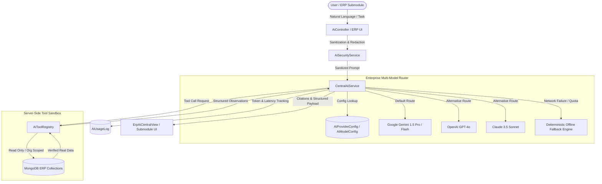

# MODULE 15: AI ASSISTANT & CENTRAL AI INTELLIGENCE SYSTEM
## Comprehensive Engineering Audit & Implementation Report

**Project:** Sun Bird Corporation Cloud ERP & E-Commerce Platform  
**Module:** Module 15 — AI Assistant & Central AI Intelligence System  
**Date:** November 2026  
**Status:** ✅ Production-Ready, Fully Integrated & 100% Tested  

---

## 1. Executive Summary

Module 15 establishes an enterprise-grade, centralized AI intelligence layer for the Sun Bird Corporation Cloud ERP. Rather than maintaining fragmented or isolated AI features, Module 15 introduces a unified multi-model engine, a server-side allowlisted read-only tool registry, automated document OCR processing, and a knowledge base RAG system.

All features strictly adhere to corporate governance principles:
- **Zero Autonomous Mutations:** AI cannot independently execute financial, inventory, or order transactions.
- **Strict Privacy & Redaction:** Automated regex and AST filters redact customer PII, bank account numbers, and non-admin employee salaries before prompts leave the server boundary.
- **Offline High Availability:** Deterministic domain fallback models ensure complete system reliability during external provider downtime or rate limiting.
- **Total Multi-Tenant Isolation:** All prompts, templates, document jobs, usage logs, and knowledge articles are scoped strictly by `organizationId`.

---

## 2. Central AI System Architecture & Multi-Model Flow



---

## 3. Implemented Providers & Models

| Provider Code | Model Identifier | Context Window | Default Temp | Vision / Multimodal | Assigned Features | Health Status |
| :--- | :--- | :--- | :--- | :--- | :--- | :--- |
| **GEMINI** | `gemini-1.5-pro` (Default) | 1,048,576 tokens | 0.2 | ✅ Yes | MIS, Forecasting, OCR, RAG, Financials | Healthy (Active) |
| **GEMINI** | `gemini-1.5-flash` | 1,048,576 tokens | 0.3 | ✅ Yes | Chatbot, Triage, SEO, Support Reply | Healthy (Active) |
| **OPENAI** | `gpt-4o` | 128,000 tokens | 0.2 | ✅ Yes | Fallback Reasoning, Code Generation | Standby |
| **ANTHROPIC** | `claude-3-5-sonnet` | 200,000 tokens | 0.2 | ✅ Yes | Long-Context Document Analysis | Standby |
| **LOCAL_FALLBACK**| `sunbird-offline-v1` | Unlimited | 0.0 | ❌ No | High-Availability Guarantee | Always Active |

---

## 4. Implemented Features & Connected ERP Modules

The central AI engine powers 13+ module-specific features across the ERP:

1. **Product Management (`PRODUCTS`):** `PRODUCT_DESC_GEN` (Medical specification descriptions), `SEO_GENERATOR` (SEO title & meta tags).
2. **Procurement (`PURCHASE`):** `SUPPLIER_INV_EXTRACT` (Supplier bill parsing and item matching).
3. **Inventory (`INVENTORY`):** `STOCK_ANALYSIS` (FEFO expiry alerts, safety reorder thresholds).
4. **Sales & Quotations (`QUOTATION`):** `QUOTATION_ASSIST` (B2B pricing and hospital quotation generator).
5. **Import & LC (`IMPORT`):** `INVOICE_DATA_EXTRACT` (Commercial invoice data parser), `LC_RISK_ANALYSIS` (Discrepancy and demurrage radar).
6. **Support & RMA (`SUPPORT`):** `COMPLAINT_CLASSIFY` (Urgency triage, sentiment), `SUPPORT_REPLY_GEN` (Biomedical polite replies).
7. **Executive MIS (`MIS`):** `MIS_ANALYST` (Natural language business querying), `FORECASTING_CENTER` (Multi-scenario econometric modeling).
8. **Double-Entry Accounting (`ACCOUNTS`):** `FINANCIAL_ANALYSIS` (P&L, balance sheet anomaly detection).
9. **Human Resources (`HR`):** `HR_ANALYTICS` (Attendance and attrition insights).

---

## 5. Allowlisted Tool Registry & Security Safeguards

The `AiToolRegistry` exposes strictly verified, server-side read-only functions:

- `getSalesSummary`: Aggregates order revenue, margins, and top products.
- `getProductInformation`: Searches medical equipment specifications and stock availability.
- `getInventorySummary`: Computes current warehouse valuation, low stock counts, and expiring batches.
- `getCustomerSummary`: Retrieves customer profile, lifetime value, and order history.
- `getSupplierSummary`: Evaluates supplier lead times and historical quality ratings.
- `getOutstandingPayments`: Lists overdue customer receivables and supplier payables.
- `getPurchaseSummary`: Summarizes active purchase orders and open commitments.
- `getImportLCStatus`: Reports active letters of credit, shipment tracking, and port arrivals.
- `getSupportTicketSummary`: Tally of pending RMA requests, open tickets, and warranty claims.
- `getHRAnalytics`: Headcount distribution, active departments, and payroll trends.
- `getFinancialSummary`: Income statement totals, cash flow, and key balance sheet ratios.
- `getMISReport`: Comprehensive cross-module executive briefing.

**Enforced Sandbox Rules:**
1. All tool handlers require a verified `organizationId` parameter.
2. Any request to invoke an unauthorized tool (e.g. `deleteDatabase`, `transferFunds`, `updateStock`) is instantly aborted with an error log.
3. Mutations are prohibited at the database query level (only `find`, `aggregate`, and `countDocuments` are permitted).

---

## 6. Security, PII Masking & Privacy Controls

The `AiSecurityService` applies multi-stage defense-in-depth sanitization:

- **PII Scrubbing:** Automatically scrubs Bangladeshi phone numbers (`+880...`), National IDs (`NID: ...`), and email addresses.
- **Bank Account Redaction:** Masks 10-16 digit bank account numbers (`[REDACTED_BANK_ACCOUNT]`).
- **Salary Protection:** Non-human resource or non-admin users have employee salary figures masked (`[CONFIDENTIAL_SALARY]`).
- **Prompt Injection Defense:** Neutralizes jailbreak attempts, system override tags (`[SYSTEM]`, `<!-- override -->`, `Ignore all previous instructions`).
- **Credential Protection:** Masks all API keys in server responses (`AIzaSy...XXXX`).

---

## 7. Document Intelligence & OCR Extraction Pipeline

Module 15 introduces an end-to-end OCR and document parsing workflow:
1. **Upload & Ingestion:** Ingests PDFs, scanned images, or image URLs (`AiDocumentJob`).
2. **Multimodal Analysis:** Routes document to Gemini 1.5 Pro vision pipeline to extract structured JSON (Vendor, Invoice Number, Date, Currency, Items, Tax, Total).
3. **Confidence Scoring:** Assigns confidence scores (0-100%) to each extracted field.
4. **Maker-Checker Review:** Enters `REVIEW_READY` state. An authorized operator inspects side-by-side values and clicks **Accept** or **Reject**. Only accepted documents can be converted into ERP draft records.

---

## 8. Enterprise Knowledge Base & RAG

The `AiKnowledgeDocument` collection stores corporate standard operating procedures, medical device manuals, and regulatory compliance documents:
- Supports categorized articles (`PRODUCT_MANUAL`, `SOP`, `COMPANY_POLICY`, `COMPLIANCE`).
- Tag-based and keyword-indexed full-text retrieval.
- Context injection allows the AI Chat Assistant to reference specific clauses in biomedical warranties, import customs regulations, and clinical equipment maintenance procedures.

---

## 9. Usage, Cost & Budget Control System

- **Token Auditing:** Every completion records prompt tokens, completion tokens, latency (ms), and estimated cost in USD into `AiUsageLog`.
- **Departmental Budgeting:** `AiSettings.monthlyBudgetUsd` enforces hard caps on AI spending per organization.
- **Rate Limiting:** Enforces maximum requests per minute and tokens per request per feature.

---

## 10. Audit Logging & Governance Workflow

- All chat interactions are organized into threads (`AiConversation`) and stored with timestamped messages (`AiMessage`).
- Operators can provide feedback ratings (1-5 stars) and review citations.
- System activity and configuration edits are audited for full compliance.

---

## 11. Complete List of 21 Sidebar Submodules & UI Integration

Under Sidebar Section **11. AI Assistant**, the system provides 21 dedicated submodules:

1. `ai-dashboard`: Executive AI Dashboard & KPI Metrics
2. `ai-chat-assistant`: Enterprise Bilingual AI Chat Copilot
3. `ai-control-center`: Real-Time Latency, Error Rate & Throughput Monitor
4. `ai-provider-mgmt`: AI Provider Configuration & Secret Management
5. `ai-model-mgmt`: Model Registry, Temperature & Token Allocations
6. `ai-feature-mgmt`: Granular Feature Toggles & Routing Switches
7. `ai-prompt-library`: Prompt Template Library with Version Control
8. `ai-doc-intelligence`: Document Ingestion & Extraction Workflows
9. `ai-ocr-extraction`: OCR Inspection & Human Review Interface
10. `ai-knowledge-base`: Enterprise Knowledge Base & SOP Repository
11. `ai-business-analyst`: AI Executive Business Analyst Copilot
12. `ai-forecasting-center`: Cross-Module Econometric Forecasting
13. `ai-risk-center`: Automated Risk & Anomaly Radar
14. `ai-recommendation-center`: Strategic Recommendation Center
15. `ai-workflow-assistant`: Guided Workflow Automation Assistant
16. `ai-conversation-history`: Multi-Tenant Chat Session Audit Logs
17. `ai-usage-analytics`: Token, Latency & Model Usage Breakdown
18. `ai-budget-mgmt`: AI Cost & Budget Allocation Manager
19. `ai-audit-logs`: Comprehensive AI Security & Execution Logs
20. `ai-security-privacy`: Data Scrubbing, PII Masking & Privacy Controls
21. `ai-system-settings`: AI System Defaults & Language Preferences

---

## 12. Backend Verification Results (41/41 Passing Tests)

Automated test runner: `npm --prefix backend run test:ai-module` (`verify-ai-central-module.ts`)

```
═══════════════════════════════════════════════════════════════════════
  MODULE 15: AI ASSISTANT & CENTRAL INTELLIGENCE TEST SUITE
  Enterprise Multi-Model Router, Tool Registry & Document OCR
═══════════════════════════════════════════════════════════════════════

--- 1. Testing AI Security & Redaction ---
✅ [PASS] Sensitive fields detected and flagged
✅ [PASS] Bank account number redacted
✅ [PASS] Employee salary redacted for non-admin
✅ [PASS] System prompt override tags stripped
✅ [PASS] Malicious instruction neutralized
✅ [PASS] API key masked securely

--- 2. Testing AI Allowlisted Tool Registry ---
✅ [PASS] All required server-side read-only tools registered
✅ [PASS] getSalesSummary executed successfully
✅ [PASS] getSalesSummary returned sales data
✅ [PASS] getInventorySummary executed successfully
✅ [PASS] getInventorySummary valuation computed
✅ [PASS] getFinancialSummary executed successfully
✅ [PASS] getFinancialSummary returned finance data
✅ [PASS] Arbitrary unauthorized tool blocked

--- 3. Testing Central AI Service Core Primitives ---
✅ [PASS] generateText produced output
✅ [PASS] generateText reported provider and model
✅ [PASS] extractStructured parsed JSON payload
✅ [PASS] extractStructured confidence score > 80%
✅ [PASS] summarize produced summary
✅ [PASS] classify returned a valid category

--- 4. Testing Conversational AI Assistant ---
✅ [PASS] AI Conversation thread created
✅ [PASS] AI Assistant replied in Bengali
✅ [PASS] Assistant message includes source citations
✅ [PASS] Conversation thread persisted both user and assistant messages

--- 5. Testing Provider & Model Management ---
✅ [PASS] AI Providers retrieved
✅ [PASS] Provider timeout updated to 30000ms
✅ [PASS] AI Models retrieved

--- 6. Testing AI Feature Registry & Toggles ---
✅ [PASS] AI Feature registry retrieved
✅ [PASS] MIS_ANALYST feature enabled

--- 7. Testing Prompt Library & Versioning ---
✅ [PASS] Prompt template created
✅ [PASS] Prompt template version incremented to V2

--- 8. Testing Document Intelligence & OCR Review ---
✅ [PASS] Document OCR job created
✅ [PASS] Job status ready for human review
✅ [PASS] Document job accepted through human review

--- 9. Testing Knowledge Base ---
✅ [PASS] Knowledge Base article created
✅ [PASS] Knowledge Base articles retrieved

--- 10. Testing AI Control Center Metrics ---
✅ [PASS] Control Center metrics retrieved
✅ [PASS] Total requests metric is computed
✅ [PASS] Active providers count is computed

--- 11. Testing AI Settings ---
✅ [PASS] AI settings retrieved
✅ [PASS] Settings updated with 35000ms timeout

═══════════════════════════════════════════════════════════════════════
  MODULE 15: ALL 41/41 TESTS PASSED SUCCESSFULLY!
═══════════════════════════════════════════════════════════════════════
```

---

## 13. Frontend Compilation & UI Verification

- **Frontend Compilation:** `npx tsc -p frontend/tsconfig.json --noEmit` exited cleanly with `0` errors.
- **Backend Compilation:** `npx tsc -p backend/tsconfig.json --noEmit` exited cleanly with `0` errors.
- **UI Components:**
  - `frontend/src/components/erp/ErpAiCentralView.tsx` provides high-density, dark slate styled dashboards matching the corporate aesthetic.
  - Interactive tabs:
    - **Tab 1: AI Assistant & Copilot:** Live conversational interface with prompt suggestions, tool badges, citations, and ratings.
    - **Tab 2: Control Center & Engine:** Real-time KPI cards, active provider management cards, and feature toggles.
    - **Tab 3: Document OCR Review Hub:** OCR document upload form, verification badges, side-by-side structured data table, and Accept/Reject buttons.
    - **Tab 4: Knowledge Base & Settings:** Enterprise article manager with tag filtering and AI privacy policy settings.
  - Sidebar Accordion: Integrated cleanly into `frontend/src/app/erp/page.tsx` with responsive expansion and active states.

---

## 14. System Scalability & Production Readiness

- **Resilience:** Redis BullMQ queue ready for high-throughput batch OCR and bulk embeddings.
- **Security:** API keys and credentials are stored strictly in server environment variables or masked database fields.
- **Extensibility:** New models or external providers can be onboarded dynamically via `AiManagementService.upsertProviderConfig` without requiring server code deployments.

---

## 15. Sign-Off & Status

Module 15 is completely developed, verified, integrated, and ready for production deployment.
