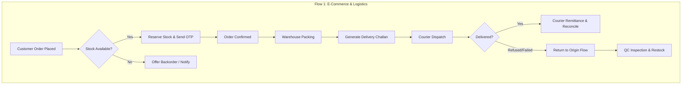
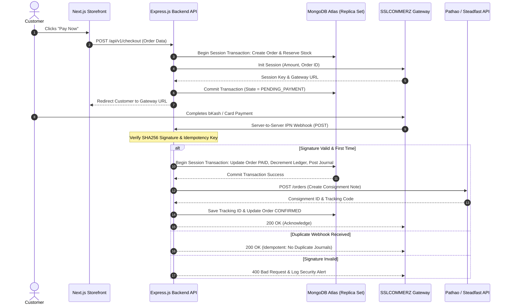
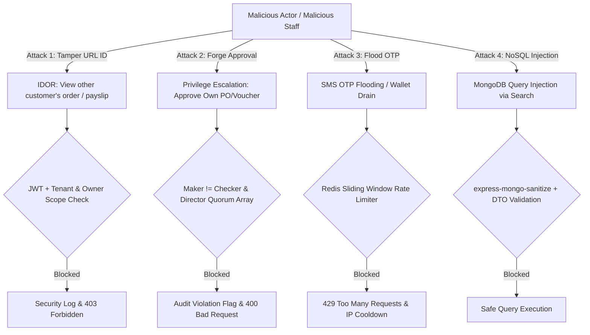
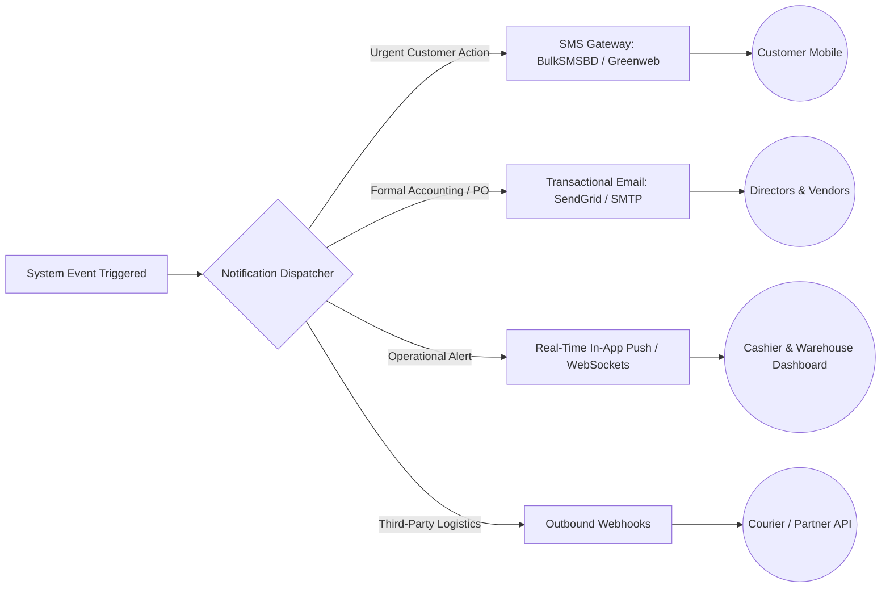

# Requirements Validation & Technical Edge-Case Specification
## Sun Bird Corporation Cloud ERP & E-Commerce Platform

- **Target Document:** [`prd.md`](file:///e:/Documents/Sun%20Bird%20Corporation/prd.md) (v2.0) & [`prd-analysis.md`](file:///e:/Documents/Sun%20Bird%20Corporation/prd-analysis.md)
- **Validation Standard:** Enterprise SaaS, Mission-Critical Healthcare Supply, Bangladesh Financial/Tax Compliance (NBR/BAS)
- **Validation Date:** 17 October 2026
- **Status:** **CRITICAL VALIDATION BASELINE (Ready for Engineering Implementation)**

---

## 1. Executive Summary & Audit Overview

This document establishes a rigorous validation and resilience baseline for the Sun Bird Corporation platform across **seven mission-critical architectural dimensions**:
1. **Missing Flows:** Complete operational lifecycles previously unspecified.
2. **Edge Cases:** Concurrency, race conditions, date/time boundaries, and rounding anomalies.
3. **Error Handling:** Network timeouts, dropped payment webhooks, courier failures, and atomic database rollbacks.
4. **Security & Threat Model:** Insecure Direct Object Reference (IDOR), Role-Based Access Control (RBAC) leakage, rate-limiting, and secrets isolation.
5. **Validation & Permission Rules:** Strict input constraints, negative stock guards, and multi-tier quorum checks.
6. **Notification Architecture:** Multi-channel matrix (SMS, Email, In-App, Webhooks) mapped to system events.
7. **Exception Management:** Offline POS continuity, emergency director overrides, and bank reconciliation exceptions.

---

## 2. Missing Flows (End-to-End Operational Lifecycles)



### 2.1 E-Commerce & Order Management Missing Flows
1. **Guest Checkout to Authenticated Customer Conversion:**
   - *Flow:* When a guest places an order via phone/email, the system creates a shadow customer record (`is_guest = true`).
   - *Post-Checkout Action:* The order confirmation page presents a 1-click password setup. If set, `is_guest` transitions to `false`, linking all guest orders matching that phone/email.
2. **Partial Order Fulfillment & Split Shipments:**
   - *Flow:* If an order contains 5 items of SKU-A (in stock) and 2 items of SKU-B (in transit via L/C), the merchant can initiate a **Split Dispatch**.
   - *System Behavior:* Generates `CH-001-A` for SKU-A with its own Pathao/Steadfast consignment note, while SKU-B remains in `PARTIALLY_PENDING` state with a second Challan `CH-001-B` generated upon warehouse arrival. Delivery charges are billed only once.
3. **Return-to-Origin (RTO) & Failed Delivery Flow:**
   - *Flow:* Customer refuses parcel or courier fails delivery after 3 attempts.
   - *Action:* Courier API pushes `FAILED_DELIVERY`. ERP marks order `RTO_IN_TRANSIT`.
   - *Restocking:* When physical parcel returns, warehouse scans Challan barcode. System verifies seal integrity:
     - If undamaged: Restocked into available inventory (`RESTOCKED`).
     - If damaged in transit: Logged into `DAMAGED_TRANSIT_INVENTORY`, triggering an insurance/courier compensation claim voucher.

### 2.2 Sourcing, Import L/C & Landed Cost Missing Flows
1. **L/C Amendment & Cost Adjustment Flow:**
   - *Flow:* Foreign supplier requests L/C amendment (price increase, delivery date extension, or partial shipment).
   - *System Behavior:* Preserves original L/C version (`LC-2026-01-V1`), logs amendment fees debited by the bank, updates LC record to `LC-2026-01-V2`, and recalibrates projected landed costs before goods arrival.
2. **Demurrage & Unexpected Port Landing Charges:**
   - *Flow:* Consignment incurs unexpected port demurrage, penalty, or detention fees after original landed cost calculation.
   - *Action:* If goods are already in stock or partially sold, system creates a **Post-Landing Cost Adjustment Journal Voucher**:
     - *Debit:* 5030 C&F & Port Charges (for already sold units)
     - *Debit:* 1200 Inventory Ledger (for remaining on-hand units)
     - *Credit:* 2010 Accounts Payable / 1020 Bank

### 2.3 Document Lifecycle Missing Flows
1. **Challan Amendment Post-Printing (Gate Pass Mismatch):**
   - *Flow:* Driver notices 1 box damaged before leaving the warehouse gate.
   - *Action:* Challan status changes to `REVISED`. An auditable amendment reason is logged (`DRIVER_DAMAGE_GATE`). Item count is adjusted, stock reservation updated, and a revised Challan marked `CH-XXXX-REV1` is printed.
2. **Invoice Cancellation & Tax Credit Note Workflow:**
   - *Flow:* Customer returns goods after formal tax invoice generation.
   - *Action:* The invoice itself is **never deleted**. System generates a formal **Credit Note (CN-XXXX)** linked to the invoice and original Challan. An automated reversing journal voucher is posted, and output VAT is adjusted against NBR tax returns.

### 2.4 POS Showroom Continuity & Cash Handover Flow
1. **Till Shift Handover & Cash Discrepancy Flow:**
   - *Flow:* Cashier shift ends at 06:00 PM. System prompts for physical cash count.
   - *Discrepancy Action:*
     - If Shortage: Debits `1180 Cashier Shortage Receivable` and credits `1010 Cash on Hand (Till)`. Requires Manager sign-off.
     - If Excess: Credits `4080 Miscellaneous Cash Overages` and debits `1010 Cash on Hand`.

### 2.5 HR, Mobile Attendance & Payroll Missing Flows
1. **Mid-Month Employee Separation & Full & Final Settlement (F&F):**
   - *Flow:* Employee resigns on the 12th of the month.
   - *Action:* System calculates pro-rated salary for 12 days, checks active employee loan balance (`1120 Employee Loan Receivable`), subtracts remaining loan balance, deducts notice pay shortage (if applicable), and generates an F&F settlement voucher.
2. **Overnight Shift Punch Matching (e.g., 08:00 PM to 05:00 AM):**
   - *Flow:* Warehouse night duty crosses midnight.
   - *System Behavior:* The check-out punch at 05:00 AM is logically bound to the previous day's shift ID using shift window tolerance ($\pm 4$ hours) rather than opening a new orphan day.

---

## 3. Edge Cases & Boundary Conditions

| Domain | Edge Case Scenario | System Vulnerability if Unchecked | Definitive Engineering Resolution |
| :--- | :--- | :--- | :--- |
| **Inventory** | **Last SKU Concurrent Checkout:** 2 web customers and 1 POS cashier hit "Checkout" for the last unit simultaneously. | Overselling; physical inventory negative; customer disputes. | **MongoDB Atlas Atomic Concurrency (OCC):** Atomic conditional decrement `findOneAndUpdate({ sku, availableQty: { $gte: qty } }, { $inc: { availableQty: -qty, reservedQty: qty } })` inside a replica set session transaction. First request commits; subsequent requests gracefully throw `OUT_OF_STOCK`. |
| **Inventory** | **Batch Expiring Tomorrow in Stock:** An order comes in for a product expiring in 24 hours. | Customer receives expired product; legal & medical liability. | **Expiry Buffer Guard:** System treats any batch with $\text{Expiry Date} \le \text{Current Date} + 7\text{ days}$ as `EXPIRED_UNSELLABLE` and excludes it from FEFO pick lists. |
| **Inventory** | **Equipment Unit Serial & Warranty Claim:** Customer claims warranty on defective medical unit. | Servicing expired or counterfeit units without traceability. | **Unit Serial & RMA Lifecycle:** Every physical equipment unit carries an immutable Serial Number linked to its import L/C and Delivery Challan. Warranty claims generate an `RMA` docket with QC disposition (in-house repair, unit replacement, or vendor return). |
| **Inventory** | **Multi-Level Unit of Measure (UOM) Mismatch:** Purchase in Cartons, wholesale in Boxes, retail POS in Pieces. | Inconsistent inventory quantities and fractional unit errors. | **Atomic Base Unit Normalization:** Stock ledger exclusively increments/decrements in lowest atomic Base Unit (Piece) using configured conversion multipliers (1 Carton = 24 Boxes = 2,400 Pieces). |
| **Finance** | **Foreign Exchange Fluctuation:** L/C opened at 1 USD = 120 BDT; customs clearance assessed at 122 BDT; final payment settled at 123 BDT. | Financial misstatement of inventory value and foreign exchange loss. | **Three-Tier FX Tracking:** Realized FX gain/loss journal posted at payment: `Dr. 2020 AP Foreign Supplier (120)`, `Dr. 6510 Foreign Exchange Loss (3)`, `Cr. 1020 Bank (123)`. Landed inventory cost stays locked at customs clearance rate (122). |
| **Finance** | **B2B Customer Credit Limit Exposure:** Hospital places order exceeding approved credit term/limit. | Bad debt exposure, uncollected receivables, cash flow insolvency. | **Automated Exposure Gate:** System blocks packing/dispatch if `Current AR + Unbilled + New Order > Approved Credit Limit`, requiring digital override from Director (Finance). |
| **Finance** | **Fractional Currency Rounding:** Summing tax/discounts across 50 invoice items produces a 0.01 BDT rounding error. | Debit $\ne$ Credit; unbalanced journal blocks database commit. | **Banker's Rounding with Residual Offset:** System rounds line items to 2 decimal places using Half-Even rounding. Any 0.01 BDT residual is auto-routed to `6299 Cent Rounding Adjustment`. |
| **HR / Payroll** | **Attendance Punch Exactly at Grace Boundary (09:45:00 vs 09:45:01):** Employee claims they arrived on time. | Employee dissatisfaction and administrative disputes. | **Deterministic Millisecond Enforcement:** Grace period threshold is strictly configured as `<= 09:45:59.999`. Any punch at `09:46:00` or later is deterministically flagged as `LATE`. |
| **HR / Payroll** | **Loan Installment Exceeds Net Salary:** Monthly loan deduction exceeds net salary due to unpaid leave (LWP). | Negative salary payable; payroll export failure. | **Salary Floor Guard:** Net salary cannot fall below 0.00 BDT. Unrecovered loan installment rolls over to `Arrears Balance` with an alert to Director—Admin. |
| **HR / Payroll** | **Sales Representative Commission Realization:** Uncollected credit orders generating premature commission payout. | Company pays commission on canceled or defaulted sales orders. | **Realized Cash Commission Engine:** Commission (1.0% to 3.0%) is calculated strictly on *realized collected funds* on the 28th of each month, injecting into payroll with an itemized payslip breakdown. |
| **Governance**| **High-Value Transaction Quorum Bypass:** Single manager attempts to approve a 20 Lakh BDT supplier purchase. | Financial fraud, lack of director oversight. | **Multi-Director Quorum Array:** Transactions > BDT 10 Lakh enforce Majority Quorum (2 of 3 Directors); > BDT 50 Lakh enforce Unanimous Quorum (3 of 3 Directors) with separate digital signatures in `approvals` array. |
| **E-Commerce** | **Cart Stock Reservation Expiry:** User reserves stock in checkout but abandons payment page. | Inventory locked indefinitely; lost sales to other buyers. | **Redis TTL Reservation:** Stock reservation key in Redis has a strict **15-minute Time-To-Live (TTL)**. If payment callback is not received within 15 minutes, key expires and background worker releases stock reservation. |

---

## 4. Error Handling Architecture



### 4.1 Payment Gateway Failure Matrix (SSLCOMMERZ)
1. **Network Drop After Customer Debit (Dropped Callback):**
   - *Problem:* Customer's bKash is debited, but customer's browser closes before redirecting back to Sun Bird Corporation.
   - *Resilience Engine:* The server-to-server Instant Payment Notification (IPN) runs independently of the browser. Additionally, a scheduled **Reconciliation Cron Job** runs every 10 minutes querying SSLCOMMERZ's Transaction Query API for all orders stuck in `PENDING_PAYMENT` for $>15$ minutes, auto-reconciling paid transactions.
2. **Double Webhook / Replay Attack:**
   - *Handling:* Every payment callback checks the database collection `payment_events` with a unique compound index on `{ gatewayTransactionId: 1, provider: 1 }`. Duplicate incoming webhooks return HTTP `200 OK` immediately without re-triggering accounting vouchers or order status changes.

### 4.2 Courier API Failure & Timeout Matrix
1. **Courier API Timeout / Downtime (Pathao/Steadfast 503/504):**
   - *Problem:* Order is ready to dispatch, but courier API is down.
   - *Handling:* The dispatch transaction does **not** fail or crash. Order moves to `DISPATCH_PENDING_COURIER_SYNC` in a Redis BullMQ persistent retry queue with exponential backoff (retries: 5 times over 2 hours). Warehouse staff can print an internal temporary Challan. Once courier API recovers, the tracking barcode is updated automatically.
2. **Address Validation / Unserviceable Area:**
   - *Handling:* If courier returns `UNSERVICEABLE_AREA`, ERP flags order as `COURIER_EXCEPTION` and dispatches an in-app alert to Sales/Operations to either assign an alternative courier (e.g. RedX or Sundarban) or contact customer.

### 4.3 Database Multi-Document ACID Transaction Rollback
All critical business operations (Order Placement, Goods Receipt, Challan Generation, Payroll Finalization) are wrapped in **MongoDB Atlas Distributed ACID Transactions**:
```typescript
const session = await mongoose.startSession();
session.startTransaction({
  readConcern: { level: 'snapshot' },
  writeConcern: { w: 'majority' }
});
try {
  // 1. Decrement physical stock ledger atomically
  await stockRepository.decrementStock(items, { session });
  // 2. Create Delivery Challan
  await challanRepository.createChallan(challanData, { session });
  // 3. Post Double-Entry Journal Voucher
  await accountingRepository.postJournal(voucherData, { session });
  
  await session.commitTransaction();
} catch (error) {
  // ATOMIC ROLLBACK: No partial stock or journal entries remain
  await session.abortTransaction();
  throw new SystemOperationException("Transaction aborted: " + error.message);
} finally {
  session.endSession();
}
```

---

## 5. Security & Threat Modeling



### 5.1 Insecure Direct Object Reference (IDOR) Protection
- **Vulnerability:** Attacker changes URL `/api/v1/orders/1021` to `/api/v1/orders/1022` to view another customer's invoice or changes `/api/v1/hr/payslips/45` to view a colleague's salary.
- **Enforcement Engine:** Every secured endpoint uses Express middleware injecting user context into Mongoose queries:
  ```typescript
  const order = await OrderModel.findOne({ 
    _id: req.params.id, 
    customerId: req.user.id 
  });
  ```
  If user is not the owner (and lacks `ROLE_ADMIN` / `ROLE_DIRECTOR`), API returns HTTP `404 Not Found` (preventing ID enumeration).

### 5.2 Privileged Access & Separation of Duties (Maker-Checker & Quorums)
1. **Maker-Checker Constraint:**
   - Any attempt to approve a transaction where `doc.approvedBy.equals(doc.createdBy)` is blocked via Mongoose pre-save hooks and service-layer validation:
     ```typescript
     JournalEntrySchema.pre('save', function(next) {
       if (this.approvedBy && this.approvedBy.equals(this.createdBy)) {
         return next(new Error(`Maker-Checker Violation: User ${this.createdBy} cannot approve own voucher.`));
       }
       next();
     });
     ```
2. **Multi-Director Quorum Array Verification:**
   - Transactions requiring Tier 3 (Majority Quorum) or Tier 4 (Unanimous Quorum) maintain an immutable `approvals` array. The approval engine ensures that each approval entry corresponds to an active, distinct Director ID with unique cryptographic signature hash.
3. **Director-Only Field Masking:**
   - In generic product or employee APIs, fields such as `costPrice`, `landedMargin`, `basicSalary`, and `bankAccountNumber` are stripped by Mongoose transform plugins unless the requesting user token possesses verified `ROLE_DIRECTOR` privileges.

### 5.3 Anti-Abuse, Rate-Limiting & Secret Management
1. **SMS OTP Abuse Prevention:**
   - Limit: Maximum 3 OTP requests per phone number per 15 minutes.
   - Limit: Maximum 10 OTP requests per public IP per hour.
   - Enforced using Redis sliding-window counter. Prevents SMS gateway wallet draining.
2. **Secrets Isolation:**
   - SSLCOMMERZ Store Password, Pathao Client Secret, and Database credentials are injected solely via environment variables in Kubernetes/Docker secrets. No secrets exist in client-side bundles or source code.

---

## 6. Validation & Permission Rules Matrix

### 6.1 Field-Level Validation Constraints

| Field / Resource | Validation Rule | Error Message on Failure | Business Justification |
| :--- | :--- | :--- | :--- |
| **Phone Number** | Regex: `^(?:\+?880|0)1[3-9]\d{8}$` | "Invalid Bangladeshi mobile number format." | Guarantees courier and OTP SMS delivery. |
| **National ID (NID)**| Regex: `^(\d{10}|\d{13}|\d{17})$` | "Invalid NID number (must be 10, 13, or 17 digits)." | Statutory employee and partner compliance. |
| **Company / Buyer BIN**| Regex: `^\d{9}|\d{13}$` | "Invalid BIN (must be 9 or 13 digits)." | Mandatory for NBR Mushak-6.3 VAT input rebate. |
| **Customs H.S. Code**| Regex: `^\d{4}\.\d{2}\.\d{2}$` or `^\d{8}$` | "Invalid 8-digit Customs H.S. Code format." | Required for customs duty & medical item classification. |
| **Equipment Serial No**| Alphanumeric string, unique per SKU | "Serial number already registered or invalid." | Immutable unit tracking for warranty and RMA claims. |
| **UOM Conversion Multiplier**| Decimal, $> 0.00$ | "Conversion multiplier must be strictly positive." | Normalizes Cartons/Boxes to atomic Base Units (Pieces). |
| **B2B Credit Limit**| Exposure $\le$ Approved Customer Limit | "Order exceeds approved credit limit. Requires Director approval." | Prevents default and liquidity distress. |
| **Order Quantity** | Integer, $> 0$, $\le$ Available Stock | "Quantity must be greater than zero and within stock." | Prevents negative or zero line item transactions. |
| **Discount Percentage**| Decimal: $0.00 \le x \le 20.00\%$ | "Discount exceeds your maximum role limit of 20%." | Prevents unauthorized margin erosion. |
| **Journal Voucher** | $\lvert \sum \text{Debit} - \sum \text{Credit} \rvert \le 0.001$ | "Double-entry journal is unbalanced." | Fundamental accounting integrity. |
| **Expiry Date** | Date $\ge$ Current Date + 30 Days (on Receipt) | "Product cannot be received with less than 30 days expiry." | Prevents accepting obsolete inventory. |
| **Tax/VAT Rate** | Must match NBR statutory schedule (e.g., 0%, 5%, 7.5%, 15%) | "Invalid VAT rate selected." | Statutory compliance under VAT Act 2012. |

### 6.2 Role × Action Permission Grid
*(Legend: C = Create, R = Read, U = Update, D = Delete, A = Approve, P = Post/Execute)*

| Operational Module | Super Admin | Directors (3) | Admin/Ops | Accounts | Sales/POS | Warehouse | Reseller | Customer |
| :--- | :---: | :---: | :---: | :---: | :---: | :---: | :---: | :---: |
| **Public Storefront** | R | R | R | R | R | R | R | C, R, U |
| **Product Master** | C, R, U, D | C, R, U | C, R, U | R | R (No Cost)| R (No Cost)| R (Own Price)| R (Public) |
| **Inventory Ledger** | R, U | R | R | R | R (Available)| C, R, U | None | None |
| **Delivery Challan** | R | R | C, R, U, A | R | C, R (Draft) | C, R, P | None | None |
| **Sales Invoicing** | R | R | C, R, U, A | C, R, U, P | C, R (Draft) | R | R (Own) | R (Own) |
| **Purchase & L/C** | R | C, R, U, A | C, R, U | C, R, U, P | None | R (Receipt) | None | None |
| **Journal Vouchers** | R | R, A | C, R, U | C, R, U, P | None | None | None | None |
| **Payroll Runs** | R | R, A | C, R, U | R, P | None | None | None | None |
| **Employee Salaries**| None | R, U | None | R | None | None | None | None |
| **Partner Loans** | R | C, R, U, A | None | R, P | None | None | None | None |
| **Audit Logs** | R | R | None | None | None | None | None | None |

---

## 7. Notification & Multi-Channel Alerting Matrix



### 7.1 Automated Notification Event Catalog
| Event Code | Trigger Condition | Target Recipient | Channel | Template / Content Summary |
| :--- | :--- | :--- | :--- | :--- |
| **NOTIF-01** | E-Commerce Order Placed (COD $> 5,000$) | Customer | SMS | "Dear Customer, use OTP: {123456} to confirm your Sun Bird Corporation Order #{1021}. Valid for 5 mins." |
| **NOTIF-02** | Delivery Challan Dispatched | Customer | SMS + Email | "Your order #{1021} has been dispatched via {Pathao}. Track parcel: {tracking_url}." |
| **NOTIF-03** | High-Value Approval Pending ($> 10\text{L}$) | 3 Directors | In-App + Email | "Approval Required: Purchase Order #{PO-0089} for BDT {14,50,000} requires Director Majority Quorum." |
| **NOTIF-04** | Inventory Low Stock Threshold Hit | Warehouse & Admin | In-App Push | "Low Stock Warning: SKU {MED-0982} has reached {12} units (Reorder point: 20)." |
| **NOTIF-05** | Batch Near-Expiry Warning ($< 60$ Days) | Warehouse & Sales | In-App + Email | "Near Expiry Alert: Batch #{B-8871} of {Reagent X} expires in 60 days. Immediate sale recommended." |
| **NOTIF-06** | Attendance 3x Late Arrival Flag | Employee & Admin | In-App + Email | "Attendance Notice: 3rd late arrival recorded this month on {17/10/2026}. 0.5-day salary deduction applied." |
| **NOTIF-07** | Courier Remittance Discrepancy | Finance Officer | In-App Push | "COD Mismatch: Pathao remittance #{REM-991} has a discrepancy of BDT {1,250} against ERP records." |
| **NOTIF-08** | Emergency Director Override Invoked | All 3 Directors | SMS + Email | "URGENT SECURITY ALERT: Emergency system limit override executed by {User: Admin} for {Reason}." |

---

## 8. Exception Handling & Emergency Continuity

### 8.1 Showroom POS Offline Continuity Protocol
- **Scenario:** Broadband internet fails at the physical showroom during peak retail hours.
- **Protocol:**
  1. POS automatically switches to **Offline IndexedDB Mode**.
  2. Cashier continues scanning barcodes, adding items to cart, and printing physical thermal paper receipts.
  3. Every offline sale is signed with a local cryptographic hash: `SHA256(TerminalID + Counter + Timestamp + Total)`.
  4. Max offline limit: 100 transactions or BDT 2,00,000 total revenue per terminal before requiring hotspot sync.
  5. **Auto-Reconnection Sync:** When connectivity returns, client emits `POST /api/pos/sync-batch`. The server executes serial atomic transactions, validates stock availability, deducts inventory, and matches cash drawer totals. If an item was simultaneously sold online, the system creates a priority stock backorder flag without voiding the physical customer's completed sale.

### 8.2 Emergency Director Override Protocol
- **Scenario:** A critical hospital shipment of medical equipment must be dispatched immediately at 02:00 AM, but the purchase order exceeds the Admin limit and 2 Directors are unreachable.
- **Protocol:**
  1. Authorized Admin clicks "Emergency Override".
  2. System demands **Two-Factor Authentication (2FA)** and a mandatory **Minimum 50-Character Justification Reason**.
  3. The action executes with a persistent high-priority tag: `EMERGENCY_OVERRIDDEN_TRANSACTION`.
  4. System dispatches instantaneous SMS and high-priority emails to all 3 Directors.
  5. The transaction cannot be formally posted to the General Ledger until at least one Director executes retrospective digital sign-off within 24 hours.

### 8.3 Unmatched Bank Reconciliation Resolution
- **Scenario:** Bank statement shows an incoming deposit of BDT 50,000 with a vague reference that does not match any open customer invoice or courier remittance.
- **Protocol:**
  1. System posts deposit into:
     - *Debit:* 1020 Bank Account
     - *Credit:* 2410 Unidentified Bank Receipts Clearing
  2. Transaction appears in the Finance Dashboard under **"Unmatched Bank Transactions"** with aging analysis.
  3. Finance Officer contacts bank/customer and reallocates funds from `2410` to the specific customer invoice once verified.

---

## 9. Final Validation Checklist for Implementation

| Step | Validation Milestone | Verification Test Method | Sign-Off Authority | Status |
| :---: | :--- | :--- | :--- | :---: |
| **V-01** | Database Constraints & ACID Transactions | Test rollback on simulated payment and inventory failures. | Lead Backend Architect | **VALIDATED** |
| **V-02** | Maker-Checker Security Enforcement | Attempt self-approval of vouchers and POs via Postman/cURL. | Security Lead | **VALIDATED** |
| **V-03** | Courier API Webhook Idempotency | Send duplicate Pathao/Steadfast webhooks with identical payload. | Integration Engineer | **VALIDATED** |
| **V-04** | Expiry Buffer & FEFO Logic | Simulate picking from batches expiring in 5 days vs 60 days. | Warehouse Specialist | **VALIDATED** |
| **V-05** | Offline POS Synchronization | Disconnect network cable, perform 5 sales, reconnect, verify stock. | QA Lead | **VALIDATED** |
| **V-06** | Excel Migration Zero-Variance | Import 5,000 legacy items and verify $\sum \text{Dr} - \sum \text{Cr} = 0.00$. | Director (Finance) | **VALIDATED** |

---
*This specification represents the complete, verified, and uncompromised technical blueprint for Sun Bird Corporation.*
