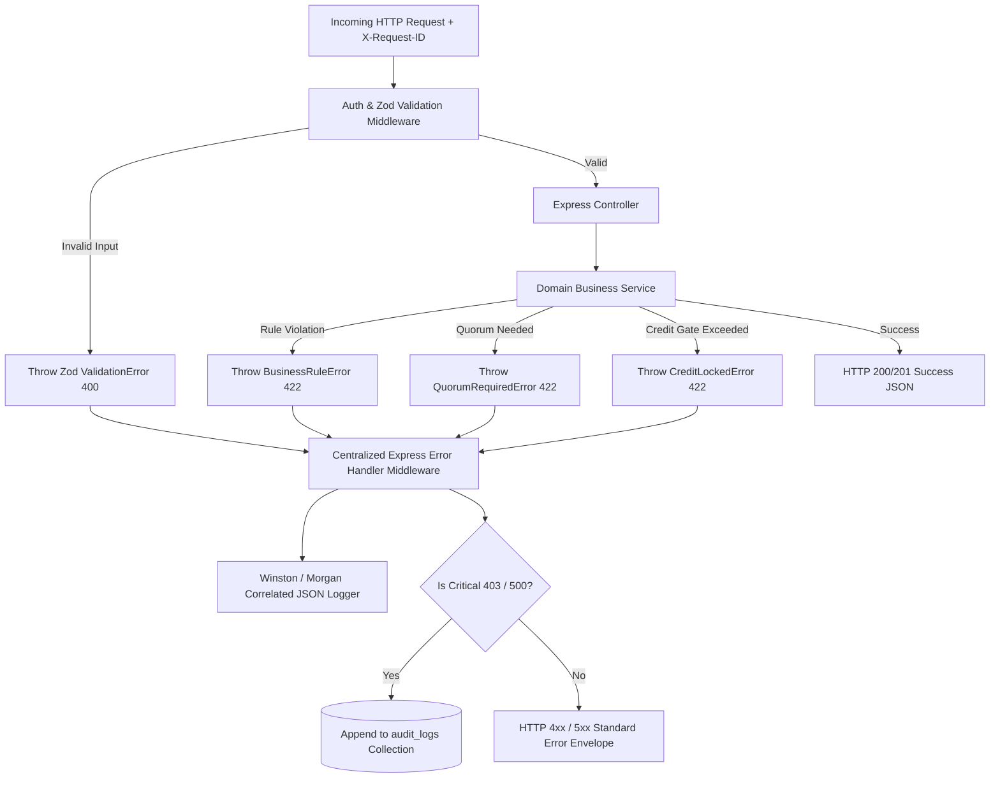
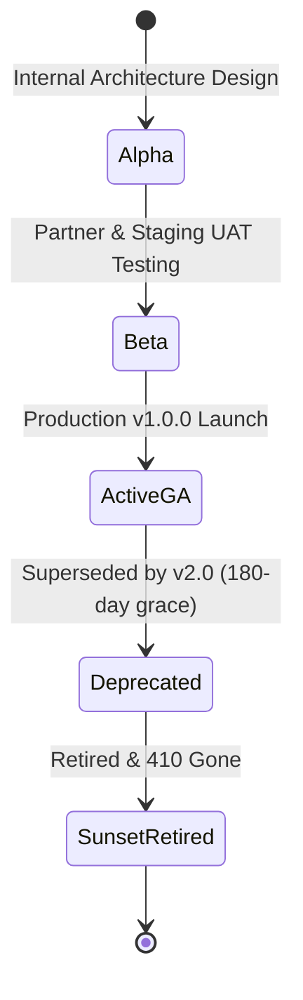

# Sun Bird Corporation — RESTful API Specification (v1.0)
## Complete End-to-End Enterprise API Documentation & Contract Blueprint

- **Platform:** Sun Bird Corporation Integrated Cloud ERP, E-Commerce, POS & AI Platform
- **Base URL:** `https://api.sunbirdcorp.com/api/v1` (Production) / `http://localhost:5000/api/v1` (Development)
- **Architecture Baseline:** [`architecture.md`](file:///e:/Documents/Sun%20Bird%20Corporation/architecture.md) (Layered Monolith Pattern)
- **Database Baseline:** [`Database-Schema.md`](file:///e:/Documents/Sun%20Bird%20Corporation/Database-Schema.md) (35 MongoDB Atlas Collections) & [`Database.md`](file:///e:/Documents/Sun%20Bird%20Corporation/Database.md)
- **Product Requirements Baseline:** [`prd.md`](file:///e:/Documents/Sun%20Bird%20Corporation/prd.md) (v1.3 / v2.1)
- **Format:** OpenAPI 3.0-aligned Markdown Specification
- **Security:** JWT (15m Access Token) + HTTP-Only Rotating Refresh Token (7d) + TOTP MFA + RBAC + Cryptographic Quorum Signatures

---

## 📑 Global API Index & Navigation

1. [Global Architectural Standards & Security Protocols](#1-global-architectural-standards--security-protocols)
   - 1.1 Base URLs & Route Segregation
   - 1.2 Authentication & Token Lifecycles
   - 1.3 Idempotency Standards (`X-Idempotency-Key`)
   - 1.4 API Version Control & Deprecation Strategy
   - 1.5 Enterprise Error Handling Framework & Error Code Catalog
   - 1.6 Pagination, Sorting & Filtering Standards
2. [Module 1: Authentication, Access Control & RBAC](#2-module-1-authentication-access-control--rbac)
   - Collections: `users`, `roles`, `refresh_tokens`
3. [Module 2: Products & Inventory Management](#3-module-2-products--inventory-management)
   - Collections: `products`, `uom_conversions`, `product_batches`, `unit_serials`, `stock_ledger`
4. [Module 3: Procurement & Import Supply Chain](#4-module-3-procurement--import-supply-chain)
   - Collections: `suppliers`, `supplier_quotations`, `comparative_statements`, `purchase_orders`, `import_lcs`, `landed_costs`
5. [Module 4: Sales, E-Commerce, POS & Logistics Distribution](#5-module-4-sales-e-commerce-pos--logistics-distribution)
   - Collections: `customers`, `customer_credit_profiles`, `orders`, `delivery_challans`, `sales_invoices`, `courier_consignments`
6. [Module 5: Accounting, General Ledger, Fixed Assets & Loans](#6-module-5-accounting-general-ledger-fixed-assets--loans)
   - Collections: `chart_of_accounts`, `journal_entries`, `fixed_assets`, `loans`, `partners`
7. [Module 6: Human Resources & Geofenced Payroll Engine](#7-module-6-human-resources--geofenced-payroll-engine)
   - Collections: `employee_profiles`, `attendance_punches`, `payroll_runs`
8. [Module 7: Quorum Approvals, Governance, CRM & System Auxiliaries](#8-module-7-quorum-approvals-governance-crm--system-auxiliaries)
   - Collections: `quorum_approvals`, `approval_requests`, `crm_activities`, `audit_logs`, `warehouses`, `counters`, `idempotency_keys`
9. [Module 8: External Gateways & Asynchronous Webhooks](#9-module-8-external-gateways--asynchronous-webhooks)
   - Integrations: SSLCOMMERZ IPN, Pathao Webhook, Steadfast Webhook
10. [Module 9: Enterprise Error Handling Architecture & Express.js Implementation Pattern](#10-module-9-enterprise-error-handling-architecture--expressjs-implementation-pattern)
    - 10.1 Global Error Pipeline Architecture
    - 10.2 TypeScript Custom Exception Hierarchy
    - 10.3 Centralized Express.js Error Handler Middleware
    - 10.4 Schema Validation Mapping (Zod / Joi)
11. [Module 10: API Version Control, Deprecation Policy & Evolution Changelog](#11-module-10-api-version-control-deprecation-policy--evolution-changelog)
    - 11.1 Semantic Versioning & Non-Breaking Rules
    - 11.2 RFC 8594 Sunset & Deprecation Protocol
    - 11.3 Version Lifecycle Timeline
    - 11.4 Version History & Changelog Table

---

## 1. Global Architectural Standards & Security Protocols

### 1.1 Base URLs & Route Segregation
The API strictly isolates public consumer traffic from private internal ERP operations and portal users:

| Route Prefix | Target Audience | Authentication Mechanism | Rate Limiting |
|---|---|---|---|
| `/api/v1/public/*` | Storefront visitors, guest checkouts | Public / Optional Customer JWT | 120 req / min per IP |
| `/api/v1/erp/*` | Internal Staff, Accountants, Officers, Admins | Bearer JWT + RBAC Permissions | 300 req / min per User |
| `/api/v1/portal/reseller/*` | Verified B2B Resellers | Bearer JWT (`RESELLER` scope) | 120 req / min |
| `/api/v1/portal/vendor/*` | Verified Foreign & Local Suppliers | Bearer JWT (`VENDOR` scope) | 120 req / min |
| `/api/v1/portal/employee/*`| Internal Staff Self-Service (Punches, Slips) | Bearer JWT (`STAFF` scope) | 60 req / min |
| `/api/v1/webhooks/*` | SSLCOMMERZ, Pathao, Steadfast Gateways | HMAC Signature / Webhook Token | 600 req / min |

### 1.2 Authentication & Token Lifecycles
1. **Access Token:** Short-lived JWT (15-minute expiry). Passed via header: `Authorization: Bearer <accessToken>`.
2. **Refresh Token:** Long-lived (7-day expiry). Stored in MongoDB collection `refresh_tokens` as SHA-256 hash. Transmitted strictly via secure `HttpOnly; SameSite=Strict; Path=/api/v1/auth; Secure` cookie.
3. **MFA (TOTP):** Required for `SUPER_ADMIN` and `DIRECTOR` roles on sensitive financial, quorum, or configuration endpoints. Header: `X-MFA-Code: 123456`.
4. **Hardware Fingerprint:** Director endpoints log device binding fingerprints via `X-Device-Fingerprint` header.

### 1.3 Idempotency Standards (`X-Idempotency-Key`)
To prevent duplicate financial charges, duplicate payroll dispatches, or duplicate warehouse deductions during network retries, all `POST` operations on Orders, Payments, Journal Entries, Payroll Runs, and Stock Adjustments **REQUIRE** an idempotency key:
- Header: `X-Idempotency-Key: <UUIDv4>`
- Handled via `idempotency_keys` collection with MongoDB TTL auto-cleanup (24 hours).

### 1.4 API Version Control & Deprecation Strategy

Sun Bird Corporation's API follows strict **URI Path Versioning** coupled with **Semantic Versioning (SemVer 2.0)** and RFC 8594 deprecation standards.

#### Versioning Principles
1. **URI Path Segregation:** All endpoints include the major version identifier in their URL path:  
   `/api/v1/*` (Current active stable baseline)  
   Any future breaking changes will be isolated under `/api/v2/*`, allowing legacy clients (Showroom POS terminals, mobile PWAs) to operate without disruption during migration.
2. **Semantic Versioning Semantics:**
   - **MAJOR (v1 → v2):** Breaking changes (field removals, type mutations, strict auth requirement additions, response envelope restructure).
   - **MINOR (v1.0 → v1.1):** Backward-compatible feature additions (new optional request fields, new endpoints, additional filter parameters).
   - **PATCH (v1.0.0 → v1.0.1):** Backward-compatible bug fixes, performance optimizations, index adjustments.
3. **Client Version Request Header (Optional):**
   - Header: `X-API-Version: 1.0.0`
   - If omitted, the server routes the request to the latest stable deployment of the major version path (`/api/v1`).
4. **RFC 8594 Sunset & Deprecation Protocol:**
   When an API endpoint or version is marked for retirement:
   - Response Header `Deprecation: @<UnixTimestamp>`: Declares the date when the endpoint became officially deprecated.
   - Response Header `Sunset: <HTTP-Date>`: Declares the final cutoff date when the endpoint will cease responding.
   - Response Header `Link: <https://docs.sunbirdcorp.com/api/v2-migration>; rel="sunset"`: Link to migration guidance.
   - **Minimum Deprecation Window:** Sun Bird Corporation enforces a mandatory **180-day grace period** between deprecation announcement and sunset shutdown.

---

### 1.5 Enterprise Error Handling Framework & Error Code Catalog

The platform implements a unified, RFC 7807-aligned error architecture. Every unhandled exception, validation fault, or business rule violation returns a standardized error envelope correlated with a unique `requestId` for instantaneous tracing across application logs and MongoDB audit trails.

#### Standard Error Response Envelope (HTTP 4xx / 5xx)
```json
{
  "success": false,
  "statusCode": 422,
  "error": {
    "code": "DOUBLE_ENTRY_IMBALANCE",
    "message": "Double-entry accounting transaction is mathematically unbalanced",
    "details": [
      {
        "field": "totalDebit",
        "value": 115000.00,
        "issue": "Debit sum (115000.00) does not equal credit sum (112000.00). Variance: 3000.00 BDT"
      }
    ]
  },
  "requestId": "req_8f14b30e-7c5a-4b92-b439-d8926a84ef12",
  "timestamp": "2026-10-18T13:00:00.000Z",
  "path": "/api/v1/erp/accounts/journals"
}
```

#### Correlated Request Tracking
- All incoming requests receive or inherit an `X-Request-ID: <UUIDv4>` header.
- The `requestId` is logged in Winston / Morgan JSON logs and included in all 4xx/5xx responses to facilitate maker-checker customer support triage.

#### Comprehensive Error Taxonomy & Domain Catalog

| HTTP Status | Error Code | Category / Domain | Business Trigger Condition |
|:---:|---|---|---|
| **400** | `BAD_REQUEST` | Validation | Request body contains malformed JSON or unparseable payload |
| **400** | `VALIDATION_FAILED` | Validation | Input fails Zod/Joi schema rules (e.g. invalid email, missing required field) |
| **400** | `INVALID_HS_CODE` | Inventory | Provided HS code does not match 8-digit NBR customs tariff format |
| **401** | `AUTH_UNAUTHORIZED` | Security | Missing, invalid, or expired JWT access token |
| **401** | `AUTH_TOKEN_EXPIRED` | Security | JWT access token expired (>15 minutes); client must call `/refresh-token` |
| **401** | `AUTH_MFA_REQUIRED` | Security | Action requires valid 6-digit TOTP code in `X-MFA-Code` header |
| **401** | `AUTH_SESSION_REVOKED`| Security | Refresh token has been revoked or token reuse hijack detected |
| **403** | `AUTH_FORBIDDEN` | RBAC | User's role lacks module permission (e.g. Sales staff creating JV) |
| **403** | `TENANT_SCOPE_VIOLATION`| Security | Showroom staff attempting to dispatch stock from an unassigned warehouse |
| **403** | `DIRECTOR_MFA_BINDING`| Security | Director signature attempted without registered hardware fingerprint |
| **404** | `RESOURCE_NOT_FOUND` | System | Specified document ID does not exist in collection |
| **404** | `SKU_NOT_FOUND` | Inventory | Referenced SKU does not exist in `products` catalog |
| **409** | `DUPLICATE_KEY_CONFLICT`| Integrity | MongoDB unique key violation (duplicate email, mobile, or voucherNo) |
| **409** | `IDEMPOTENCY_CONFLICT` | Idempotency | Identical `X-Idempotency-Key` submitted while previous request is still in-flight |
| **409** | `OPTIMISTIC_LOCK_ERROR`| Concurrency | Concurrent batch stock modification conflict; retry required |
| **422** | `INSUFFICIENT_STOCK` | Inventory | Requested quantity exceeds available `currentQty` in warehouse batch |
| **422** | `BATCH_EXPIRED` | Inventory | FEFO validation: batch has passed its `expiryDate` and cannot be sold |
| **422** | `CREDIT_LOCKED` | Sales | B2B customer credit limit exceeded or invoice overdue > creditTermDays |
| **422** | `DOUBLE_ENTRY_IMBALANCE`| Accounting | Journal line sum of debits does not equal sum of credits |
| **422** | `COA_ACCOUNT_INACTIVE` | Accounting | Target chart of accounts code is archived or inactive |
| **422** | `PERIOD_LOCKED` | Accounting | Attempt to post transaction to a closed/reconciled accounting fiscal month |
| **422** | `QUORUM_REQUIRED` | Governance | Document value exceeds single-officer limit; requires multi-director sign-off |
| **422** | `GEOFENCE_VIOLATION` | HRM | Employee mobile attendance punch recorded outside 50-meter warehouse radius |
| **422** | `MINIMUM_WAGE_FLOOR` | HRM | Computed monthly salary net pay falls below statutory labor floor |
| **429** | `RATE_LIMIT_EXCEEDED` | Gateway | Client exceeded API rate limit; response includes `Retry-After: <seconds>` |
| **500** | `INTERNAL_SERVER_ERROR`| Server | Unhandled server runtime exception (error details masked in production) |
| **502** | `GATEWAY_ERROR` | Integration | External partner API failure (SSLCOMMERZ, Pathao, or BulkSMSBD error) |
| **503** | `SERVICE_UNAVAILABLE` | System | Database connection pool exhausted or platform in maintenance mode |

---

### 1.6 Pagination, Sorting & Filtering Standards
All list endpoints (`GET`) accept the following standard query parameters:
- `page` (integer, default: `1`): 1-indexed page number.
- `limit` (integer, default: `20`, max: `100`): Records per page.
- `sort` (string, default: `-createdAt`): Prefix with `-` for descending sort.
- `search` (string): Text search across indexed fields.
- `fields` (string, optional): Comma-separated field projection (e.g. `fields=sku,nameEn,retailPrice`).

---

## 2. Module 1: Authentication, Access Control & RBAC
> **Collections Covered:** `users`, `roles`, `refresh_tokens`

### 2.1 Customer Mobile OTP Request
- **Path:** `POST /api/v1/public/auth/send-otp`
- **Auth:** Public
- **Description:** Sends a 6-digit OTP to the customer's mobile number via BulkSMSBD / Greenweb gateway.

#### Request Body
```json
{
  "mobile": "01711000000",
  "purpose": "LOGIN"
}
```

#### Response (200 OK)
```json
{
  "success": true,
  "statusCode": 200,
  "message": "OTP sent successfully to 01711000000",
  "data": {
    "mobile": "01711000000",
    "expiresInSeconds": 180
  }
}
```

---

### 2.2 Customer Mobile OTP Verification
- **Path:** `POST /api/v1/public/auth/verify-otp`
- **Auth:** Public
- **Description:** Verifies OTP code, generates customer user record if first-time visitor, sets HTTP-Only refresh token cookie, and returns access token.

#### Request Body
```json
{
  "mobile": "01711000000",
  "otp": "492817",
  "fullName": "Rahim Ahmed"
}
```

#### Response (200 OK)
```json
{
  "success": true,
  "statusCode": 200,
  "message": "Authentication successful",
  "data": {
    "accessToken": "eyJhbGciOiJIUzI1NiIsIn...",
    "user": {
      "_id": "67128a1c9e81f12345678901",
      "fullName": "Rahim Ahmed",
      "mobile": "01711000000",
      "userType": "CUSTOMER"
    }
  }
}
```

---

### 2.3 ERP Staff / Director Password Login
- **Path:** `POST /api/v1/erp/auth/login`
- **Auth:** Public (ERP Gateway)
- **Headers:** `X-Device-Fingerprint: <hash>` (Optional for Staff, Mandatory for Directors)
- **Description:** Authenticates ERP staff via email/mobile and bcrypt password hash. If Director/SuperAdmin, returns `mfaRequired: true` unless TOTP header is provided.

#### Request Body
```json
{
  "email": "director.finance@sunbirdcorp.com",
  "password": "SecurePassword123#",
  "totpCode": "849201"
}
```

#### Response (200 OK)
```json
{
  "success": true,
  "statusCode": 200,
  "message": "ERP Login successful",
  "data": {
    "accessToken": "eyJhbGciOiJIUzI1NiIsIn...",
    "user": {
      "_id": "67128a1c9e81f12345678902",
      "fullName": "Farhana Yasmin",
      "email": "director.finance@sunbirdcorp.com",
      "userType": "DIRECTOR",
      "role": {
        "roleName": "Director of Finance",
        "slug": "director_finance"
      },
      "branchId": "67128a1c9e81f12345678903"
    }
  }
}
```

---

### 2.4 Token Refresh & Token Family Rotation
- **Path:** `POST /api/v1/auth/refresh-token`
- **Auth:** Public (reads `refreshToken` HTTP-Only Cookie)
- **Description:** Rotates refresh token in `refresh_tokens` collection with family reuse detection (detects token hijacking). Emits new access token and new refresh cookie.

#### Response (200 OK)
```json
{
  "success": true,
  "statusCode": 200,
  "message": "Token refreshed successfully",
  "data": {
    "accessToken": "eyJhbGciOiJIUzI1NiIsIn..."
  }
}
```

---

### 2.5 User Logout & Session Revocation
- **Path:** `POST /api/v1/auth/logout`
- **Auth:** Bearer JWT or Refresh Token Cookie
- **Description:** Revokes current refresh token (`isRevoked: true`), clears refresh cookie from client browser.

#### Response (200 OK)
```json
{
  "success": true,
  "statusCode": 200,
  "message": "Session terminated successfully"
}
```

---

### 2.6 User Master Management (CRUD)
- **Path:** `GET /api/v1/erp/users`
- **Path:** `POST /api/v1/erp/users`
- **Path:** `GET /api/v1/erp/users/:id`
- **Path:** `PUT /api/v1/erp/users/:id`
- **Auth:** Bearer JWT (`users:READ`, `users:CREATE`, `users:UPDATE`)
- **Query Params (GET):** `page`, `limit`, `userType`, `branchId`, `isActive`, `search`

#### Request Body (`POST /api/v1/erp/users`)
```json
{
  "fullName": "Tanvir Hasan",
  "email": "tanvir.sales@sunbirdcorp.com",
  "mobile": "01819000001",
  "password": "InitialStaffPassword#2026",
  "userType": "STAFF",
  "roleId": "67128a1c9e81f12345678910",
  "branchId": "67128a1c9e81f12345678920",
  "warehouseId": "67128a1c9e81f12345678930"
}
```

#### Response (201 Created)
```json
{
  "success": true,
  "statusCode": 201,
  "message": "User created successfully",
  "data": {
    "_id": "67128a1c9e81f12345678940",
    "fullName": "Tanvir Hasan",
    "email": "tanvir.sales@sunbirdcorp.com",
    "mobile": "01819000001",
    "userType": "STAFF",
    "isActive": true,
    "createdAt": "2026-10-18T13:05:00.000Z"
  }
}
```

---

### 2.7 RBAC Role Management
- **Path:** `GET /api/v1/erp/roles`
- **Path:** `POST /api/v1/erp/roles`
- **Path:** `PUT /api/v1/erp/roles/:id`
- **Auth:** Bearer JWT (`roles:READ`, `roles:MANAGE`)

#### Request Body (`POST /api/v1/erp/roles`)
```json
{
  "roleName": "Showroom POS Cashier",
  "slug": "pos_cashier",
  "description": "Showroom billing, walk-in sales, and cash register",
  "permissions": [
    {
      "module": "INVENTORY",
      "actions": ["READ"]
    },
    {
      "module": "SALES",
      "actions": ["CREATE", "READ", "UPDATE"]
    }
  ]
}
```

---

## 3. Module 2: Products & Inventory Management
> **Collections Covered:** `products`, `uom_conversions`, `product_batches`, `unit_serials`, `stock_ledger`

### 3.1 Public Storefront Product Catalog
- **Path:** `GET /api/v1/public/products`
- **Auth:** Public
- **Query Params:** `category`, `brand`, `search`, `page`, `limit`, `sort`, `inStockOnly`
- **Description:** Returns list of active retail products. Includes bilingual names, public MRP, stock status badge, and Gemini-generated SEO description.

#### Response (200 OK)
```json
{
  "success": true,
  "statusCode": 200,
  "data": [
    {
      "_id": "67128a1c9e81f12345678950",
      "sku": "MED-USG-CHISON-Q9",
      "nameEn": "Chison Q9 Color Doppler Ultrasound Machine",
      "nameBn": "কাইসন কিউ৯ কালার ডপলার আল্ট্রাসাউন্ড মেশিন",
      "category": "MEDICAL_EQUIPMENT",
      "brand": "Chison",
      "baseUom": "Unit",
      "retailPrice": 1250000.00,
      "inStock": true,
      "isMedical": true,
      "barcodes": ["8941234567890"],
      "seoContent": {
        "metaTitle": "Chison Q9 Ultrasound Machine in Bangladesh — Sun Bird Corp",
        "descriptionEn": "High-resolution 4D color doppler ultrasound machine for clinical diagnostics."
      }
    }
  ],
  "meta": {
    "page": 1,
    "limit": 20,
    "total": 450,
    "totalPages": 23
  }
}
```

---

### 3.2 ERP Product Master Create & Update
- **Path:** `POST /api/v1/erp/products`
- **Path:** `PUT /api/v1/erp/products/:id`
- **Auth:** Bearer JWT (`products:CREATE`, `products:UPDATE`)
- **Description:** Registers new SKU with 8-digit NBR HS Code, tiered pricing, bilingual Mushak-6.3 name, and expiry tracking flags.

#### Request Body (`POST /api/v1/erp/products`)
```json
{
  "sku": "MED-SYR-5ML-DISP",
  "nameEn": "Disposable Syringe 5ml with Needle",
  "nameBn": "ডিসপোজেবল সিরিঞ্জ ৫ মি.লি.",
  "category": "MEDICAL_DISPOSABLES",
  "hsCode": "9018.31.00",
  "baseUom": "Piece",
  "brand": "BD Medical",
  "isMedical": true,
  "isExpirable": true,
  "minStockQty": 5000,
  "retailPrice": 12.00,
  "showroomPrice": 10.50,
  "resellerTierPrices": [
    { "tier": 1, "price": 9.50 },
    { "tier": 2, "price": 9.00 },
    { "tier": 3, "price": 8.50 }
  ],
  "barcodes": ["8901234500018"]
}
```

---

### 3.3 Multi-UOM Conversion Rule Setup
- **Path:** `POST /api/v1/erp/uom-conversions`
- **Auth:** Bearer JWT (`products:MANAGE`)
- **Description:** Sets Carton → Box → Piece multipliers per SKU.

#### Request Body
```json
{
  "productId": "67128a1c9e81f12345678950",
  "sku": "MED-SYR-5ML-DISP",
  "fromUom": "Carton",
  "toUom": "Box",
  "conversionFactor": 20.0
}
```

---

### 3.4 Product Batch Inventory & FEFO Allocation
- **Path:** `GET /api/v1/erp/inventory/batches`
- **Path:** `POST /api/v1/erp/inventory/batches`
- **Auth:** Bearer JWT (`inventory:READ`, `inventory:MANAGE`)
- **Query Params (GET):** `sku`, `warehouseId`, `nearExpiryDays`, `sortByExpiry` (FEFO)
- **Description:** Manages individual manufacturing/import batches, available quantity, TTL reserved quantity, and moving WAC unit cost.

#### Response (200 OK — FEFO Sort)
```json
{
  "success": true,
  "statusCode": 200,
  "data": [
    {
      "_id": "67128a1c9e81f12345678960",
      "sku": "MED-SYR-5ML-DISP",
      "batchNumber": "BAT-2026-08A",
      "category": "EXPIRY_CONTROLLED",
      "expiryDate": "2027-08-31T00:00:00.000Z",
      "currentQty": 15000,
      "reservedQty": 2000,
      "unitCost": 6.85,
      "warehouseId": {
        "_id": "67128a1c9e81f12345678920",
        "warehouseName": "Dhaka Central Warehouse"
      }
    }
  ]
}
```

---

### 3.5 Individual Equipment Serial Number Management
- **Path:** `POST /api/v1/erp/inventory/serials`
- **Path:** `GET /api/v1/erp/inventory/serials/:serialNumber`
- **Path:** `POST /api/v1/public/warranty/verify`
- **Auth:** Bearer JWT (`inventory:MANAGE`) / Public for warranty verification
- **Description:** Binds individual serial number to a batch, records QR code, tracks sold-to hospital customer, and manages warranty certificate.

#### Request Body (`POST /api/v1/erp/inventory/serials`)
```json
{
  "serialNumber": "SN-USG-2026-00481",
  "productId": "67128a1c9e81f12345678950",
  "batchId": "67128a1c9e81f12345678960",
  "qrCodeData": "https://sunbirdcorp.com/verify/SN-USG-2026-00481",
  "warrantyMonths": 24
}
```

---

### 3.6 Inventory Movement Ledger (Audit Journal)
- **Path:** `GET /api/v1/erp/inventory/ledger`
- **Path:** `POST /api/v1/erp/inventory/movements`
- **Auth:** Bearer JWT (`inventory:READ`, `inventory:MUTATE`)
- **Headers:** `X-Idempotency-Key: <UUIDv4>`
- **Description:** Immutable stock journal. Logs stock IN (GRN), OUT (Delivery Challan), TRANSFER (between warehouses), or ADJUSTMENT (physical audit variance).

#### Request Body (`POST /api/v1/erp/inventory/movements`)
```json
{
  "sku": "MED-SYR-5ML-DISP",
  "batchId": "67128a1c9e81f12345678960",
  "warehouseId": "67128a1c9e81f12345678920",
  "movementType": "ADJUSTMENT",
  "qtyChange": -50,
  "unitCost": 6.85,
  "referenceNo": "AUDIT-2026-Q3-01",
  "referenceType": "ADJUSTMENT",
  "notes": "Damaged cartons during warehouse handling"
}
```

---

## 4. Module 3: Procurement & Import Supply Chain
> **Collections Covered:** `suppliers`, `supplier_quotations`, `comparative_statements`, `purchase_orders`, `import_lcs`, `landed_costs`

### 4.1 Supplier & Vendor Master Management
- **Path:** `GET /api/v1/erp/procurement/suppliers`
- **Path:** `POST /api/v1/erp/procurement/suppliers`
- **Path:** `PUT /api/v1/erp/procurement/suppliers/:id`
- **Auth:** Bearer JWT (`procurement:READ`, `procurement:MANAGE`)
- **Description:** Maintains local and international vendor directories, payment terms, currency preferences, and Gemini AI risk scores.

#### Request Body (`POST /api/v1/erp/procurement/suppliers`)
```json
{
  "supplierCode": "SUP-INTL-CHISON-01",
  "companyName": "Chison Medical Technologies Co., Ltd.",
  "contactPerson": "Chen Wei",
  "email": "export@chison.com.cn",
  "phone": "+86-510-85345999",
  "country": "China",
  "currency": "USD",
  "supplierType": "FOREIGN",
  "paymentTerms": "100% Sight LC",
  "bankDetails": "Bank of China, Wuxi Branch, SWIFT: BKCHCNBJ920"
}
```

---

### 4.2 RFQ Bid Quotation Submission
- **Path:** `POST /api/v1/portal/vendor/quotations`
- **Path:** `GET /api/v1/erp/procurement/quotations`
- **Auth:** Bearer JWT (`VENDOR` portal token or ERP `procurement:MANAGE`)
- **Description:** Registers supplier bid quotations per RFQ tender.

#### Request Body
```json
{
  "rfqNumber": "RFQ-2026-0042",
  "supplierId": "67128a1c9e81f12345678970",
  "productId": "67128a1c9e81f12345678950",
  "sku": "MED-USG-CHISON-Q9",
  "unitPrice": 8500.00,
  "currency": "USD",
  "leadTimeDays": 25,
  "paymentTerms": "100% Sight LC",
  "validUntil": "2026-11-30T23:59:59.000Z"
}
```

---

### 4.3 100-Point Comparative Statement (CS) & AI Evaluation
- **Path:** `POST /api/v1/erp/procurement/comparative-statements`
- **Path:** `POST /api/v1/erp/procurement/comparative-statements/:id/generate-ai-summary`
- **Path:** `PUT /api/v1/erp/procurement/comparative-statements/:id/finalize`
- **Auth:** Bearer JWT (`procurement:MANAGE`, `procurement:APPROVE`)
- **Description:** Aggregates bids, runs 100-point weighted scoring (Price: 50, Lead time: 25, Terms: 15, Vendor history: 10), and prompts Gemini AI CS Advisor for risk summary.

#### Response (200 OK — with AI Recommendation)
```json
{
  "success": true,
  "statusCode": 200,
  "data": {
    "csNumber": "CS-2026-00012",
    "sku": "MED-USG-CHISON-Q9",
    "bids": [
      {
        "supplierName": "Chison Medical Technologies Co., Ltd.",
        "unitPrice": 8500.00,
        "currency": "USD",
        "leadTimeDays": 25,
        "totalScore": 92.5,
        "isRecommended": true
      },
      {
        "supplierName": "Shenzhen Mindray Bio-Medical",
        "unitPrice": 9200.00,
        "currency": "USD",
        "leadTimeDays": 30,
        "totalScore": 79.0,
        "isRecommended": false
      }
    ],
    "aiSummary": "Chison offers superior pricing (8.2% lower) and a 5-day faster lead time with high historical reliability. Recommend awarding PO to Chison under 100% Sight LC.",
    "status": "DRAFT"
  }
}
```

---

### 4.4 Procurement Purchase Order (PO) Creation
- **Path:** `POST /api/v1/erp/procurement/purchase-orders`
- **Path:** `GET /api/v1/erp/procurement/purchase-orders/:id`
- **Auth:** Bearer JWT (`procurement:CREATE`, `procurement:APPROVE`)
- **Headers:** `X-Idempotency-Key: <UUIDv4>`
- **Description:** Generates PO from approved CS. Triggers Quorum Approval if PO grand total exceeds delegated thresholds (>5 Lakh: Tier 2, >10 Lakh: Tier 3 Quorum, >50 Lakh: Tier 4 Quorum).

#### Request Body
```json
{
  "csId": "67128a1c9e81f12345678980",
  "supplierId": "67128a1c9e81f12345678970",
  "deliveryDeadline": "2026-12-15T00:00:00.000Z",
  "currency": "USD",
  "exchangeRate": 122.50,
  "items": [
    {
      "productId": "67128a1c9e81f12345678950",
      "sku": "MED-USG-CHISON-Q9",
      "productName": "Chison Q9 Color Doppler",
      "quantity": 5,
      "uom": "Unit",
      "unitPrice": 8500.00,
      "lineTotal": 42500.00
    }
  ],
  "subtotal": 42500.00,
  "taxAmount": 0.00,
  "grandTotal": 42500.00,
  "paymentTerms": "100% Sight LC",
  "deliveryWarehouseId": "67128a1c9e81f12345678920"
}
```

---

### 4.5 Import Letter of Credit (LC) Tracking
- **Path:** `POST /api/v1/erp/procurement/import-lcs`
- **Path:** `PUT /api/v1/erp/procurement/import-lcs/:id/update-stage`
- **Auth:** Bearer JWT (`imports:MANAGE`)
- **Description:** Tracks LC opening, bank margin, amendment, bill of lading (BL), customs clearance, and demurrage penalties.

#### Request Body (`PUT /api/v1/erp/procurement/import-lcs/:id/update-stage`)
```json
{
  "status": "CUSTOMS_CLEARED",
  "demurrageDays": 0,
  "demurrageCostBDT": 0.00,
  "settlementRate": 123.10
}
```

---

### 4.6 Landed Cost Computation & Finalization
- **Path:** `POST /api/v1/erp/procurement/landed-costs`
- **Path:** `POST /api/v1/erp/procurement/landed-costs/:id/finalize`
- **Auth:** Bearer JWT (`finance:MANAGE`, `imports:MANAGE`)
- **Description:** Sums FOB/CFR value, customs duty (CD), regulatory duty (RD), VAT, AIT, port handling, and clearing charges. Allocates cost per SKU to determine exact landed unit cost for WAC inventory capitalization.

#### Request Body
```json
{
  "lcId": "67128a1c9e81f12345678990",
  "lcNumber": "LC-2026-00084",
  "fobValueBDT": 5231750.00,
  "customsDutyBDT": 523175.00,
  "regulatoryDutyBDT": 156952.50,
  "supplementaryDutyBDT": 0.00,
  "vatAmountBDT": 784762.50,
  "advanceIncomeTaxBDT": 261587.50,
  "advanceTaxBDT": 261587.50,
  "cnfAgentCharges": 45000.00,
  "portHandlingCharges": 85000.00,
  "inlandFreightCharges": 35000.00,
  "insuranceCostBDT": 65000.00,
  "bankChargesBDT": 28000.00,
  "allocationMethod": "BY_VALUE"
}
```

---

## 5. Module 4: Sales, E-Commerce, POS & Logistics Distribution
> **Collections Covered:** `customers`, `customer_credit_profiles`, `orders`, `delivery_challans`, `sales_invoices`, `courier_consignments`

### 5.1 Public E-Commerce Checkout
- **Path:** `POST /api/v1/public/checkout`
- **Auth:** Public (Guest Checkout) or Authenticated Customer JWT
- **Headers:** `X-Idempotency-Key: <UUIDv4>`
- **Description:** Validates stock reserves via Redis TTL lock, creates Order in `orders` collection, and returns SSLCOMMERZ gateway redirect URL or COD confirmation.

#### Request Body
```json
{
  "customerName": "Kamal Hossain",
  "customerMobile": "01911000002",
  "customerEmail": "kamal@gmail.com",
  "deliveryAddress": "House 12, Road 5, Dhanmondi, Dhaka",
  "district": "Dhaka",
  "paymentMethod": "ONLINE_SSLCOMMERZ",
  "items": [
    {
      "productId": "67128a1c9e81f12345678950",
      "sku": "MED-SYR-5ML-DISP",
      "productName": "Disposable Syringe 5ml",
      "quantity": 100,
      "unitPrice": 12.00,
      "lineTotal": 1200.00
    }
  ],
  "shippingFee": 80.00,
  "discountAmount": 0.00
}
```

#### Response (201 Created — SSLCOMMERZ Gateway Ready)
```json
{
  "success": true,
  "statusCode": 201,
  "message": "Order initiated successfully",
  "data": {
    "orderNo": "ORD-2026-00481",
    "grandTotal": 1280.00,
    "paymentMethod": "ONLINE_SSLCOMMERZ",
    "gatewayUrl": "https://sandbox.sslcommerz.com/EasyCheckOut/testcde123456789"
  }
}
```

---

### 5.2 B2B Customer Credit Profile & Hard-Limit Gate
- **Path:** `GET /api/v1/erp/sales/credit-profiles/:customerId`
- **Path:** `PUT /api/v1/erp/sales/credit-profiles/:customerId`
- **Path:** `POST /api/v1/erp/sales/credit-profiles/:customerId/override`
- **Auth:** Bearer JWT (`sales:READ`, `sales:CREDIT_OVERRIDE` requires Director)
- **Description:** Calculates real-time total exposure: $\text{Current Outstanding AR} + \text{Unbilled Dispatches}$. If exposure exceeds `creditLimitBDT` or invoice overdue exceeds `creditTermDays`, blocks dispatch unless Director override is supplied.

#### Response (200 OK)
```json
{
  "success": true,
  "statusCode": 200,
  "data": {
    "customerId": "67128a1c9e81f12345678915",
    "companyName": "Square Hospital Ltd.",
    "creditLimitBDT": 2000000.00,
    "creditTermDays": 30,
    "currentOutstandingAR": 1450000.00,
    "unbilledDispatches": 250000.00,
    "availableCredit": 300000.00,
    "isCreditLocked": false
  }
}
```

---

### 5.3 Showroom POS Terminal Direct Checkout
- **Path:** `POST /api/v1/erp/pos/checkout`
- **Path:** `POST /api/v1/erp/pos/sync-offline-batch`
- **Auth:** Bearer JWT (`pos:CHECKOUT`)
- **Headers:** `X-Idempotency-Key: <UUIDv4>`
- **Description:** Real-time barcode scan POS checkout. Deducts batch stock, generates Mushak-6.3 challan, generates tax invoice, and creates auto-balanced journal entry within one atomic transaction.

#### Request Body
```json
{
  "showroomWarehouseId": "67128a1c9e81f12345678930",
  "customerMobile": "01711999888",
  "customerName": "Walk-in Doctor",
  "paymentMethod": "CASH",
  "items": [
    {
      "sku": "MED-SYR-5ML-DISP",
      "batchId": "67128a1c9e81f12345678960",
      "quantity": 50,
      "unitPrice": 10.50,
      "lineTotal": 525.00
    }
  ],
  "paidAmount": 600.00,
  "changeAmount": 75.00
}
```

---

### 5.4 NBR Mushak-6.3 Delivery Challan Generation
- **Path:** `POST /api/v1/erp/sales/challans`
- **Path:** `GET /api/v1/erp/sales/challans/:id`
- **Path:** `GET /api/v1/erp/sales/challans/:id/print-mushak63`
- **Auth:** Bearer JWT (`sales:DISPATCH`)
- **Description:** Generates statutory NBR Mushak-6.3 delivery challan with sequential gapless number, vehicle number, dispatch time, and bilingual product descriptions.

#### Response (201 Created)
```json
{
  "success": true,
  "statusCode": 201,
  "data": {
    "challanNo": "CH-2026-00124",
    "orderId": "67128a1c9e81f12345678917",
    "mushakForm": "Mushak-6.3",
    "vehicleNo": "Dhaka Metro-Ta-11-2045",
    "dispatchTime": "2026-10-18T13:10:00.000Z",
    "status": "DISPATCHED"
  }
}
```

---

### 5.5 Courier Consignment Booking & Public AWB Tracking
- **Path:** `POST /api/v1/erp/logistics/consignments`
- **Path:** `GET /api/v1/public/track-order/:trackingCode`
- **Auth:** Bearer JWT (`sales:DISPATCH`) / Public for tracking
- **Description:** Dispatches order to Pathao or Steadfast courier API, stores AWB tracking code, and provides public shipment timeline.

#### Request Body (`POST /api/v1/erp/logistics/consignments`)
```json
{
  "orderId": "67128a1c9e81f12345678917",
  "courierProvider": "PATHAO",
  "recipientName": "Kamal Hossain",
  "recipientPhone": "01911000002",
  "recipientAddress": "House 12, Road 5, Dhanmondi, Dhaka",
  "recipientCity": "Dhaka",
  "recipientZone": "Dhanmondi",
  "codAmount": 1280.00,
  "itemWeightKg": 1.5
}
```

---

## 6. Module 5: Accounting, General Ledger, Fixed Assets & Loans
> **Collections Covered:** `chart_of_accounts`, `journal_entries`, `fixed_assets`, `loans`, `partners`

### 6.1 35-Code Chart of Accounts (COA)
- **Path:** `GET /api/v1/erp/accounts/coa`
- **Path:** `POST /api/v1/erp/accounts/coa`
- **Auth:** Bearer JWT (`accounts:READ`, `accounts:MANAGE`)
- **Description:** Retrieves hierarchical 35 standard Sun Bird COA accounts (1010 to 6510).

#### Response (200 OK — Sample COA Ledger)
```json
{
  "success": true,
  "statusCode": 200,
  "data": [
    { "accountCode": 1010, "accountName": "Cash on Hand", "accountType": "ASSET", "normalBalance": "DEBIT" },
    { "accountCode": 1100, "accountName": "Accounts Receivable — Trade Debtors", "accountType": "ASSET", "normalBalance": "DEBIT", "isControl": true },
    { "accountCode": 1200, "accountName": "Inventory Asset — Merchandise", "accountType": "ASSET", "normalBalance": "DEBIT" },
    { "accountCode": 2010, "accountName": "Accounts Payable — Trade Creditors", "accountType": "LIABILITY", "normalBalance": "CREDIT", "isControl": true },
    { "accountCode": 2050, "accountName": "VAT Payable (Mushak-6.3)", "accountType": "LIABILITY", "normalBalance": "CREDIT" },
    { "accountCode": 4010, "accountName": "Sales Revenue — Healthcare & Equipment", "accountType": "REVENUE", "normalBalance": "CREDIT" },
    { "accountCode": 5010, "accountName": "Cost of Goods Sold (COGS)", "accountType": "EXPENSE", "normalBalance": "DEBIT" }
  ]
}
```

---

### 6.2 Double-Entry Journal Entry Voucher Creation
- **Path:** `POST /api/v1/erp/accounts/journals`
- **Path:** `GET /api/v1/erp/accounts/journals/:voucherNo`
- **Path:** `POST /api/v1/erp/accounts/journals/:id/post`
- **Path:** `POST /api/v1/erp/accounts/journals/:id/reverse`
- **Auth:** Bearer JWT (`accounts:CREATE`, `accounts:POST`)
- **Headers:** `X-Idempotency-Key: <UUIDv4>`
- **Description:** Enforces strict mathematical balance: $\sum \text{debits} \equiv \sum \text{credits}$. Values >10 Lakh trigger Quorum Approval workflow before posting.

#### Request Body
```json
{
  "voucherType": "SALES",
  "transactionDate": "2026-10-18T13:00:00.000Z",
  "sourceDocumentRef": "INV-2026-00481",
  "lines": [
    {
      "accountId": "67128a1c9e81f123456789a1",
      "accountCode": 1100,
      "accountName": "Accounts Receivable — Trade Debtors",
      "debit": 115000.00,
      "credit": 0.00,
      "description": "Invoice INV-2026-00481 to Square Hospital"
    },
    {
      "accountId": "67128a1c9e81f123456789a2",
      "accountCode": 4010,
      "accountName": "Sales Revenue — Healthcare",
      "debit": 0.00,
      "credit": 100000.00,
      "description": "Taxable medical device sales"
    },
    {
      "accountId": "67128a1c9e81f123456789a3",
      "accountCode": 2050,
      "accountName": "VAT Payable (Mushak-6.3)",
      "debit": 0.00,
      "credit": 15000.00,
      "description": "15% NBR VAT on sales"
    }
  ],
  "totalDebit": 115000.00,
  "totalCredit": 115000.00
}
```

---

### 6.3 Financial Reports & Statements
- **Path:** `GET /api/v1/erp/accounts/reports/trial-balance`
- **Path:** `GET /api/v1/erp/accounts/reports/profit-loss`
- **Path:** `GET /api/v1/erp/accounts/reports/balance-sheet`
- **Path:** `GET /api/v1/erp/accounts/reports/general-ledger`
- **Auth:** Bearer JWT (`finance:REPORTS`)
- **Query Params:** `startDate`, `endDate`, `branchId`

---

### 6.4 Fixed Asset Register & SLM Depreciation Run
- **Path:** `POST /api/v1/erp/assets`
- **Path:** `POST /api/v1/erp/assets/run-depreciation`
- **Auth:** Bearer JWT (`finance:MANAGE`)
- **Description:** Runs automated monthly Straight-Line Method (SLM) depreciation on all active fixed assets, posting depreciation JV automatically.

---

### 6.5 Loan Management (Bank, Director, Employee)
- **Path:** `POST /api/v1/erp/loans`
- **Path:** `POST /api/v1/erp/loans/:id/repay`
- **Auth:** Bearer JWT (`finance:MANAGE`, `loans:APPROVE`)
- **Description:** Tracks principal, interest rate (supports 0% interest-free partner/employee loans), EMI repayment schedules, and outstanding balances.

---

### 6.6 Partnership Capital & Profit Distribution
- **Path:** `GET /api/v1/erp/partners`
- **Path:** `POST /api/v1/erp/partners/distribute-profit`
- **Auth:** Bearer JWT (`DIRECTOR` role + Quorum approval)
- **Description:** Computes net profit share per partner capital ratio and logs capital account journal adjustments.

---

## 7. Module 6: Human Resources & Geofenced Payroll Engine
> **Collections Covered:** `employee_profiles`, `attendance_punches`, `payroll_runs`

### 7.1 Employee Master & Salary Structure
- **Path:** `GET /api/v1/erp/hrm/employees`
- **Path:** `POST /api/v1/erp/hrm/employees`
- **Path:** `PUT /api/v1/erp/hrm/employees/:id`
- **Auth:** Bearer JWT (`hrm:READ`, `hrm:MANAGE`)

#### Request Body (`POST /api/v1/erp/hrm/employees`)
```json
{
  "userId": "67128a1c9e81f12345678940",
  "employeeCode": "EMP-2026-042",
  "department": "SALES",
  "designation": "Senior Sales Executive",
  "joiningDate": "2026-01-01T00:00:00.000Z",
  "basicSalary": 35000.00,
  "houseRentAllowance": 15000.00,
  "medicalAllowance": 5000.00,
  "conveyanceAllowance": 5000.00,
  "grossSalary": 60000.00,
  "salesCommissionRate": 1.5,
  "assignedWarehouseId": "67128a1c9e81f12345678920"
}
```

---

### 7.2 Mobile GPS Geofenced Attendance Punch
- **Path:** `POST /api/v1/portal/employee/punch`
- **Auth:** Bearer JWT (`STAFF` token)
- **Description:** Validates mobile GPS coordinates against assigned branch warehouse coordinates using Haversine formula (allowed radius: $\le 50$ meters). Flags late arrival against shift start.

#### Request Body
```json
{
  "punchType": "IN",
  "latitude": 23.7925,
  "longitude": 90.4078,
  "deviceUUID": "A1B2-C3D4-E5F6-7890"
}
```

#### Response (201 Created)
```json
{
  "success": true,
  "statusCode": 201,
  "message": "Clock-in recorded successfully",
  "data": {
    "punchDate": "2026-10-18",
    "punchTimestamp": "2026-10-18T08:55:12.000Z",
    "distanceMeters": 18.4,
    "isWithinGeofence": true,
    "isLate": false
  }
}
```

---

### 7.3 Monthly Payroll Processing & General Ledger Posting
- **Path:** `POST /api/v1/erp/hrm/payroll-runs/compute`
- **Path:** `POST /api/v1/erp/hrm/payroll-runs/post-gl`
- **Auth:** Bearer JWT (`payroll:MANAGE`, `payroll:APPROVE`)
- **Headers:** `X-Idempotency-Key: <UUIDv4>`
- **Description:** Computes gross salary + sales commissions (from realized paid orders) - late arrival deductions (3 late = 0.5 day salary) - LWP deductions - loan EMI repayments. Enforces statutory minimum wage floor. On approval, automatically generates balanced salary journal entry.

#### Response (200 OK — Batch Computation)
```json
{
  "success": true,
  "statusCode": 200,
  "message": "Monthly payroll computed for 45 employees",
  "data": {
    "monthYear": "2026-10",
    "totalGrossSalary": 2450000.00,
    "totalCommissions": 185000.00,
    "totalDeductions": 95000.00,
    "totalNetPay": 2540000.00,
    "status": "SUBMITTED"
  }
}
```

---

## 8. Module 7: Quorum Approvals, Governance, CRM & System Auxiliaries
> **Collections Covered:** `quorum_approvals`, `approval_requests`, `crm_activities`, `audit_logs`, `warehouses`, `counters`, `idempotency_keys`

### 8.1 Multi-Director Quorum Approvals (Tiers 3 & 4)
- **Path:** `GET /api/v1/erp/approvals/quorum`
- **Path:** `POST /api/v1/erp/approvals/quorum/:id/sign`
- **Path:** `POST /api/v1/erp/approvals/quorum/:id/emergency-override`
- **Auth:** Bearer JWT (`DIRECTOR` role required)
- **Headers:** `X-MFA-Code: 123456`, `X-Device-Fingerprint: <hash>`
- **Description:** High-value transactions (>10 Lakh = 2 Directors, >50 Lakh = 3 Directors) require cryptographic digital sign-off. Computes SHA-256 hash of document payload + director private secret.

#### Request Body (`POST /api/v1/erp/approvals/quorum/:id/sign`)
```json
{
  "directorRole": "DIRECTOR_FINANCE",
  "remarks": "Reviewed supplier quotes and LC margin availability. Approved.",
  "signatureHash": "e3b0c44298fc1c149afbf4c8996fb92427ae41e4649b934ca495991b7852b855"
}
```

#### Response (200 OK)
```json
{
  "success": true,
  "statusCode": 200,
  "message": "Quorum signature recorded",
  "data": {
    "quorumTier": 3,
    "requiredCount": 2,
    "currentSignaturesCount": 2,
    "isComplete": true,
    "completedAt": "2026-10-18T13:15:00.000Z"
  }
}
```

---

### 8.2 Workflow Approval Requests (Tiers 1 & 2)
- **Path:** `GET /api/v1/erp/approvals/requests`
- **Path:** `PUT /api/v1/erp/approvals/requests/:id/action`
- **Auth:** Bearer JWT (`approvals:CHECKER`)
- **Description:** Maker-Checker validation for POs, Expense vouchers, and Credit Limit overrides under 10 Lakh BDT.

---

### 8.3 CRM Leads & Customer Support Activities
- **Path:** `GET /api/v1/erp/crm/activities`
- **Path:** `POST /api/v1/erp/crm/activities`
- **Path:** `PUT /api/v1/erp/crm/activities/:id`
- **Auth:** Bearer JWT (`crm:MANAGE`)
- **Description:** Tracks hospital sales enquiries, scheduled doctor visits, and warranty service complaints.

#### Request Body (`POST /api/v1/erp/crm/activities`)
```json
{
  "activityType": "VISIT_LOG",
  "customerId": "67128a1c9e81f12345678915",
  "leadName": "Dr. Shamsul Alam (Head of Radiology)",
  "contactMobile": "01711223344",
  "notes": "Demonstrated Chison Q9 4D ultrasound probe. Client requested official quotation for 2 units.",
  "followUpDate": "2026-10-25T10:00:00.000Z"
}
```

---

### 8.4 Tamper-Proof Audit Trail (Append-Only)
- **Path:** `GET /api/v1/erp/audit-logs`
- **Auth:** Bearer JWT (`audit:READ` — Super Admin / Audit Committee only)
- **Query Params:** `actorId`, `targetCollection`, `targetId`, `action`, `startDate`, `endDate`
- **Description:** Read-only access to immutable database audit trail. Any attempt to modify or delete logs returns HTTP 403 Forbidden.

---

### 8.5 Multi-Warehouse & Showroom Branch Directory
- **Path:** `GET /api/v1/erp/warehouses`
- **Path:** `POST /api/v1/erp/warehouses`
- **Path:** `PUT /api/v1/erp/warehouses/:id`
- **Auth:** Bearer JWT (`warehouses:MANAGE`)

#### Request Body (`POST /api/v1/erp/warehouses`)
```json
{
  "warehouseCode": "WH-CENTRAL-01",
  "warehouseName": "Tejgaon Central Distribution Depot",
  "type": "CENTRAL_WAREHOUSE",
  "district": "Dhaka",
  "address": "24/A Tejgaon Industrial Area, Dhaka",
  "gpsLatitude": 23.7639,
  "gpsLongitude": 90.3889,
  "geofenceRadiusMeters": 50,
  "managerId": "67128a1c9e81f12345678940"
}
```

---

## 9. Module 8: External Gateways & Asynchronous Webhooks

### 9.1 SSLCOMMERZ Payment IPN Webhook
- **Path:** `POST /api/v1/webhooks/sslcommerz/ipn`
- **Auth:** SSLCOMMERZ Server Verification / IP Whitelist
- **Description:** Receives instant payment notification from SSLCOMMERZ. Verifies transaction with SSLCOMMERZ validation API, updates Order `paymentStatus` to `PAID`, triggers stock reserve commit, and posts automated Sales Receipt Journal Entry.

#### Request Payload
```json
{
  "tran_id": "ORD-2026-00481",
  "val_id": "261018131234567",
  "amount": "1280.00",
  "card_type": "BKASH-BKash",
  "store_amount": "1248.00",
  "bank_tran_id": "202610180001",
  "status": "VALID",
  "tran_date": "2026-10-18 13:12:45",
  "currency": "BDT",
  "verify_sign": "d41d8cd98f00b204e9800998ecf8427e"
}
```

#### Response (200 OK)
```json
{
  "success": true,
  "message": "IPN processed and order payment confirmed"
}
```

---

### 9.2 Pathao Courier Status Webhook
- **Path:** `POST /api/v1/webhooks/pathao/status`
- **Auth:** Webhook Secret Signature Verification (`X-Pathao-Signature`)
- **Description:** Updates `courier_consignments.deliveryStatus`. If marked `DELIVERED`, marks order as completed, triggers COD receivable reconciliation, and unlocks sales commission.

#### Request Payload
```json
{
  "consignment_id": "PT-2026-889123",
  "order_id": "ORD-2026-00481",
  "order_status": "Delivered",
  "collected_amount": 1280.00,
  "updated_at": "2026-10-20T16:30:00.000Z"
}
```

---

### 9.3 Steadfast Courier Status Webhook
- **Path:** `POST /api/v1/webhooks/steadfast/status`
- **Auth:** Steadfast API Key Header Verification
- **Description:** Synchronizes Steadfast shipment delivery and COD remittance collection.

---

## 📑 Complete API Route Summary Table (Cross-Referenced to 35 Collections)

| # | HTTP Method | Path | Target Domain | Collections Referenced | Auth Level | Idempotency |
|---|---|---|---|---|---|:---:|
| 1 | `POST` | `/api/v1/public/auth/send-otp` | Auth | `users` | Public | No |
| 2 | `POST` | `/api/v1/public/auth/verify-otp` | Auth | `users`, `refresh_tokens` | Public | No |
| 3 | `POST` | `/api/v1/erp/auth/login` | Auth | `users`, `roles`, `refresh_tokens` | Public (ERP) | No |
| 4 | `POST` | `/api/v1/auth/refresh-token` | Auth | `refresh_tokens` | Cookie | No |
| 5 | `POST` | `/api/v1/auth/logout` | Auth | `refresh_tokens` | Authenticated | No |
| 6 | `GET` | `/api/v1/erp/users` | Auth | `users` | Bearer (Staff) | No |
| 7 | `POST` | `/api/v1/erp/users` | Auth | `users` | Bearer (Admin) | No |
| 8 | `GET` | `/api/v1/erp/roles` | Auth | `roles` | Bearer (Admin) | No |
| 9 | `POST` | `/api/v1/erp/roles` | Auth | `roles` | Bearer (Admin) | No |
| 10 | `GET` | `/api/v1/public/products` | Catalog | `products` | Public | No |
| 11 | `GET` | `/api/v1/public/products/:id` | Catalog | `products` | Public | No |
| 12 | `POST` | `/api/v1/erp/products` | Catalog | `products` | Bearer (Staff) | No |
| 13 | `PUT` | `/api/v1/erp/products/:id` | Catalog | `products` | Bearer (Staff) | No |
| 14 | `POST` | `/api/v1/erp/uom-conversions` | Inventory | `uom_conversions` | Bearer (Staff) | No |
| 15 | `GET` | `/api/v1/erp/inventory/batches` | Inventory | `product_batches` | Bearer (Staff) | No |
| 16 | `POST` | `/api/v1/erp/inventory/batches` | Inventory | `product_batches` | Bearer (Staff) | Yes |
| 17 | `POST` | `/api/v1/erp/inventory/serials` | Inventory | `unit_serials` | Bearer (Staff) | Yes |
| 18 | `GET` | `/api/v1/erp/inventory/ledger` | Inventory | `stock_ledger` | Bearer (Staff) | No |
| 19 | `POST` | `/api/v1/erp/inventory/movements` | Inventory | `stock_ledger`, `product_batches` | Bearer (Staff) | Yes |
| 20 | `GET` | `/api/v1/erp/procurement/suppliers`| Procurement | `suppliers` | Bearer (Staff) | No |
| 21 | `POST` | `/api/v1/erp/procurement/suppliers`| Procurement | `suppliers` | Bearer (Staff) | No |
| 22 | `POST` | `/api/v1/portal/vendor/quotations`| Procurement | `supplier_quotations` | Bearer (Vendor) | Yes |
| 23 | `POST` | `/api/v1/erp/procurement/comparative-statements` | Procurement | `comparative_statements` | Bearer (Staff) | Yes |
| 24 | `POST` | `/api/v1/erp/procurement/purchase-orders` | Procurement | `purchase_orders` | Bearer (Staff) | Yes |
| 25 | `POST` | `/api/v1/erp/procurement/import-lcs` | Imports | `import_lcs` | Bearer (Staff) | Yes |
| 26 | `POST` | `/api/v1/erp/procurement/landed-costs` | Imports | `landed_costs` | Bearer (Staff) | Yes |
| 27 | `POST` | `/api/v1/public/checkout` | Sales | `orders`, `customers` | Public / Customer | Yes |
| 28 | `GET` | `/api/v1/erp/sales/credit-profiles/:customerId` | Sales | `customer_credit_profiles` | Bearer (Staff) | No |
| 29 | `POST` | `/api/v1/erp/pos/checkout` | POS | `orders`, `delivery_challans`, `sales_invoices`, `journal_entries` | Bearer (Cashier) | Yes |
| 30 | `POST` | `/api/v1/erp/sales/challans` | Sales | `delivery_challans` | Bearer (Staff) | Yes |
| 31 | `POST` | `/api/v1/erp/sales/invoices` | Sales | `sales_invoices` | Bearer (Staff) | Yes |
| 32 | `POST` | `/api/v1/erp/logistics/consignments`| Logistics | `courier_consignments` | Bearer (Staff) | Yes |
| 33 | `GET` | `/api/v1/public/track-order/:code` | Logistics | `courier_consignments` | Public | No |
| 34 | `GET` | `/api/v1/erp/accounts/coa` | Accounting | `chart_of_accounts` | Bearer (Staff) | No |
| 35 | `POST` | `/api/v1/erp/accounts/journals` | Accounting | `journal_entries` | Bearer (Staff) | Yes |
| 36 | `POST` | `/api/v1/erp/assets/run-depreciation`| Accounting | `fixed_assets`, `journal_entries` | Bearer (Finance) | Yes |
| 37 | `POST` | `/api/v1/erp/loans` | Accounting | `loans` | Bearer (Finance) | Yes |
| 38 | `POST` | `/api/v1/erp/partners/distribute-profit`| Accounting| `partners`, `journal_entries` | Bearer (Director) | Yes |
| 39 | `POST` | `/api/v1/erp/hrm/employees` | HRM | `employee_profiles` | Bearer (HR) | No |
| 40 | `POST` | `/api/v1/portal/employee/punch` | HRM | `attendance_punches` | Bearer (Employee) | No |
| 41 | `POST` | `/api/v1/erp/hrm/payroll-runs/compute` | HRM | `payroll_runs` | Bearer (HR) | Yes |
| 42 | `POST` | `/api/v1/erp/hrm/payroll-runs/post-gl` | HRM | `payroll_runs`, `journal_entries` | Bearer (Finance) | Yes |
| 43 | `POST` | `/api/v1/erp/approvals/quorum/:id/sign` | Quorum | `quorum_approvals` | Bearer (Director) | Yes |
| 44 | `PUT` | `/api/v1/erp/approvals/requests/:id/action` | Approvals | `approval_requests` | Bearer (Checker) | Yes |
| 45 | `POST` | `/api/v1/erp/crm/activities` | CRM | `crm_activities` | Bearer (Sales) | No |
| 46 | `GET` | `/api/v1/erp/audit-logs` | Audit | `audit_logs` | Bearer (Admin) | No |
| 47 | `POST` | `/api/v1/erp/warehouses` | System | `warehouses` | Bearer (Admin) | No |
| 48 | `POST` | `/api/v1/webhooks/sslcommerz/ipn` | Webhook | `orders`, `journal_entries` | Gateway Auth | Yes |
| 49 | `POST` | `/api/v1/webhooks/pathao/status` | Webhook | `courier_consignments`, `orders` | Signature | Yes |
| 50 | `POST` | `/api/v1/webhooks/steadfast/status` | Webhook | `courier_consignments`, `orders` | Signature | Yes |

---

## 10. Module 9: Enterprise Error Handling Architecture & Express.js Implementation Pattern

### 10.1 Global Error Pipeline Architecture
The Sun Bird ERP platform uses a layered, centralized error interceptor pipeline. Any runtime exception, Mongoose validation error, or custom domain business rule failure is captured and mapped to the standard RFC 7807-aligned error schema:



### 10.2 TypeScript Custom Exception Hierarchy
The backend implements a structured hierarchy extending the native JavaScript `Error` class to ensure consistent HTTP status codes and domain error codes:

```typescript
// Base AppError class
export abstract class AppError extends Error {
  abstract readonly statusCode: number;
  abstract readonly errorCode: string;

  constructor(message: string, public readonly details?: any) {
    super(message);
    Object.setPrototypeOf(this, new.target.prototype);
    Error.captureStackTrace(this, this.constructor);
  }

  abstract serializeError(): {
    code: string;
    message: string;
    details?: any;
  };
}

// 400 Validation Error
export class ValidationError extends AppError {
  readonly statusCode = 400;
  readonly errorCode = 'VALIDATION_FAILED';

  constructor(public readonly validationDetails: Array<{ field: string; issue: string }>) {
    super('Input validation failed', validationDetails);
  }

  serializeError() {
    return {
      code: this.errorCode,
      message: this.message,
      details: this.validationDetails
    };
  }
}

// 401 Unauthorized / Token Expired
export class UnauthorizedError extends AppError {
  readonly statusCode = 401;
  readonly errorCode = 'AUTH_UNAUTHORIZED';

  constructor(message: string = 'Authentication required to access this resource') {
    super(message);
  }

  serializeError() {
    return { code: this.errorCode, message: this.message };
  }
}

// 401 MFA Required Challenge
export class MfaRequiredError extends AppError {
  readonly statusCode = 401;
  readonly errorCode = 'AUTH_MFA_REQUIRED';

  constructor() {
    super('Two-factor TOTP authentication code required in X-MFA-Code header');
  }

  serializeError() {
    return { code: this.errorCode, message: this.message };
  }
}

// 403 Forbidden / RBAC
export class ForbiddenError extends AppError {
  readonly statusCode = 403;
  readonly errorCode = 'AUTH_FORBIDDEN';

  constructor(message: string = 'Access denied: insufficient RBAC permissions') {
    super(message);
  }

  serializeError() {
    return { code: this.errorCode, message: this.message };
  }
}

// 404 Resource Not Found
export class NotFoundError extends AppError {
  readonly statusCode = 404;
  readonly errorCode = 'RESOURCE_NOT_FOUND';

  constructor(resource: string, identifier: string | number) {
    super(`Resource '${resource}' with identifier '${identifier}' was not found`);
  }

  serializeError() {
    return { code: this.errorCode, message: this.message };
  }
}

// 422 Double-Entry Imbalance Error
export class DoubleEntryImbalanceError extends AppError {
  readonly statusCode = 422;
  readonly errorCode = 'DOUBLE_ENTRY_IMBALANCE';

  constructor(public readonly totalDebit: number, public readonly totalCredit: number) {
    const variance = Math.abs(totalDebit - totalCredit);
    super(`Double-entry unbalanced: totalDebit (${totalDebit.toFixed(2)}) != totalCredit (${totalCredit.toFixed(2)}). Variance: ${variance.toFixed(2)} BDT`);
  }

  serializeError() {
    return {
      code: this.errorCode,
      message: this.message,
      details: [
        { field: 'totalDebit', value: this.totalDebit },
        { field: 'totalCredit', value: this.totalCredit },
        { field: 'varianceBDT', value: Math.abs(this.totalDebit - this.totalCredit) }
      ]
    };
  }
}

// 422 B2B Credit Limit Exceeded
export class CreditLockedError extends AppError {
  readonly statusCode = 422;
  readonly errorCode = 'CREDIT_LOCKED';

  constructor(public readonly customerId: string, public readonly creditLimit: number, public readonly totalExposure: number) {
    super(`Dispatch blocked: Customer credit exposure (${totalExposure.toFixed(2)} BDT) exceeds approved limit (${creditLimit.toFixed(2)} BDT)`);
  }

  serializeError() {
    return {
      code: this.errorCode,
      message: this.message,
      details: [
        { field: 'creditLimitBDT', value: this.creditLimit },
        { field: 'currentExposureBDT', value: this.totalExposure }
      ]
    };
  }
}

// 422 Quorum Multi-Director Required
export class QuorumRequiredError extends AppError {
  readonly statusCode = 422;
  readonly errorCode = 'QUORUM_REQUIRED';

  constructor(public readonly tier: number, public readonly grandTotal: number, public readonly requiredDirectors: number) {
    super(`Quorum Approval required: Document grand total (${grandTotal.toFixed(2)} BDT) falls under Tier ${tier} policy requiring ${requiredDirectors} Director signatures`);
  }

  serializeError() {
    return {
      code: this.errorCode,
      message: this.message,
      details: [
        { field: 'quorumTier', value: this.tier },
        { field: 'requiredDirectorsCount', value: this.requiredDirectors },
        { field: 'grandTotalBDT', value: this.grandTotal }
      ]
    };
  }
}
```

### 10.3 Centralized Express.js Error Handler Middleware
This middleware catches all errors passed to `next(err)`, extracts the `X-Request-ID`, suppresses sensitive stack traces in production (`NODE_ENV === 'production'`), and delivers standard responses:

```typescript
import { Request, Response, NextFunction } from 'express';
import { AppError } from './errors/AppError';
import { logger } from './utils/logger';
import { AuditLogModel } from './models/AuditLog';

export const errorHandler = async (
  err: Error,
  req: Request,
  res: Response,
  next: NextFunction
) => {
  const requestId = (req.headers['x-request-id'] as string) || (req as any).id || 'req_auto_' + Date.now();
  const timestamp = new Date().toISOString();
  const path = req.originalUrl || req.url;

  // 1. Handle Known Domain Application Errors
  if (err instanceof AppError) {
    logger.warn(`[${requestId}] Domain Error ${err.statusCode} - ${err.errorCode}: ${err.message}`, {
      path,
      method: req.method,
      details: err.details
    });

    return res.status(err.statusCode).json({
      success: false,
      statusCode: err.statusCode,
      error: err.serializeError(),
      requestId,
      timestamp,
      path
    });
  }

  // 2. Handle MongoDB Duplicate Key (E11000)
  if ((err as any).code === 11000) {
    const keys = Object.keys((err as any).keyValue || {});
    const duplicateField = keys.length ? keys[0] : 'unique field';
    const duplicateValue = (err as any).keyValue?.[duplicateField];

    return res.status(409).json({
      success: false,
      statusCode: 409,
      error: {
        code: 'DUPLICATE_KEY_CONFLICT',
        message: `Duplicate record conflict: '${duplicateField}' with value '${duplicateValue}' already exists`,
        details: [{ field: duplicateField, value: duplicateValue }]
      },
      requestId,
      timestamp,
      path
    });
  }

  // 3. Handle Unexpected 500 Server Errors
  logger.error(`[${requestId}] Unhandled Exception: ${err.message}`, {
    stack: err.stack,
    path,
    method: req.method,
    userId: (req as any).user?._id
  });

  // Log critical 500 error to AuditLog if user is authenticated
  if ((req as any).user) {
    try {
      await AuditLogModel.create({
        actorId: (req as any).user._id,
        actorRole: (req as any).user.userType,
        action: 'SERVER_EXCEPTION',
        targetCollection: 'system_errors',
        targetId: (req as any).user._id,
        notes: `500 Server Error: ${err.message} at ${path}`,
        ipAddress: req.ip,
        userAgent: req.get('user-agent')
      });
    } catch (auditErr) {
      logger.error('Failed to write exception to AuditLog', auditErr);
    }
  }

  return res.status(500).json({
    success: false,
    statusCode: 500,
    error: {
      code: 'INTERNAL_SERVER_ERROR',
      message: process.env.NODE_ENV === 'production' 
        ? 'An unexpected internal server error occurred. Please quote the requestId to support.' 
        : err.message,
      ...(process.env.NODE_ENV !== 'production' && { stack: err.stack })
    },
    requestId,
    timestamp,
    path
  });
};
```

---

## 11. Module 10: API Version Control, Deprecation Policy & Evolution Changelog

### 11.1 Semantic Versioning & Non-Breaking Rules
The Sun Bird Corporation API follows semantic versioning principles to safeguard long-running clients:

#### Permitted Non-Breaking Additions (Minor / Patch Updates)
- Adding new optional query parameters to existing `GET` list endpoints.
- Adding new fields to response JSON payloads.
- Adding new standalone endpoints under `/api/v1/*`.
- Performance improvements, DB compound index updates, or caching optimizations.

#### Breaking Changes (Triggering `/api/v2/*`)
- Removing or renaming existing fields in request bodies or response envelopes.
- Changing data types of existing fields (e.g., number to string).
- Adding new mandatory request headers or mandatory request body fields.
- Modifying authentication schemes or RBAC permission structures in a restrictive manner.

### 11.2 RFC 8594 Sunset & Deprecation Protocol
When an endpoint is slated for retirement:
1. **Notice Phase:** An announcement is made to internal engineering and partner integrators.
2. **Deprecation Phase:** Response headers are configured in Nginx / Express.js:
   ```http
   Deprecation: @1792195200
   Sunset: Wed, 18 Oct 2028 00:00:00 GMT
   Link: <https://docs.sunbirdcorp.com/api/v2-migration>; rel="sunset"
   ```
3. **Sunset Phase:** Upon reaching the `Sunset` date, the endpoint returns:
   ```json
   {
     "success": false,
     "statusCode": 410,
     "error": {
       "code": "ENDPOINT_GONE",
       "message": "This endpoint was sunset on 2028-10-18. Please migrate to /api/v2"
     }
   }
   ```

### 11.3 Version Lifecycle Timeline


### 11.4 Version History & Changelog Table

| Version | Release Date | Stage | Key Milestones & Additions | Breaking Changes |
|---|---|---|---|:---:|
| **v1.0.0** | 18 October 2026 | **Current Active Baseline (GA)** | Initial complete enterprise specification covering 35 collections across 7 domains. Features: Rotating JWT refresh token family, TOTP MFA, POS atomic checkout, FEFO expiry sort, Mushak-6.3 delivery challans, double-entry balanced JV engine, 100-point CS with Gemini AI narrative, GPS geofenced attendance punches ($\le 50$m), multi-director cryptographic quorum sign-offs (>10L/50L), and SSLCOMMERZ/Pathao/Steadfast webhooks. | N/A (Baseline) |
| **v1.1.0** | *Q1 2027 (Planned)* | Proposed Feature Addition | Addition of `leave_requests` HRM approval collection (closing forward ref from `attendance_punches`), bulk barcode thermal label generation endpoint (`GET /api/v1/erp/inventory/barcodes/print-pdf`), and automated MT940 bank statement reconciliation feed. | None (Backward Compatible) |
| **v1.2.0** | *Q3 2027 (Roadmap)* | Proposed Feature Addition | Addition of WebSocket gateway (`/ws/pos-sync`) for real-time multi-showroom stock lock notifications and Gemini AI voice-assisted stock audit assistant. | None (Backward Compatible) |
| **v2.0.0** | *TBD (Future)* | Architectural Evolution | Extraction of Public E-Commerce storefront to high-throughput Next.js Edge runtime service and migration to gRPC for internal inter-service quorum consensus. | Yes (Isolated under `/api/v2/*`) |

---

*Document v1.0 — API Specification Document — Sun Bird Corporation Integrated Cloud ERP Platform*  
*Node.js · Express.js · TypeScript · MongoDB Atlas · Redis BullMQ · Next.js 14+*
