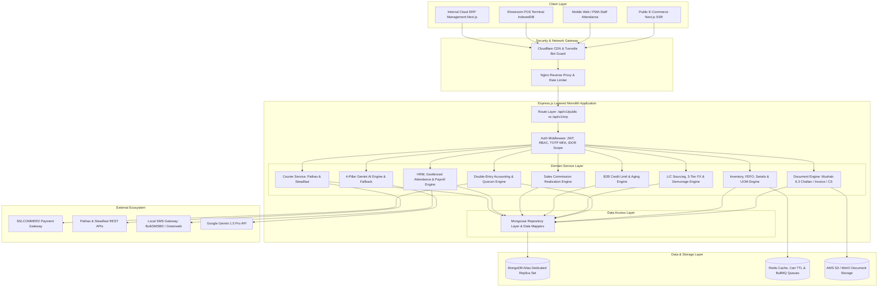
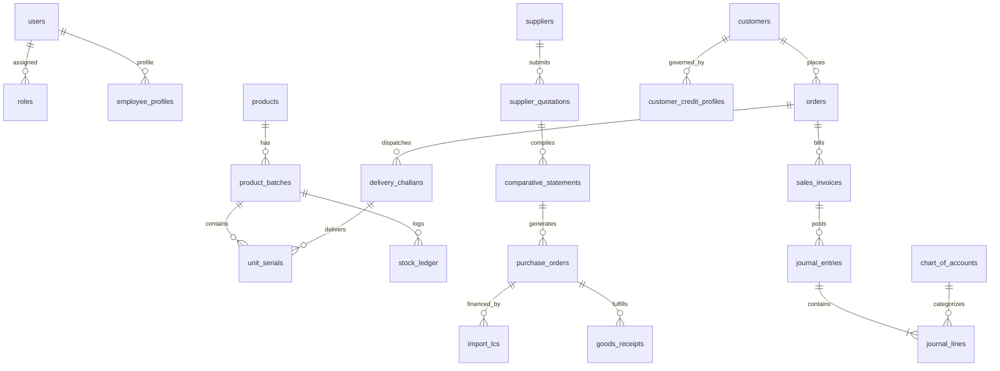
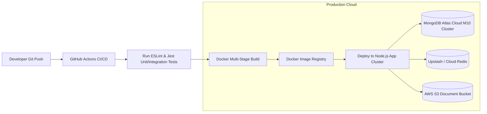

# System Architecture & Technical Blueprint
## Sun Bird Corporation — Integrated Cloud ERP, E-Commerce, POS & AI Platform

- **Project:** Sun Bird Corporation Unified Business Platform
- **Architecture Pattern:** **Layered Monolith Architecture (Clean Layered Pattern)**
- **Frontend Stack:** **Next.js 14+ (App Router, Tailwind CSS, TypeScript)**
- **Backend Stack:** **Express.js (Node.js, TypeScript, RESTful APIs)**
- **Database:** **MongoDB Atlas (Mongoose ODM, Distributed Replica Set, ACID Multi-Document Transactions)**
- **Cache & Message Broker:** **Redis (BullMQ for background queues, session store, cart TTL)**
- **External Integrations:** SSLCOMMERZ, Pathao Courier, Steadfast Courier, BulkSMSBD/Greenweb, Google Gemini API
- **Document Baseline:** [`prd.md`](file:///e:/Documents/Sun%20Bird%20Corporation/prd.md) (v2.1) & [`Requirements.validation.md`](file:///e:/Documents/Sun%20Bird%20Corporation/Requirements.validation.md)
- **Status:** **COMPLETE TECHNICAL ARCHITECTURE (Production & Development Ready)**

---

## 1. Architectural Philosophy & Strategy

To satisfy the operational and statutory requirements of Sun Bird Corporation (medical equipment, diagnostics, electronics, general goods trading) within an aggressive delivery timeline, the platform is architected as a **Modular Layered Monolith**.

### 1.1 Why Layered Monolith with Express.js & MongoDB Atlas?
1. **Single Deployable Unit with High Velocity:** Eliminates network serialization delays, distributed transaction sagas, and multi-service deployment orchestrations while meeting the go-live target.
2. **Domain-Isolated Modules:** Code is organized by domain modules (`inventory`, `procurement`, `accounting`, `sales`, `commissions`, `warranties`, `loans`, `assets`, etc.) with strict layer boundaries:
   $$\text{Client} \longrightarrow \text{Routes} \longrightarrow \text{Controllers} \longrightarrow \text{Services} \longrightarrow \text{Repositories} \longrightarrow \text{MongoDB Atlas}$$
3. **Future Microservices Pathway:** Clean service interfaces allow high-traffic modules (e.g. Public Storefront or Courier Logistics) to be extracted into independent microservices in the future without rewriting core business logic.



---

## 2. Foundational Patterns for Express + MongoDB Atlas

### 2.1 Atomic Multi-Document ACID Transactions
MongoDB Atlas replica sets support distributed multi-document ACID transactions across shards and nodes. Every multi-step financial or inventory operation is wrapped in a Mongoose session transaction:
```typescript
const session = await mongoose.startSession();
session.startTransaction({
  readConcern: { level: 'snapshot' },
  writeConcern: { w: 'majority' },
});
try {
  await stockRepository.decrementStock(items, { session });
  await challanRepository.createChallan(challanData, { session });
  await accountingRepository.postJournalEntry(journalData, { session });
  await session.commitTransaction();
} catch (error) {
  await session.abortTransaction();
  throw error;
} finally {
  session.endSession();
}
```

### 2.2 Concurrency Control & Inventory Overselling Protection (OCC)
To prevent overselling when multiple web buyers and showroom cashiers simultaneously purchase the last unit of stock, atomic conditional modification is executed directly on the MongoDB document:
```typescript
const updatedStock = await StockBalanceModel.findOneAndUpdate(
  { sku: item.sku, availableQty: { $gte: item.quantity } },
  { 
    $inc: { availableQty: -item.quantity, reservedQty: item.quantity },
    $set: { updatedAt: new Date() }
  },
  { new: true, session }
);
if (!updatedStock) {
  throw new InsufficientStockException(`SKU ${item.sku} is out of stock.`);
}
```

### 2.3 Gapless Sequential Numbering Pattern (Atomic Counters)
Statutory Bangladesh VAT (NBR Mushak-6.3) requires sequential, unalterable, and gapless numbers for Challans (`CH-2026-0001`), Invoices (`INV-2026-0001`), and Journal Vouchers (`JV-2026-0001`). This is guaranteed using atomic counter increments:
```typescript
export async function getNextSequenceValue(sequenceName: string, session?: ClientSession): Promise<string> {
  const year = new Date().getFullYear();
  const fullSeqName = `${sequenceName}_${year}`;
  const counter = await CounterModel.findOneAndUpdate(
    { _id: fullSeqName },
    { $inc: { seq: 1 } },
    { new: true, upsert: true, session }
  );
  return `${sequenceName}-${year}-${String(counter.seq).padStart(5, '0')}`;
}
```

### 2.4 Storefront vs Private ERP Network Segregation
To prevent brute force, DDoS, and parameter tampering:
1. **Public Storefront Endpoints (`/api/v1/public/*`):** Protected by Cloudflare Turnstile bot challenges, strict rate-limiting (60 req/min per IP), and response sanitization (internal cost prices, stock counts, and margins are stripped).
2. **Private ERP Endpoints (`/api/v1/erp/*`):** Restricted to authenticated staff sessions with HTTP-Only secure cookies, Role-Based Access Control (RBAC), and mandatory Two-Factor Authentication (TOTP Authenticator app) for Super Admin and Directors.

---

## 3. Backend Module Hierarchy (Express.js Layered Monolith)

The backend code is organized into a clean 4-tier layer pattern inside `backend/src/`:

```
backend/
├── src/
│   ├── config/                     # Environment variables, Atlas connection, Redis client
│   ├── core/                       # Core foundational infrastructure
│   │   ├── middleware/             # Auth, RBAC, RateLimiter, ErrorHandler, Logger, QuorumGuard
│   │   ├── errors/                 # AppError, NotFoundError, UnauthorizedError, CreditLimitError
│   │   ├── constants/              # COA codes, VAT rates, currency definitions
│   │   └── utils/                  # Banker's rounding, Haversine formula, crypto hash
│   ├── modules/                    # Domain-Driven Functional Modules
│   │   ├── auth/                   # Public OTP login, ERP password + TOTP MFA, session rotation
│   │   ├── users/                  # User master, roles, permissions, Director designations
│   │   ├── products/               # Product Master, Categories, HS Codes, Barcodes, Multi-UOM
│   │   ├── inventory/              # Batch/FEFO, Medical Serials, Multi-Warehouse & In-Transit
│   │   ├── procurement/            # Quotation Entry, Auto CS 100pt Formula, Landed Cost
│   │   ├── imports/                # L/C Lifecycle (V1->V2), 3-Tier FX Accounting, Demurrage
│   │   ├── documents/              # Editable NBR Mushak-6.3 Challan, Invoice & Puppeteer PDF
│   │   ├── sales/                  # Orders, Checkout, POS Showroom, Split Dispatch, Tiered Pricing
│   │   ├── credit/                 # B2B Hospital Credit Limits, Net Terms & AR Aging Ledger
│   │   ├── commissions/            # Sales Rep Realized Commission Engine & Payroll Feed
│   │   ├── warranties/             # Equipment Serial Tags, Warranty Window, RMA Claims
│   │   ├── accounting/             # 35 COA Ledger, Multi-Director Quorum Vouchers, Reconciliations
│   │   ├── hrm/                    # Employee Master, Mobile Geofence (50m), Leave vs Absent Sync
│   │   ├── payroll/                # Automated Salary, 3x Late Deductions, Loan Recovery, Payslips
│   │   ├── logistics/              # Pathao & Steadfast Courier Adapters & BullMQ Retry
│   │   ├── payments/               # SSLCOMMERZ IPN Webhooks, COD Settlement Reconciliation
│   │   ├── loans/                  # Reducing Balance Amortization, Waterfall, Net Salary Floor
│   │   ├── assets/                 # Fixed Asset Register, SLM Monthly Depreciation Engine
│   │   └── ai/                     # 4-Pillar Google Gemini Engine & Fallback Architecture
│   ├── shared/                     # Cross-module shared utilities
│   │   ├── notifications/          # Multi-channel notification catalog (SMS, Email, In-App)
│   │   ├── queue/                  # BullMQ job queues (Courier sync, Payment cron, Depreciation)
│   │   └── migration/              # Zero-Variance Excel Migration & Reconciliation Engine
│   └── server.ts                   # Express server bootstrap & graceful shutdown hooks
```

---

## 4. Frontend Architecture (Next.js 14+ App Router)

The frontend is structured as a unified Next.js project with segregated Route Groups:

```
frontend/
├── src/
│   ├── app/
│   │   ├── (storefront)/           # Public E-Commerce Portal
│   │   │   ├── page.tsx            # High-conversion Homepage
│   │   │   ├── products/           # Server-Side Rendered catalogue & filters
│   │   │   ├── product/[slug]/     # Product details with dynamic SEO & schema.org
│   │   │   ├── cart/               # Cart page with 15-min reservation timer
│   │   │   ├── checkout/           # Checkout with COD OTP + SSLCOMMERZ redirect
│   │   │   ├── account/            # Customer self-service dashboard
│   │   │   └── track-order/        # Live courier tracking portal
│   │   ├── (erp)/                  # Protected Internal Cloud ERP
│   │   │   ├── layout.tsx          # Sidebar, top navigation, quick actions
│   │   │   ├── dashboard/          # Role-based KPI dashboard (Sales, Stock, Approvals)
│   │   │   ├── inventory/          # Batch/FEFO, Serials, Warehouse In-Transit transfers
│   │   │   ├── procurement/        # Supplier bids, Auto CS comparison matrix
│   │   │   ├── imports/            # L/C tracking, FX currency conversions, demurrage
│   │   │   ├── documents/          # Editable Quotation, Mushak-6.3 Challan & Invoice generator
│   │   │   ├── accounting/         # General ledger, journal vouchers, trial balance, COA
│   │   │   ├── credit/             # B2B Hospital Credit limits & overdue aging analysis
│   │   │   ├── hrm/                # Staff directory, attendance monitor, leave requests
│   │   │   ├── payroll/            # Monthly payroll runs, commission additions, payslips
│   │   │   ├── loans/              # Loan amortization schedules & repayment waterfall
│   │   │   ├── assets/             # Fixed asset register & depreciation runs
│   │   │   └── settings/           # System settings, user roles, Excel migration gate
│   │   ├── (reseller)/             # Restricted Reseller B2B Portal
│   │   │   └── reseller/page.tsx   # Tiered wholesale catalogue, bulk ordering & credit balance
│   │   ├── (pos)/                  # Showroom Point of Sale
│   │   │   └── erp/pos/page.tsx    # Lightweight, offline-ready thermal barcode POS (PWA)
│   │   └── api/                    # Next.js BFF (Backend-For-Frontend) proxies
│   ├── components/                 # Reusable UI Components
│   │   ├── ui/                     # Buttons, inputs, modals, data tables
│   │   ├── documents/              # Printable Challan, Invoice, CS templates
│   │   ├── ai/                     # Gemini AI assistant widget & CS summary panel
│   │   └── charts/                 # Sales velocity, attendance & profit charts
│   ├── hooks/                      # Custom hooks (useCart, useAuth, useOfflinePOS)
│   ├── lib/                        # Axios client, IndexedDB client, utils
│   └── styles/                     # Tailwind CSS & custom design tokens
```

---

## 5. MongoDB Atlas Data Architecture & Mongoose Schemas

### 5.1 Entity Relationship Diagram



### 5.2 Critical Mongoose Schema Definitions

#### 1. Atomic Sequence Counter Schema
```typescript
const CounterSchema = new Schema({
  _id: { type: String, required: true }, // e.g. "CH_2026", "INV_2026", "JV_2026"
  seq: { type: Number, default: 0 }
});
export const CounterModel = model('Counter', CounterSchema);
```

#### 2. Journal Entry Schema (Double-Entry Engine with Multi-Director Quorums)
```typescript
const JournalLineSchema = new Schema({
  accountId: { type: Schema.Types.ObjectId, ref: 'ChartOfAccounts', required: true },
  accountCode: { type: Number, required: true }, // 1010 to 6500
  accountName: { type: String, required: true },
  debit: { type: Number, default: 0.00, min: 0 },
  credit: { type: Number, default: 0.00, min: 0 },
  description: { type: String }
});

const DirectorApprovalSchema = new Schema({
  directorId: { type: Schema.Types.ObjectId, ref: 'User', required: true },
  directorRole: { type: String, enum: ['MD', 'DIRECTOR_ADMIN', 'DIRECTOR_FINANCE'], required: true },
  approvedAt: { type: Date, default: Date.now },
  remarks: { type: String },
  signatureHash: { type: String, required: true }
});

const JournalEntrySchema = new Schema({
  voucherNo: { type: String, required: true, unique: true }, // JV-2026-00001
  voucherType: { 
    type: String, 
    enum: ['SALES', 'PURCHASE', 'PAYMENT', 'RECEIPT', 'CONTRA', 'JOURNAL'],
    required: true 
  },
  transactionDate: { type: Date, required: true },
  sourceDocumentRef: { type: String, required: true }, // OrderID / ChallanNo / InvoiceNo / LC-No
  lines: [JournalLineSchema],
  totalDebit: { type: Number, required: true },
  totalCredit: { type: Number, required: true },
  
  status: { type: String, enum: ['DRAFT', 'PENDING_APPROVAL', 'POSTED', 'REVERSED'], default: 'DRAFT' },
  createdBy: { type: Schema.Types.ObjectId, ref: 'User', required: true },
  
  // Quorum & Multi-Director Governance
  requiredQuorumTier: { type: Number, enum: [1, 2, 3, 4], default: 1 },
  approvals: [DirectorApprovalSchema],
  isFullyApproved: { type: Boolean, default: false },
  
  reversalOf: { type: Schema.Types.ObjectId, ref: 'JournalEntry' }
}, { timestamps: true });

// Strict double-entry balance validation hook
JournalEntrySchema.pre('save', function(next) {
  const diff = Math.abs(this.totalDebit - this.totalCredit);
  if (diff > 0.001) {
    return next(new Error(`Unbalanced Journal Entry: Debits (${this.totalDebit}) != Credits (${this.totalCredit})`));
  }
  
  // Maker-Checker enforcement: Creator cannot approve own voucher
  if (this.approvals && this.approvals.some(a => a.directorId.equals(this.createdBy))) {
    return next(new Error(`Maker-Checker Violation: Creator cannot approve own journal voucher.`));
  }
  
  next();
});
```

#### 3. Product Batch & Unit Serial Schema (Multi-UOM, Expiry & Medical Serials)
```typescript
const UnitSerialSchema = new Schema({
  serialNumber: { type: String, required: true, unique: true }, // Immutable QR / Machine Tag
  qrCodeUrl: { type: String },
  status: { type: String, enum: ['IN_STOCK', 'RESERVED', 'SOLD', 'RMA_CLAIMED', 'DEFECTIVE'], default: 'IN_STOCK' },
  soldToCustomerId: { type: Schema.Types.ObjectId, ref: 'Customer' },
  deliveryChallanNo: { type: String },
  warrantyExpiryDate: { type: Date }
});

const ProductBatchSchema = new Schema({
  productId: { type: Schema.Types.ObjectId, ref: 'Product', required: true },
  sku: { type: String, required: true },
  batchNumber: { type: String, required: true },
  category: { 
    type: String, 
    enum: ['EXPIRY_CONTROLLED', 'NON_EXPIRING'], 
    required: true 
  },
  manufacturingDate: { type: Date },
  expiryDate: { type: Date }, // Required if EXPIRY_CONTROLLED
  
  // Multi-Level UOM Conversion
  baseUom: { type: String, required: true }, // e.g. "Piece"
  currentQty: { type: Number, required: true, default: 0, min: 0 }, // In base units
  reservedQty: { type: Number, required: true, default: 0, min: 0 },
  unitCost: { type: Number, required: true }, // Moving WAC Unit Cost in Base UOM
  
  // Medical Equipment & Electronics Individual Unit Serials
  hasIndividualSerials: { type: Boolean, default: false },
  warrantyMonths: { type: Number, default: 0 },
  unitSerials: [UnitSerialSchema],
  
  warehouseId: { type: Schema.Types.ObjectId, ref: 'Warehouse', required: true },
  locationStatus: { type: String, enum: ['ON_HAND', 'IN_TRANSIT'], default: 'ON_HAND' }
}, { timestamps: true });

ProductBatchSchema.index({ sku: 1, batchNumber: 1, warehouseId: 1 }, { unique: true });
ProductBatchSchema.index({ expiryDate: 1 }); // Fast FEFO picking
```

#### 4. Delivery Challan (চালান) Schema (NBR Form Mushak-6.3 Compliance)
```typescript
const DeliveryChallanSchema = new Schema({
  challanNo: { type: String, required: true, unique: true }, // CH-2026-00001
  orderId: { type: Schema.Types.ObjectId, ref: 'Order', required: true },
  customerId: { type: Schema.Types.ObjectId, ref: 'Customer', required: true },
  customerName: { type: String, required: true },
  shippingAddress: { type: String, required: true },
  contactPhone: { type: String, required: true },
  
  // Bangladesh NBR Form Mushak-6.3 Statutory Fields
  companyBin: { type: String, required: true, default: '13-Digit-SunBird-BIN' },
  buyerBin: { type: String }, // Buyer BIN for commercial VAT input rebate
  vehicleNumber: { type: String },
  dispatchTime: { type: Date, default: Date.now },

  transporterType: { 
    type: String, 
    enum: ['PATHAO', 'STEADFAST', 'OWN_FLEET', 'THIRD_PARTY'], 
    required: true 
  },
  consignmentTrackingId: { type: String }, // Courier AWB ID
  consignmentBarcode: { type: String },
  cartonCount: { type: Number, default: 1 },

  items: [{
    productId: { type: Schema.Types.ObjectId, ref: 'Product' },
    sku: { type: String, required: true },
    productName: { type: String, required: true },
    hsCode: { type: String, required: true }, // 8-Digit Customs Tariff Code
    batchNumber: { type: String, required: true },
    dispatchedQty: { type: Number, required: true, min: 1 },
    uom: { type: String, required: true }, // Box / Piece / Carton
    dispatchedSerials: [{ type: String }], // Array of unique serial numbers
    vatRate: { type: Number, default: 15.0 }, // NBR statutory VAT rate
    sdRate: { type: Number, default: 0.0 }
  }],

  status: { 
    type: String, 
    enum: ['DRAFT', 'APPROVED', 'DISPATCHED', 'DELIVERED', 'REVISED', 'CANCELLED'], 
    default: 'DRAFT' 
  },
  isRevised: { type: Boolean, default: false },
  revisionReason: { type: String },
  preparedBy: { type: Schema.Types.ObjectId, ref: 'User', required: true },
  approvedBy: { type: Schema.Types.ObjectId, ref: 'User' }
}, { timestamps: true });
```

#### 5. Import Letter of Credit (L/C) & Foreign Sourcing Schema
```typescript
const ImportLCSchema = new Schema({
  lcNumber: { type: String, required: true, unique: true }, // LC-2026-0089
  version: { type: String, default: 'V1' }, // V1 -> V2 on amendment
  supplierId: { type: Schema.Types.ObjectId, ref: 'Supplier', required: true },
  issuingBank: { type: String, required: true },
  foreignCurrency: { type: String, enum: ['USD', 'EUR', 'CNY', 'JPY'], default: 'USD' },
  lcValueFC: { type: Number, required: true },
  
  // 3-Tier FX Rate Tracking
  openingExchangeRate: { type: Number, required: true }, // e.g. 1 USD = 120.00 BDT
  customsAssessmentRate: { type: Number }, // Assessed at port arrival (e.g. 122.00 BDT)
  finalSettlementRate: { type: Number }, // Settled by bank (e.g. 123.00 BDT)
  realizedFxGainLoss: { type: Number, default: 0.00 },

  // Landed Cost Components (in BDT)
  customsDuty: { type: Number, default: 0.00 },
  portDemurragePenalty: { type: Number, default: 0.00 },
  cfAgentCharges: { type: Number, default: 0.00 },
  marineInsurance: { type: Number, default: 0.00 },
  totalLandedCostBDT: { type: Number, default: 0.00 },

  status: { 
    type: String, 
    enum: ['LC_OPENED', 'IN_TRANSIT', 'CUSTOMS_ASSESSED', 'PORT_CLEARED', 'SETTLED', 'AMENDED'], 
    default: 'LC_OPENED' 
  }
}, { timestamps: true });
```

#### 6. B2B Customer Credit Profile Schema
```typescript
const CustomerCreditProfileSchema = new Schema({
  customerId: { type: Schema.Types.ObjectId, ref: 'Customer', required: true, unique: true },
  creditLimitBDT: { type: Number, required: true, default: 0.00 }, // e.g. 5,00,000 BDT
  creditTermDays: { type: Number, required: true, default: 30 }, // Net 30 days
  currentOutstandingAR: { type: Number, default: 0.00 },
  unbilledDispatches: { type: Number, default: 0.00 },
  isCreditLocked: { type: Boolean, default: false },
  lockReason: { type: String },
  approvedByDirector: { type: Schema.Types.ObjectId, ref: 'User' }
}, { timestamps: true });
```

---

## 6. Service-by-Service Implementation Architecture

### 6.1 E-Commerce, Tiered Pricing & B2B Credit Gate
- **OTP Validation:** Customers placing COD orders above BDT 5,000 receive a 6-digit SMS OTP via BulkSMSBD/Greenweb. The order remains in `UNVERIFIED_COD` until verified.
- **Cart Reservation:** Uses Redis key `cart:reservation:<orderId>` with a 15-minute TTL. An atomic BullMQ queue worker releases unpurchased items automatically.
- **Tiered Pricing Engine:**
  - Public Storefront: Displays `retailPrice`.
  - Showroom POS: Applies `showroomPrice` with cashier discount capped at $\le 5\%$.
  - Reseller B2B Portal: Resolves `resellerWholesaleTier` (Tier 1/2/3) after authentication.
- **B2B Credit Exposure Gate:**
  On B2B Sales Order placement, the system evaluates:
  $$\text{Effective Exposure} = \text{Current Outstanding AR} + \text{Unbilled Dispatches} + \text{New Order Value}$$
  If $\text{Effective Exposure} > \text{Credit Limit}$, the order is locked in `CREDIT_LIMIT_EXCEEDED` and cannot be packed without explicit digital override from Director (Finance).

### 6.2 Procurement, Auto CS (100pt) & L/C 3-Tier FX Engine
- **Comparative Statement (CS) Engine:** Evaluates multi-vendor bids across 4 weighted dimensions:
  $$\text{CS Score} = \text{Price Score (50)} + \text{Lead Time Score (25)} + \text{Payment Term Score (15)} + \text{Vendor Rating (10)}$$
- **3-Tier FX Accounting for Import L/C:**
  On final bank settlement of the import L/C, the system automatically posts the realized foreign exchange gain/loss voucher:
  $$\text{Debit: 2020 AP Foreign Supplier (Opening Rate)}$$
  $$\text{Debit: 6510 Foreign Exchange Loss (or Credit 4095 FX Gain)}$$
  $$\text{Credit: 1020 Bank Account (Final Settlement Rate)}$$
  The inventory unit cost remains permanently anchored to the landed customs valuation.

### 6.3 POS Showroom Engine & Offline Sync Conflict Resolution
- **Offline IndexedDB Store:** Built as a Progressive Web App (PWA). Scans barcodes, records sales up to 100 transactions or BDT 2,00,000 revenue during internet blackouts, and prints thermal receipts.
- **Conflict Resolution on Reconnection:**
  If an item sold offline in the showroom was concurrently purchased online on the e-commerce storefront:
  1. The showroom sale takes physical precedence (customer already walked out with product).
  2. The online web order is automatically flagged for **Priority Warehouse Restock / Split Shipment**.
  3. The inventory discrepancy is posted to `1199 Offline POS Stock Conflict Suspense` until warehouse restock is completed, preventing negative stock halts.

### 6.4 HRM, Mobile Attendance, Leave Sync & Sales Commission
- **Geofenced Check-In:** Validates mobile GPS coordinates against registered office/warehouse using the Haversine formula ($\text{Radius} \le 50\text{ meters}$).
- **Leave vs Absence Integration:**
  Approved Casual Leave (CL), Sick Leave (SL), and Earned Leave (EL) explicitly suppress salary deduction for the approved dates. Unapproved absences deterministically trigger Leave Without Pay (LWP) deduction.
- **Realized Sales Commission Engine:**
  Sales representatives receive 1.0% to 3.0% commission calculated exclusively on **realized (collected) revenue** on the 28th of each month, injected directly into the monthly payroll run as an itemized earning.

### 6.5 Full 4-Pillar Google Gemini AI Integration Engine
The system integrates Google Gemini 1.5 Pro API across 4 strategic pillars:
1. **AI CS Advisor:** Evaluates supplier bids, MOQ, landed costs, and flags hidden freight or risk terms.
2. **AI Content Generator:** Automatically drafts SEO-optimized product titles, bilingual (Bangla & English) descriptions, and medical equipment specifications.
3. **AI Demand Forecasting:** Evaluates 30/60/90-day sales velocity, seasonal trends, and lead times to generate reorder quantity recommendations.
4. **AI Smart Customer Support:** 24/7 web chatbot widget integrated with order tracking and product catalog APIs to answer customer inquiries without human agent intervention.
- **Resilience & Fallback Guard:** If the Gemini API is unreachable or rate-limited, system falls back gracefully to rule-based scoring and static templates with zero downtime.

### 6.6 Server-Side PDF Document Generation (Puppeteer & S3)
To ensure identical, compliant paper layouts for NBR Form Mushak-6.3 Delivery Challans, Invoices, and Comparative Statements:
1. Express service invokes a headless Chromium instance (Puppeteer) with pre-compiled Tailwind/Handlebars HTML templates.
2. Generates print-ready vector PDF documents and uploads them to AWS S3.
3. Returns a time-limited (15 minutes) pre-signed S3 download URL to the client.

### 6.7 Zero-Variance Excel Migration Pipeline (Launch Gate 1)
To fulfill the mandatory Go-Live Acceptance Gate 1:
1. Excel import engine parses spreadsheets using Node.js streaming parser (`xlsx-stream-reader`).
2. Performs staging validation on all 5,000 legacy SKUs, opening inventory quantities, customers, suppliers, and chart of accounts.
3. Confirms that the opening trial balance achieves zero variance:
   $$\sum \text{Debit Balances} - \sum \text{Credit Balances} = 0.00\text{ BDT}$$
4. Commits data atomically inside a MongoDB Atlas session transaction.

---

## 7. Security Architecture & Threat Mitigation

| Threat Vector | Potential Impact | Architectural Mitigation in Express & Atlas |
| :--- | :--- | :--- |
| **Insecure Direct Object Reference (IDOR)** | Unauthorized access to other customers' orders or invoices. | Global query scoping: `{ _id: req.params.id, customerId: req.user.id }`. |
| **Maker-Checker Bypass** | User approving their own PO, voucher, or stock adjustment. | Database pre-save hook throws error if `doc.approvedBy.equals(doc.createdBy)`. |
| **Director Quorum Bypass** | Single manager approving high-value transactions (> 10L / > 50L). | Service-layer `QuorumGuard` enforces Majority (2 of 3) or Unanimous (3 of 3) digital signatures in `approvals` array. |
| **Sensitive Data Leakage** | Showroom staff seeing purchase costs or executive salaries. | Mongoose transform plugins delete `costPrice`, `basicSalary`, and `margin` from JSON output unless `req.user.roles.includes('DIRECTOR')`. |
| **Brute Force & OTP Flooding** | Denial of Service or SMS gateway wallet drainage. | Redis sliding-window rate-limiter: Max 3 OTP requests per phone per 15 minutes. |
| **NoSQL Injection** | Malicious JSON objects bypassing query operators (`$ne`, `$gt`). | `express-mongo-sanitize` middleware strips leading `$` and `.` characters from input bodies. |
| **Tampered Audit Trails** | Malicious administrator deleting evidence of fraudulent transactions. | `audit_logs` collection is append-only with strict MongoDB Atlas role preventing `delete` commands. |

---

## 8. API Specification Standards

### 8.1 Base URL & Route Segregation
- Public Storefront: `https://api.sunbirdcorp.com/api/v1/public/`
- Internal ERP Operations: `https://api.sunbirdcorp.com/api/v1/erp/`

### 8.2 Unified API Response Envelope
```json
{
  "success": true,
  "statusCode": 200,
  "message": "Delivery Challan (Mushak-6.3) generated successfully",
  "data": {
    "challanNo": "CH-2026-00001",
    "status": "APPROVED",
    "consignmentTrackingId": "PTH-889102",
    "downloadPdfUrl": "https://s3.ap-southeast-1.amazonaws.com/sunbird-docs/challans/CH-2026-00001.pdf"
  },
  "timestamp": "2026-10-17T13:30:00.000Z",
  "correlationId": "req-98712-abc"
}
```

---

## 9. Infrastructure, Deployment & CI/CD Pipeline



### Deployment Topology
- **Web & ERP Frontend:** Next.js deployed on Containerized Node.js cluster behind Cloudflare.
- **Backend API:** Containerized Express.js running on AWS ECS / DigitalOcean Kubernetes with automatic horizontal pod autoscaling (HPA) based on CPU/Memory.
- **Database Cluster:** MongoDB Atlas Dedicated M10/M20 Replica Set deployed in AWS Singapore (`ap-southeast-1`) region with automated point-in-time backups.
- **Storage:** AWS S3 Bucket with pre-signed URLs for document downloads (Mushak-6.3 Challans, Invoices, Supplier Quotes).

---

## 10. Summary & Sign-Off

The **Clean Layered Monolith Architecture** using **Next.js**, **Express.js**, and **MongoDB Atlas** provides Sun Bird Corporation with:
1. **Zero-Overselling Inventory:** High-performance OCC stock reservations, FEFO picking, and unit serial tracking.
2. **Double-Entry Financial Integrity:** Atomic Mongoose transactions, balanced vouchers, and Multi-Director Quorum enforcement.
3. **Statutory Bangladesh VAT Compliance:** NBR Form Mushak-6.3 Delivery Challans and Invoices with H.S. Code and BIN tracking.
4. **Resilient Showroom POS:** Offline IndexedDB mode ensuring physical sales continue during internet outages with automated conflict resolution.
5. **Governed Approvals & HR:** Automated GPS attendance, leave balance coordination, realized sales commission, and reducing balance loan recovery.
6. **4-Pillar AI Intelligence:** Gemini 1.5 Pro integration for Comparative Statements, SEO product content, demand forecasting, and 24/7 smart customer support.

This document stands as the definitive, comprehensive, and production-ready architectural blueprint for direct implementation.
