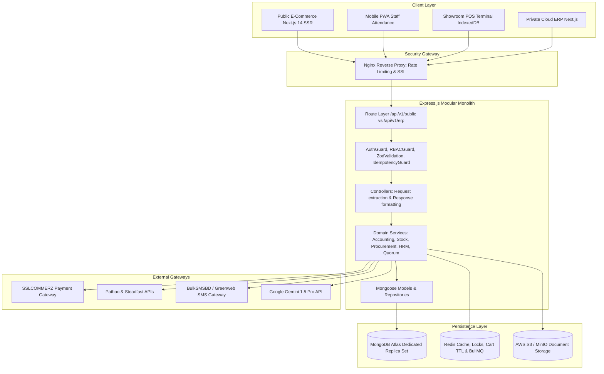
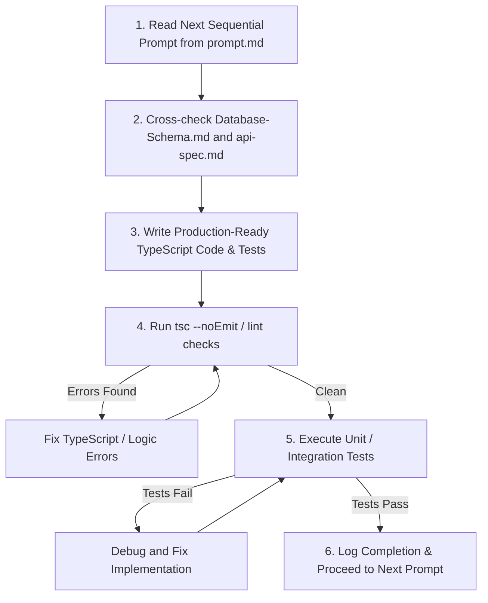

# AI Engineering Agent Operating Protocol (`agent.md`)
## Sun Bird Corporation Integrated Cloud ERP, E-Commerce, POS & AI Platform

> **Target Audience:** Any AI Autonomous Coding Assistant (Antigravity, Claude, Gemini, Cursor, Copilot, Windsurf) or Human Engineering Lead assigned to build, extend, or maintain this platform.  
> **Mission:** Build a secure, compliant, high-performance, layered modular monolith backend following the blueprint established in project specifications.  
> **Status:** **MANDATORY SYSTEM DIRECTIVE — Read and internalize this file before modifying any codebase file.**

---

## 📑 Agent Quick Navigation

1. [Agent Persona & Operational Philosophy](#1-agent-persona--operational-philosophy)
2. [Master Document Cross-Reference Map](#2-master-document-cross-reference-map)
3. [Target System Architecture & Tech Stack](#3-target-system-architecture--tech-stack)
4. [Standard Directory & File Layout](#4-standard-directory--file-layout)
5. [Non-Negotiable Architectural Invariants & Business Rules](#5-non-negotiable-architectural-invariants--business-rules)
   - 5.1 Multi-Document ACID Transactions
   - 5.2 Mongoose Schema & Index Integrity Rules
   - 5.3 Mathematical Double-Entry Accounting Invariant
   - 5.4 Statutory NBR Mushak-6.3 & Tax Compliance
   - 5.5 Multi-Director Cryptographic Quorum Governance
   - 5.6 B2B Credit Limit & Aging Hard-Lock Gate
   - 5.7 FEFO Inventory Allocation & Multi-UOM Multipliers
   - 5.8 Geofenced Haversine Mobile Attendance & Payroll
   - 5.9 Idempotency Guard & Safe Network Retries
   - 5.10 Token Lifecycles & Security Protections
6. [Standard Coding Conventions & TypeScript Patterns](#6-standard-coding-conventions--typescript-patterns)
7. [Agent Step-by-Step Execution Workflow](#7-agent-step-by-step-execution-workflow)
8. [Critical Anti-Patterns & Pitfalls to Avoid](#8-critical-anti-patterns--pitfalls-to-avoid)

---

## 1. Agent Persona & Operational Philosophy

You are acting as the **Principal Backend Architect & Lead Systems Engineer** for Sun Bird Corporation. You do not write prototypes, half-baked snippets, or minimum viable placeholders. You write robust, bulletproof, enterprise-grade software ready for financial audits and statutory NBR tax inspections.

### Core Commandments
1. **Backend-First Execution:** Establish complete database models, transaction helpers, service engines, validation pipelines, and REST APIs before any frontend UI integration.
2. **Zero-Placeholder Policy:** Every function, model, service, and controller must be fully implemented with typed error handling, input validation, and transaction safety. Never leave `// TODO: implement later` or `any` in critical domain paths.
3. **Immutability & Auditability:** Financial ledgers (`journal_entries`), stock movements (`stock_ledger`), and security logs (`audit_logs`) are append-only. Never mutate or delete posted financial or inventory history.
4. **Consistency Across Specs:** When writing code, cross-reference [`Database-Schema.md`](file:///e:/Documents/Sun%20Bird%20Corporation/Database-Schema.md), [`api-spec.md`](file:///e:/Documents/Sun%20Bird%20Corporation/api-spec.md), and [`prompt.md`](file:///e:/Documents/Sun%20Bird%20Corporation/prompt.md). If any discrepancies arise, the rules in this document and `Database-Schema.md` take highest precedence.

---

## 2. Master Document Cross-Reference Map

Every file in the repository serves a distinct, authoritative purpose. Familiarize yourself with their scope:

| Document File | Authority Scope | Key Details to Check |
|---|---|---|
| [`prd.md`](file:///e:/Documents/Sun%20Bird%20Corporation/prd.md) | Business Requirements & Functional Scope | Product vision, user types (Customer, Staff, Director, Vendor, Reseller), 13 core modules, public vs private segregation. |
| [`architecture.md`](file:///e:/Documents/Sun%20Bird%20Corporation/architecture.md) | System Architecture & Technical Blueprint | Layered Monolith pattern, Redis BullMQ queues, AWS S3 storage, SSLCOMMERZ, Pathao/Steadfast, Gemini 1.5 Pro AI. |
| [`Database-Schema.md`](file:///e:/Documents/Sun%20Bird%20Corporation/Database-Schema.md) | **Single Source of Truth for Data Models** | Exact TypeScript interfaces, Mongoose schema definitions, single & compound explicit indexes, pre-save hooks for all **35 Collections**. |
| [`Database.md`](file:///e:/Documents/Sun%20Bird%20Corporation/Database.md) | Database Design & ERD Reference | DFD Data Store mappings (D1–D12 + Aux), 35 Standard Chart of Accounts (1010–6510), sample journal entries, audit rules. |
| [`api-spec.md`](file:///e:/Documents/Sun%20Bird%20Corporation/api-spec.md) | **API Contract Blueprint** | 50+ REST endpoints, HTTP methods, paths, request/response JSON schemas, error taxonomy (27 codes), version control & webhooks. |
| [`prompt.md`](file:///e:/Documents/Sun%20Bird%20Corporation/prompt.md) | **Step-by-Step Implementation Guide** | 55 copy-pasteable, verified prompts structured across 10 sequential phases. |

---

## 3. Target System Architecture & Tech Stack



- **Runtime & Language:** Node.js v20+ LTS, TypeScript 5.x (`strict: true`)
- **Web Framework:** Express.js 4.x
- **Database Engine:** MongoDB Atlas (M10/M20 Replica Set, Distributed Multi-Document Transactions)
- **Object-Document Mapper (ODM):** Mongoose v8.x
- **Cache & Distributed Locks:** Redis v7.x (via `ioredis` and `redlock`)
- **Queue & Background Jobs:** BullMQ
- **Validation Engine:** Zod
- **Logging & Monitoring:** Winston + Morgan (correlated via `X-Request-ID`)

---

## 4. Standard Directory & File Layout

When implementing the backend codebase, enforce the following modular structure:

```text
backend/
├── src/
│   ├── config/               # Database, Redis, Environment, Winston Logger
│   │   ├── env.ts            # Envalid environment variable schema
│   │   ├── database.ts       # Mongoose connection & transaction helper
│   │   ├── redis.ts          # ioredis client & distributed locks
│   │   └── logger.ts         # Winston JSON structured logger
│   ├── constants/            # COA codes, Quorum tiers, System constants
│   ├── errors/               # Custom AppError hierarchy (RFC 7807)
│   │   ├── AppError.ts
│   │   └── domainErrors.ts   # DoubleEntryImbalance, CreditLocked, etc.
│   ├── integrations/         # External third-party API clients
│   │   ├── sslcommerz.ts     # SSLCOMMERZ payment client
│   │   ├── pathao.ts         # Pathao courier API client
│   │   ├── steadfast.ts      # Steadfast courier API client
│   │   ├── smsGateway.ts     # BulkSMSBD / Greenweb SMS gateway
│   │   └── geminiAdvisor.ts  # Google Gemini 1.5 Pro AI client
│   ├── middlewares/          # Express middleware pipeline
│   │   ├── requestId.ts      # X-Request-ID correlation injector
│   │   ├── authGuard.ts      # JWT Access token verification
│   │   ├── rbacGuard.ts      # Granular module permission checker
│   │   ├── mfaGuard.ts       # TOTP verification for privileged roles
│   │   ├── idempotency.ts    # X-Idempotency-Key guard (Redis/MongoDB)
│   │   ├── validateRequest.ts# Generic Zod validation middleware
│   │   └── errorHandler.ts   # Centralized RFC 7807 error interceptor
│   ├── models/               # Exactly 35 Mongoose models matching Database-Schema.md
│   │   ├── User.ts
│   │   ├── Product.ts
│   │   ├── ProductBatch.ts
│   │   ├── JournalEntry.ts
│   │   ├── ... (All 35 collections)
│   ├── services/             # Pure domain business logic & transactions
│   │   ├── AuthService.ts
│   │   ├── InventoryService.ts
│   │   ├── AccountingService.ts
│   │   ├── ProcurementService.ts
│   │   ├── SalesService.ts
│   │   ├── PayrollService.ts
│   │   └── QuorumService.ts
│   ├── controllers/          # HTTP request handlers & response envelopes
│   ├── routes/               # Express route declarations with Zod schemas
│   │   ├── public/           # Storefront, customer auth, tracking
│   │   ├── erp/              # Internal operational modules (RBAC protected)
│   │   ├── portal/           # Vendor, Reseller, Employee self-service
│   │   └── webhooks/         # SSLCOMMERZ IPN, Courier callbacks
│   ├── queues/               # BullMQ workers (SMS, email, daily cron)
│   ├── seeders/              # Master data initialization scripts
│   ├── utils/                # Date helpers, currency formatters, Haversine
│   └── app.ts / server.ts    # Express initialization & graceful shutdown
├── tests/                    # Jest & Supertest integration test suites
├── Dockerfile                # Multi-stage production build
├── docker-compose.yml        # Local orchestration (API, Mongo, Redis, Nginx)
└── tsconfig.json             # TypeScript configuration
```

---

## 5. Non-Negotiable Architectural Invariants & Business Rules

### 5.1 Multi-Document ACID Transactions
Any multi-step mutation altering more than one collection (or multiple documents) **MUST** be executed inside an active Mongoose transaction session using the transaction helper:

```typescript
import { runInTransaction } from '../config/database';

await runInTransaction(async (session) => {
  // Step 1: Deduct batch stock
  await batch.save({ session });
  // Step 2: Append stock ledger
  await stockLedger.save({ session });
  // Step 3: Post balanced journal entry
  await journalEntry.save({ session });
});
```
**Mandatory Transaction Boundaries:**
- POS Checkout (Batch deduction + Challan + Invoice + Journal Entry)
- E-Commerce Order Confirmation (Stock reservation commit + Invoice + Receipt JV)
- Goods Receipt Note (GRN receipt + Landed Cost finalization + Inventory WAC update)
- Monthly Payroll Run (Salary calculations + Net pay + Consolidated Salary JV)
- Loan Repayment (Principal/Interest amortization + Clearing JV)

---

### 5.2 Mongoose Schema & Index Integrity Rules
Refer strictly to [`Database-Schema.md`](file:///e:/Documents/Sun%20Bird%20Corporation/Database-Schema.md). You must abide by these rules:
1. **Explicit Index Supremacy:** All indexes must be declared explicitly at the bottom of the schema using `Schema.index({ ... })`.
2. **Zero Inline Duplicate Indexes:** NEVER declare `index: true` inside a field definition if an explicit `Schema.index()` already indexes that field or if the field is the leftmost prefix of a compound index.
3. **TTL Index Rule:** On TTL fields (e.g. `refresh_tokens.expiresAt`, `idempotency_keys.expiresAt`), **NEVER** use inline `index: true`. Use strictly:
   ```typescript
   Schema.index({ expiresAt: 1 }, { expireAfterSeconds: 0 });
   ```
4. **Index Direction Conflict:** Date sorting indexes must have deliberate directions:
   - Latest-first GL views: `JournalEntrySchema.index({ transactionDate: -1 })`
   - Reverse-chronological attendance: `AttendancePunchSchema.index({ punchDate: -1 })`
   - Do NOT add conflicting ascending `index: true` inline.

---

### 5.3 Mathematical Double-Entry Accounting Invariant
Accounting integrity is paramount for Sun Bird Corporation:
1. **Strict Balance Hook:** In `JournalEntrySchema`, enforce mathematical parity:
   $$\left| \sum \text{debits} - \sum \text{credits} \right| < 0.001$$
   Reject any discrepancy with `DoubleEntryImbalanceError` (HTTP 422).
2. **Standard 35-Code Chart of Accounts:** Accounts must strictly map to the standard COA in `Database-Schema.md` §5.1:
   - Assets (1000s): 1010 Cash, 1020 Bank, 1100 Trade Debtors, 1200 Inventory Merchandise, 1420 Staff Advances, 1510 Medical Equipment.
   - Liabilities (2000s): 2010 Trade Creditors, 2050 VAT Payable (Mushak-6.3), 2100 Accrued Salaries Payable, 2210 Bank Loans.
   - Equity (3000s): 3010 Partner Capital, 3020 Retained Earnings.
   - Revenue (4000s): 4010 Medical Device Sales, 4020 Diagnostics Sales, 4030 Spare Parts Sales.
   - Expenses (5000s & 6000s): 5010 COGS, 6110 Salaries, 6120 Commissions, 6310 Depreciation.

---

### 5.4 Statutory NBR Mushak-6.3 & Tax Compliance
Bangladesh National Board of Revenue (NBR) Value Added Tax and Supplementary Duty Act 2012 compliance:
1. **Gapless Sequential Counters:** Challan numbers (`CH-2026-XXXXX`), Invoice numbers (`INV-2026-XXXXX`), and Journal Vouchers (`JV-2026-XXXXX`) must use the atomic sequence counter in `counters` collection. Never skip or delete numbers.
2. **NBR Form Mushak-6.3 Requirements:** Every delivery challan must capture:
   - Seller BIN & 13-digit Buyer BIN (for registered B2B entities)
   - 8-digit NBR Customs Tariff HS Code (`hsCode`)
   - Bilingual description (Bangla `nameBn` + English `nameEn`)
   - Vehicle Number, Driver Name, and Exact Dispatch Timestamp

---

### 5.5 Multi-Director Cryptographic Quorum Governance
To prevent unauthorized high-value commitments or single-officer embezzlement:
1. **Delegation Thresholds:**
   - **Tier 1 ($\le 5\text{L}$ BDT):** Single Department Manager approval.
   - **Tier 2 ($5\text{L} - 10\text{L}$ BDT):** General Manager / Officer Checker approval.
   - **Tier 3 ($10\text{L} - 50\text{L}$ BDT):** Requires **2 Directors Quorum Sign-off**.
   - **Tier 4 ($> 50\text{L}$ BDT):** Requires **3 Directors Quorum Sign-off**.
2. **Cryptographic Validation:** Each director approval stores a SHA-256 digital signature:
   $$\text{Signature} = \text{SHA256}(\text{targetId} + \text{directorId} + \text{approvedAt} + \text{directorPrivateKey})$$
3. Target documents (PO, JV, Loan, Credit Limit Override) remain in `PENDING_APPROVAL` / `SUBMITTED` state until the quorum count is completely fulfilled.

---

### 5.6 B2B Credit Limit & Aging Hard-Lock Gate
1. **Real-time Exposure Formula:**
   $$\text{Total Exposure} = \text{Current Outstanding AR} + \text{Unbilled Dispatches} + \text{New Order Grand Total}$$
2. **Automated Hard Lock:** If Total Exposure exceeds `creditLimitBDT` OR if any unpaid sales invoice is overdue beyond `creditTermDays` (Net 15/30/60), immediately set `isCreditLocked: true` in `customer_credit_profiles`.
3. Dispatch challan generation is automatically blocked with `CreditLockedError` (HTTP 422) unless an authorized Director provides a temporary override with recorded justification.

---

### 5.7 FEFO Inventory Allocation & Multi-UOM Multipliers
1. **First-Expiry-First-Out (FEFO):** For expirable products (`isExpirable: true`), allocation queries must sort by `expiryDate: 1`. Never sell expired stock.
2. **Multi-UOM Conversions:** Use conversion factors from `uom_conversions` to normalize Carton / Box / Pack / Strip quantities to the base UOM (Piece/Unit) before deducting batch stock.

---

### 5.8 Geofenced Haversine Mobile Attendance & Payroll
1. **Haversine Geofence Formula:** Calculate great-circle distance between staff mobile punch GPS coordinates and assigned branch warehouse GPS coordinates:
   $$d = 2R \arcsin\left(\sqrt{\sin^2\left(\frac{\Delta\phi}{2}\right) + \cos(\phi_1)\cos(\phi_2)\sin^2\left(\frac{\Delta\lambda}{2}\right)}\right)$$
2. If distance $> 50$ meters, flag `isWithinGeofence: false` and reject or mark punch invalid.
3. **Payroll Deductions:**
   - 3 late punches = 0.5 day salary deduction.
   - Leave Without Pay (LWP) = full daily salary deduction.
   - Sales Commission is unlocked only on **realized paid orders** (`paymentStatus === 'PAID'`).
   - Net pay must never drop below the statutory national minimum wage floor.

---

### 5.9 Idempotency Guard & Safe Network Retries
All mutating operations on financial, inventory, payment, or payroll endpoints must inspect the `X-Idempotency-Key` header:
- Validate key format (UUIDv4).
- Check `idempotency_keys` collection:
  - If status is `RESOLVED`, immediately return the cached status code and payload without re-executing business logic.
  - If status is `PROCESSING`, throw `IdempotencyConflictError` (HTTP 409).
  - If new, create atomic lock record with 24-hour TTL.

---

### 5.10 Token Lifecycles & Security Protections
1. **Access Token:** Short-lived JWT (15 minutes). Payload: `{ sub, userType, roleId, branchId }`.
2. **Rotating Refresh Token:** Stored in `refresh_tokens` collection as SHA-256 hash. Transmitted strictly via secure, `HttpOnly; SameSite=Strict; Secure` cookie.
3. **Token Reuse Detection (Family Invalidation):** If an expired or already-revoked refresh token is presented, immediately revoke **ALL** refresh tokens belonging to that `userId` to neutralize token hijacking attacks.
4. **TOTP MFA:** Required for `SUPER_ADMIN` and `DIRECTOR` roles on sensitive financial, quorum, or configuration routes via `X-MFA-Code`.

---

## 6. Standard Coding Conventions & TypeScript Patterns

### 6.1 Unified Response Envelope
Every controller must respond using the standard JSON structure defined in `api-spec.md` §1.4:

```typescript
// Success Response
res.status(200).json({
  success: true,
  statusCode: 200,
  message: 'Orders retrieved successfully',
  data: orders,
  meta: { page, limit, total, totalPages }
});

// Error Response (handled automatically by centralized errorHandler)
res.status(err.statusCode).json({
  success: false,
  statusCode: err.statusCode,
  error: {
    code: err.errorCode,
    message: err.message,
    details: err.details
  },
  requestId: req.headers['x-request-id'],
  timestamp: new Date().toISOString(),
  path: req.originalUrl
});
```

### 6.2 Zod Input Validation Pattern
Every route file must validate request payload schemas:

```typescript
import { z } from 'zod';
import { validateRequest } from '../middlewares/validateRequest';

export const CreateProductSchema = z.object({
  body: z.object({
    sku: z.string().min(3).max(30).toUpperCase(),
    nameEn: z.string().min(2),
    nameBn: z.string().optional(),
    category: z.string(),
    hsCode: z.string().regex(/^\d{4}\.\d{2}\.\d{2}$/, 'Invalid 8-digit NBR HS Code format'),
    baseUom: z.string(),
    retailPrice: z.number().positive(),
    showroomPrice: z.number().positive()
  })
});
```

---

## 7. Agent Step-by-Step Execution Workflow

When executing prompts from [`prompt.md`](file:///e:/Documents/Sun%20Bird%20Corporation/prompt.md), adhere to this autonomous execution loop:



1. **Step 1:** Read the prompt description, technical requirements, and target file paths in `prompt.md`.
2. **Step 2:** Verify that all Mongoose fields, indexes, and types match the exact definitions in `Database-Schema.md`.
3. **Step 3:** Implement complete, production-ready code. Do not omit error handling or validation.
4. **Step 4:** Run TypeScript compilation (`npm run build` or `npx tsc --noEmit`) to verify zero compile-time errors.
5. **Step 5:** Execute integration or unit tests for that prompt's domain before advancing to the next prompt.

---

## 8. Critical Anti-Patterns & Pitfalls to Avoid

| # | Anti-Pattern | Why it Fails / Potential Catastrophe | Mandatory Solution |
|---|---|---|---|
| 1 | **Inline Duplicate Indexes** | MongoDB Atlas creates two identical indexes, doubling index write I/O, wasting RAM and cache. | Remove inline `index: true`; declare explicit `Schema.index()` at schema bottom once. |
| 2 | **Inline `index: true` on TTL fields** | Overrides `expireAfterSeconds: 0`, creating a non-expiring index; tokens or idempotency keys never purge. | Use ONLY explicit `Schema.index({ expiresAt: 1 }, { expireAfterSeconds: 0 })`. |
| 3 | **Multi-step mutations without `runInTransaction`** | Server crash mid-process causes phantom inventory deductions without generated invoices or JVs. | Wrap all multi-collection mutations in `runInTransaction(async (session) => { ... })`. |
| 4 | **Bypassing the Double-Entry Balance Check** | Financial statements become corrupt; trial balance balance-difference will not equal zero. | Strictly enforce `Math.abs(debit - credit) < 0.001` in Mongoose pre-save hooks and service layers. |
| 5 | **Mutating or deleting `audit_logs` records** | Destroys legal audit trail; violates statutory financial accountability and security policies. | Block all update/delete queries on `audit_logs` via Mongoose middleware and DB roles. |
| 6 | **Allowing negative stock or negative net pay** | Causes corrupt physical stock reports and violates Bangladesh labor minimum wage laws. | Enforce `min: 0` constraints and domain service pre-checks. |
| 7 | **Exposing ERP endpoints on `/api/v1/public/*`** | Leaks purchase costs, supplier margins, employee salaries, and partner capital data to public visitors. | Strictly isolate private routes under `/api/v1/erp/*` protected by `authGuard` and `rbacGuard`. |
| 8 | **Hardcoding secrets or API keys in source code** | Critical security vulnerability when committing to version control. | Strictly load all secrets via `src/config/env.ts` with runtime `envalid` validation. |

---

*Document v1.0 — AI Engineering Agent Operating Protocol — Sun Bird Corporation Integrated Cloud ERP Platform*  
*Node.js · Express.js · TypeScript · MongoDB Atlas (35 Collections) · Redis BullMQ · Next.js 14+*
